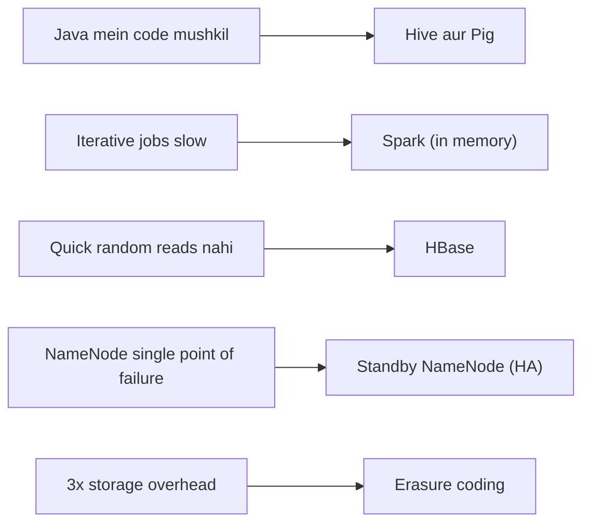

**Ek line mein:** <mark>Hadoop scalable, low cost, fault tolerant hai aur har type ka data handle karta hai, lekin small files, real-time answers, iterative jobs aur transactions ke liye kamzor hai</mark>. <Cite id="hadoop-ecosystem-gfg-hadoop-intro" /> <Cite id="hadoop-ecosystem-ibm-hadoop" />

<Box kind="key">

**Hadoop ke advantages aur limitations ke question mein ye points likho:**

- <mark>Advantages: scalable, low cost, fault tolerant, structured aur unstructured data handle karta hai, bade data pe fast</mark>.
- <mark>Limitation: small files ke liye suitable nahi (NameNode memory overload)</mark>.
- <mark>Limitation: sirf batch, high latency, real time nahi</mark>.
- <mark>Limitation: iterative jobs mein slow kyunki MapReduce steps ke beech disk pe likhta hai</mark>.
- Limitation: **in-place update ya transactions nahi** (write once, read many).
- Limitation: **program karna mushkil**, NameNode weak point, **3x storage** overhead, security ke liye set-up chahiye.

</Box>

## Core answer (5 marks, yahan ke har question ke liye)

<Box kind="definition">

**Hadoop** is an open-source framework that stores data in HDFS and processes it with MapReduce on a cluster of commodity machines. Its design gives clear strengths and clear weaknesses. <Cite id="hadoop-ecosystem-wiki-hadoop" />

</Box>

| Advantages | Limitations |
|---|---|
| **Scalable:** nodes add karo to storage aur speed badhti hai | **Small files problem:** har file aur block NameNode memory mein ek object hai |
| **Low cost:** commodity hardware, free software | **Sirf batch:** jobs start aur khatam hone mein seconds se minutes, real time nahi |
| **Fault tolerant:** blocks ki 3 copies, failed tasks dobara chalte hain | **Iterative kaam slow:** MapReduce steps ke beech disk writes |
| **Koi bhi data type:** schema on read | **In-place updates ya transactions nahi:** write once, read many |
| **Bade data pe fast:** parallel kaam aur data locality | **Program karna mushkil:** simple jobs ke liye bhi lamba Java code |
| **Bada ecosystem aur community** | **Overheads:** 3x storage, NameNode weak point, security set-up chahiye |

<Cite id="hadoop-ecosystem-gfg-hadoop-intro" /> <Cite id="hadoop-ecosystem-ibm-hadoop" /> <Cite id="mapreduce-gfg-proscons" />

**Conclusion:** <mark>Hadoop bahut bade data ke batch analysis ke liye low-cost, scalable platform hai, small files, real-time answers ya transactions ke liye nahi</mark>. <Cite id="hadoop-ecosystem-aws-hadoop" />

## Extended answer (10 marks): ye add karo

### 1. Advantages detail mein

1. **Scalable:** kuch nodes se hazaron tak, bas machines add karke.
2. **Low cost:** commodity hardware aur open-source software.
3. **Fault tolerant:** HDFS har block ki 3 copies rakhta hai aur failed task doosre node pe dobara chalta hai. <Cite id="hadoop-ecosystem-apache-hdfs-design" loc="Data Replication" />
4. **Saare data types:** structured, semi-structured aur unstructured; structure data padhte waqt lagta hai.
5. **High throughput:** bahut nodes parallel kaam karte hain aur tasks wahan chalte hain jahan data hai.
6. **Rich ecosystem:** Hive, Pig, HBase, Spark aur kai vendors.

### 2. Limitations detail mein

1. **Small files:** har file, directory aur block NameNode memory mein ek object hai (lagbhag 150 bytes), isliye lakhon chhoti files memory khatam kar deti hain, aur har file ko apna chhota map task bhi milta hai. <Cite id="hdfs-cloudera-small" />
2. **Batch aur high latency:** real-time answers ya streams ke liye nahi.
3. **Iterative jobs:** MapReduce har step ke baad disk pe likhta hai, isliye machine learning aur graph algorithms jo bahut baar loop karte hain slow hote hain. Spark data memory mein rakhta hai aur bahut tez hai. <Cite id="hadoop-ecosystem-apache-spark" />
4. **Updates ya transactions nahi:** HDFS sirf append karta hai; banking-type updates ke liye kamzor.
5. **Mushkil programming model:** sab kuch map aur reduce mein fit karna padta hai.
6. **NameNode:** Hadoop 1 mein single point of failure; Hadoop 2 mein standby NameNode aaya par extra set-up chahiye.
7. **Storage overhead:** 3 copies matlab 200% extra storage. Hadoop 3 ka erasure coding utni hi safety lagbhag 50% overhead mein deta hai. <Cite id="web-bda-1-hdfs-erasure-coding" />
8. **Security aur administration:** default mein kamzor jab tak Kerberos set up na ho, aur bade clusters ko skilled log chahiye.

### 3. Kab use karein, kab nahi

| Hadoop use karo | Hadoop use mat karo |
|---|---|
| Log analysis, search indexes | Chhota data jo ek server mein aa jaye |
| Recommendation aur bade analytics | Real-time answers, quick lookups |
| Bahut bade data ki sasti archiving | Banking-type updates aur transactions |

<Cite id="hadoop-ecosystem-wiki-hadoop" />

## Har question mein kaise fit karein

- **"Write the limitations of Hadoop."** (5 marks) <PYQ id="2024-12/q1c" />: sirf table ka **right column** likho (5 se 6 limitations, har ek ka ek line reason) aur fixes wala diagram add karo; advantages nahi chahiye.
- **"What are the advantages and limitations of Hadoop?"** (5 marks) <PYQ id="2025-05/q1b" />: **poori do-column table**, phir ek line ka conclusion. Har ek ke lagbhag 4 ya 5 do.

## Exam tips

- **Har limitation ke saath reason do** (jaise "small files: NameNode metadata RAM mein rakhta hai"), sirf naam nahi.
- **Spark, Hive aur HA NameNode** ko fixes ki tarah mention karo; isse lagta hai ki aapko ecosystem samajh aata hai.
- Akela "slow" mat likho: **"high latency batch"** likho.
