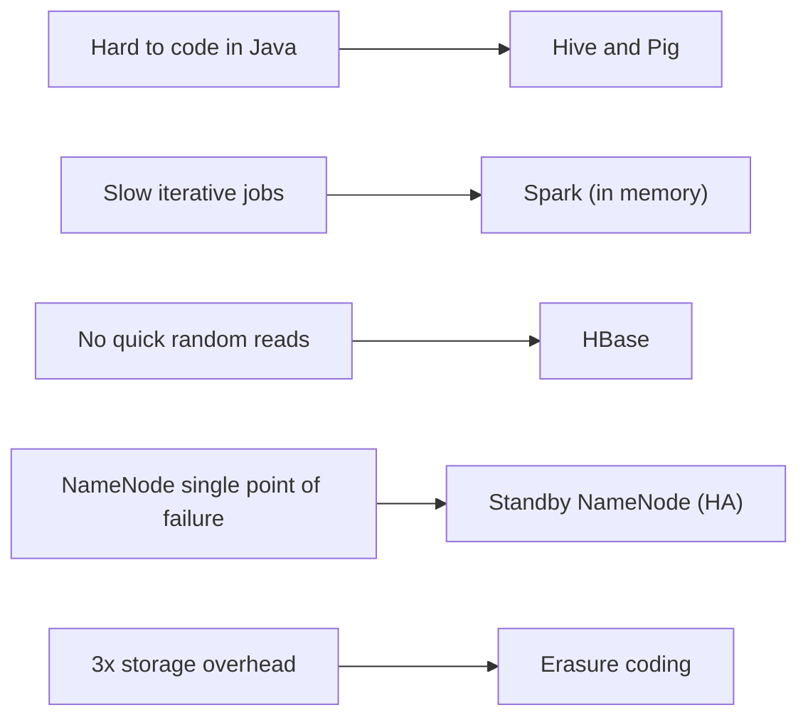

**In one line:** <mark>Hadoop is scalable, low cost, fault tolerant and handles all data types, but it is poor for small files, real-time answers, iterative jobs and transactions</mark>. <Cite id="hadoop-ecosystem-gfg-hadoop-intro" /> <Cite id="hadoop-ecosystem-ibm-hadoop" />

<Box kind="key">

**Key points to write (advantages and limitations of Hadoop):**

- <mark>Advantages: scalable, low cost, fault tolerant, handles structured and unstructured data, fast on huge data</mark>.
- <mark>Limitation: not suited to small files (NameNode memory overload)</mark>.
- <mark>Limitation: batch only, high latency, not real time</mark>.
- <mark>Limitation: slow for iterative jobs because MapReduce writes to disk between steps</mark>.
- Limitation: **no in-place updates or transactions** (write once, read many).
- Limitation: **hard to program**, NameNode weak point, **3x storage** overhead, security needs set-up.

</Box>

## Core answer (5 marks, fits every question here)

<Box kind="definition">

**Hadoop** is an open-source framework that stores data in HDFS and processes it with MapReduce on a cluster of commodity machines. Its design gives clear strengths and clear weaknesses. <Cite id="hadoop-ecosystem-wiki-hadoop" />

</Box>

| Advantages | Limitations |
|---|---|
| **Scalable:** add nodes to add storage and speed | **Small files problem:** every file and block is an object in NameNode memory |
| **Low cost:** commodity hardware, free software | **Batch only:** jobs take seconds to minutes to start, no real time |
| **Fault tolerant:** 3 copies of blocks, failed tasks re-run | **Slow for iterative work:** disk writes between MapReduce steps |
| **Any data type:** schema on read | **No in-place updates or transactions:** write once, read many |
| **Fast on huge data:** parallel work and data locality | **Hard to program:** long Java code for simple jobs |
| **Large ecosystem and community** | **Overheads:** 3x storage, NameNode weak point, security needs set-up |

<Cite id="hadoop-ecosystem-gfg-hadoop-intro" /> <Cite id="hadoop-ecosystem-ibm-hadoop" /> <Cite id="mapreduce-gfg-proscons" />

**Conclusion:** <mark>Hadoop is a low-cost, scalable platform for batch analysis of very large data, not for small files, real-time answers or transactions</mark>. <Cite id="hadoop-ecosystem-aws-hadoop" />

## Extended answer (10 marks): add these

### 1. Advantages in detail

1. **Scalable:** from a few nodes to thousands, just by adding machines.
2. **Low cost:** commodity hardware plus open-source software.
3. **Fault tolerant:** HDFS keeps 3 copies of each block and a failed task runs again on another node. <Cite id="hadoop-ecosystem-apache-hdfs-design" loc="Data Replication" />
4. **All data types:** structured, semi-structured and unstructured; structure is applied when the data is read.
5. **High throughput:** many nodes work in parallel and tasks run where the data is.
6. **Rich ecosystem:** Hive, Pig, HBase, Spark and many vendors.

### 2. Limitations in detail

1. **Small files:** each file, directory and block is an object (about 150 bytes) in the NameNode's memory, so millions of tiny files exhaust it, and each file also gets its own short map task. <Cite id="hdfs-cloudera-small" />
2. **Batch and high latency:** not for real-time answers or streams.
3. **Iterative jobs:** MapReduce writes to disk after every step, so machine learning and graph algorithms that loop many times are slow. Spark keeps data in memory and is much faster. <Cite id="hadoop-ecosystem-apache-spark" />
4. **No updates or transactions:** HDFS only appends; it is a poor fit for banking-type updates.
5. **Hard programming model:** everything must be forced into map and reduce.
6. **NameNode:** a single point of failure in Hadoop 1; Hadoop 2 added a standby NameNode but it needs extra set-up.
7. **Storage overhead:** 3 copies means 200% extra storage. Hadoop 3 erasure coding gives the same safety with about 50% overhead. <Cite id="web-bda-1-hdfs-erasure-coding" />
8. **Security and administration:** weak by default unless Kerberos is set up, and large clusters need skilled people.

### 3. When to use and when not to use

| Use Hadoop for | Do not use Hadoop for |
|---|---|
| Log analysis, search indexes | Small data that fits one server |
| Recommendation and big analytics | Real-time answers, quick lookups |
| Cheap archiving of huge data | Banking-type updates and transactions |

<Cite id="hadoop-ecosystem-wiki-hadoop" />

## Fit it to each question

- **"Write the limitations of Hadoop."** (5 marks) <PYQ id="2024-12/q1c" />: write only the **right column** of the table (5 to 6 limitations with a one-line reason each) and add the fixes diagram; no advantages needed.
- **"What are the advantages and limitations of Hadoop?"** (5 marks) <PYQ id="2025-05/q1b" />: the **full two-column table**, then the one-line conclusion. Give about 4 or 5 of each.

## Exam tips

- **Give a reason with every limitation** (for example "small files: NameNode keeps metadata in RAM"), not just a name.
- Mention **Spark, Hive and HA NameNode** as fixes; it shows you understand the ecosystem.
- Do not write "slow" alone: say **"high latency batch"**.
