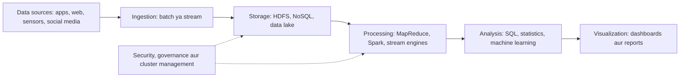
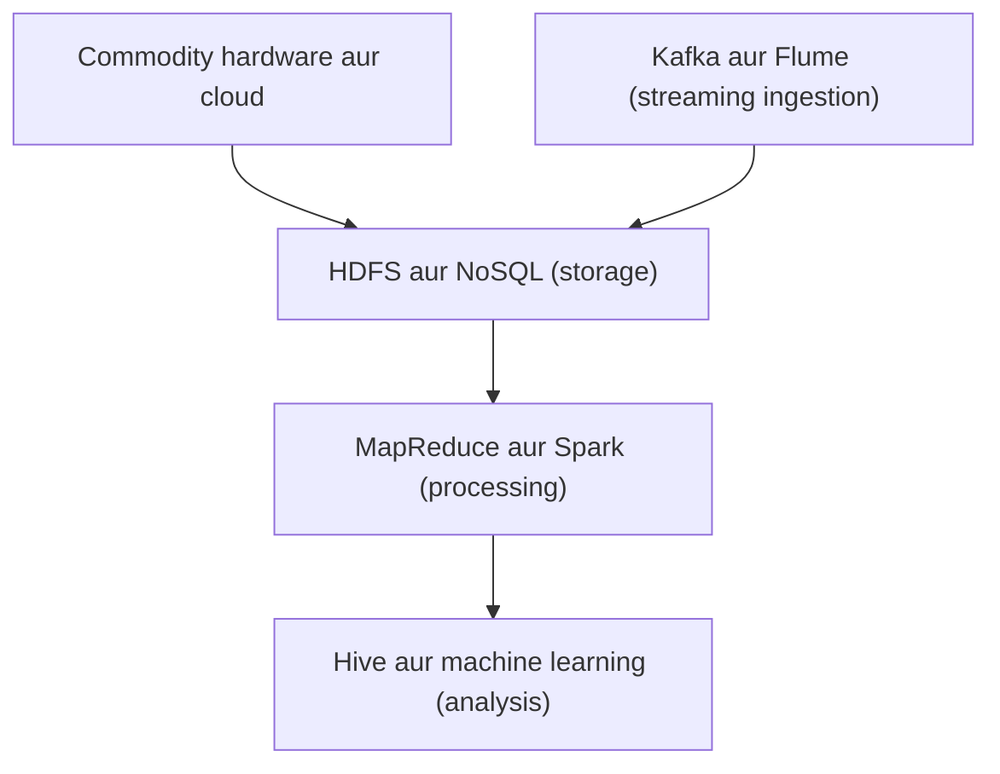

**Ek line mein:** <mark>Big data architecture layers ka set hai (sources, ingestion, storage, processing, analysis, visualization) jo raw data ko useful results tak pahunchata hai</mark>, aur <mark>enabling technologies</mark> woh inventions hain (commodity hardware, cloud, HDFS, MapReduce aur Spark, NoSQL, streaming tools) jinhone big data ko practical banaya. <Cite id="big-data-intro-gfg" /> <Cite id="web-bda-1-azure-bigdata-arch" />

<Box kind="key">

**Architecture ya enabling technologies ke question mein ye points likho:**

- <mark>Layers: data sources, ingestion, storage, processing, analysis, visualization</mark>, aur <mark>security aur management saari layers mein</mark>.
- <mark>Ingestion batch (nightly load) ya stream (Kafka-type tools) hota hai</mark>.
- <mark>Storage distributed hota hai</mark>: HDFS, NoSQL databases ya data lake.
- <mark>Processing parallel hoti hai</mark>: batch (MapReduce, Spark) aur stream engines.
- Enabling technologies: **commodity hardware, cloud, distributed file systems, MapReduce/Spark, NoSQL, streaming platforms, data lakes, machine learning tools**.
- Characteristics likho: **volume, velocity, variety, veracity, value**.

</Box>

## Core answer (5 marks, yahan ke har question ke liye)

<Box kind="definition">

A **big data architecture** is the layered design that collects data from many sources, stores it on a cluster, processes it in parallel and presents the results. There is no single official picture, but books and vendors all show the same layers, with data flowing left to right. <Cite id="big-data-intro-gfg" /> <Cite id="big-data-intro-aws" /> <Cite id="big-data-intro-mmds" />

</Box>

<Cite id="big-data-intro-gfg" loc="diagram" /> <Cite id="web-bda-1-azure-bigdata-arch" loc="diagram" />

| Layer | Kaam | Example |
|---|---|---|
| Data sources | Data kahan paida hota hai | Apps, web logs, sensors, social media |
| Ingestion | Data andar laata hai, batch ya stream mein | Sqoop, Flume, Kafka |
| Storage | Bade scale pe safe rakhta hai | HDFS, NoSQL, data lake |
| Processing | Raw data ko useful data banata hai | MapReduce, Spark, stream engines |
| Analysis | Patterns dhoondhta hai | Hive (SQL), machine learning |
| Visualization | Results logon ko dikhata hai | Dashboards, reports |
| Security aur management | Kaun kya dekhe, resource sharing | Kerberos, YARN |

<Cite id="big-data-intro-gfg" /> <Cite id="big-data-intro-aws" />

**Conclusion:** <mark>har layer big data ki ek problem solve karti hai aur saari layers milke raw data ko decisions mein badalti hain</mark>.

## Extended answer (10 marks): ye add karo

### 1. Big data enabling technologies

| Technology | Kya karti hai | Example |
|---|---|---|
| Cheap commodity hardware aur storage | Sainkdon nodes afford karna possible banati hai | Ordinary x86 servers |
| Cloud computing | Storage aur machines kiraye pe, use ke hisaab se paisa | AWS, Azure, Google Cloud <Cite id="big-data-intro-aws" /> |
| Distributed file systems | Bade files ko blocks mein nodes pe baantti hain, copies rakhti hain | HDFS <Cite id="big-data-intro-gfs" /> <Cite id="big-data-intro-hdfs" /> |
| Parallel processing frameworks | Chhote tasks bahut nodes pe ek saath chalate hain | MapReduce <Cite id="big-data-intro-mapreduce" />, Spark <Cite id="big-data-intro-spark" /> |
| NoSQL databases | Flexible bada data store, scale out | MongoDB <Cite id="big-data-intro-mongo" />, Cassandra <Cite id="big-data-intro-cassandra" /> |
| Streaming platforms | Data aate hi move aur process karte hain | Kafka, Spark Streaming |
| Data lakes | Kisi bhi format ka raw data sasta rakhte hain <Cite id="big-data-intro-wiki-lake" /> | Cloud object storage |
| Machine learning aur analytics tools | Patterns dhoondhte hain, predict karte hain | Spark MLlib |
| IoT aur mobile devices | Data paida karte hain | Sensors, phones |

### 2. NIST reference model mein architecture

NIST model wahi idea dikhata hai: data providers, ek big data application aur framework, aur data consumers, aur unke charo taraf security aur management. <Cite id="web-bda-1-nist-defs" />

### 3. Big data ki characteristics (2023 ke question mein chahiye)

<mark>Volume, velocity, variety, veracity aur value</mark>: bahut bada size, tez arrival, kai formats, uncertain quality aur useful results. Har ek ki ek line likho. Zyadatar data unstructured ya semi-structured hota hai, isliye storage flexible chahiye. <Cite id="big-data-intro-gfg" />

### 4. Batch aur stream paths

Batch processing bade stored sets pe chalti hai (nightly reports). Stream processing data aate hi chalti hai (fraud alert). Bahut systems mein dono hote hain. <Cite id="web-bda-1-azure-bigdata-arch" />

## Har question mein kaise fit karein

- **"Explain architecture of Big data and give characteristics of it."** (10 marks) <PYQ id="2023-12/q3a" />: core answer (definition, diagram, layer table), phir section 2 aur **section 3 (characteristics)**; time bache to section 4 add karo.
- **"Explain big data enabling technologies."** (10 marks) <PYQ id="2024-12/q2b" />: enabling technology kya hai uski ek line, **section 1 table diagram ke saath**, phir core answer ka layer diagram dikhane ke liye ki har technology kahan fit hoti hai.

## Exam tips

- **Hamesha draw karo** arrows wala layered flow diagram aur har box mein ek example tool likho.
- **Batch aur stream dono** ingestion aur processing likho; bahut answers mein stream chhoot jata hai.
- 2023 ke question mein **doosra half** (characteristics) mat chhodo; usme marks hain.
