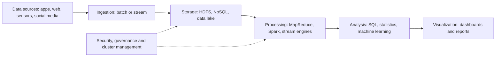
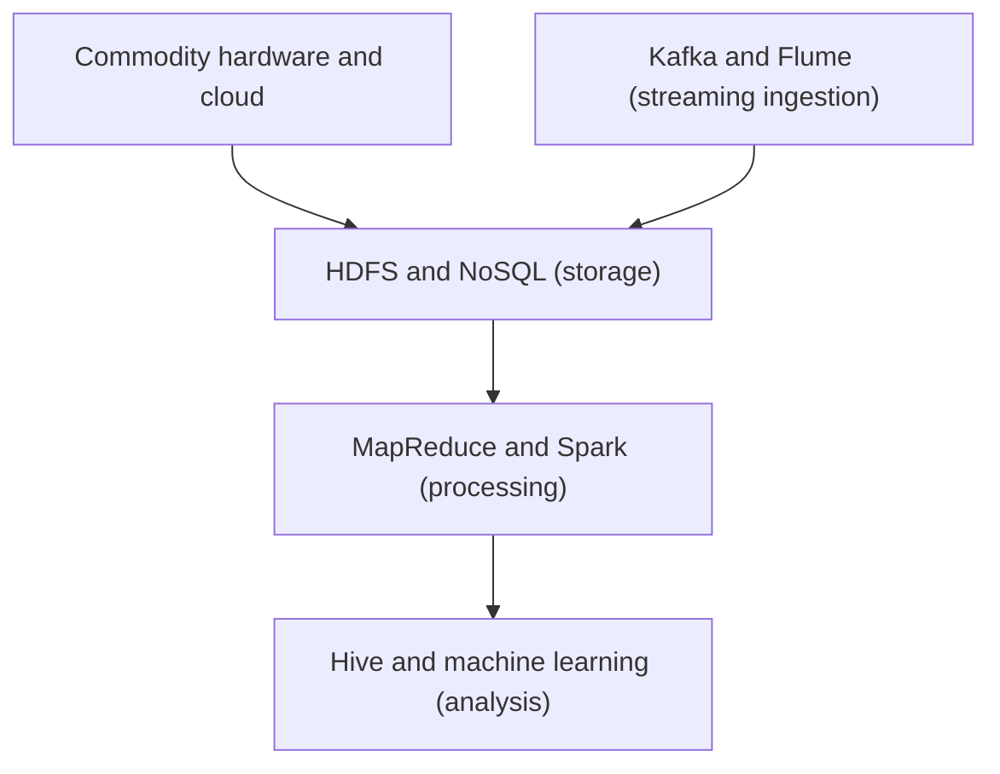

**In one line:** <mark>A big data architecture is a set of layers (sources, ingestion, storage, processing, analysis, visualization) that carries raw data to useful results</mark>, and the <mark>enabling technologies</mark> are the inventions (commodity hardware, cloud, HDFS, MapReduce and Spark, NoSQL, streaming tools) that made it practical. <Cite id="big-data-intro-gfg" /> <Cite id="web-bda-1-azure-bigdata-arch" />

<Box kind="key">

**Key points to write (architecture or enabling technologies):**

- <mark>Layers: data sources, ingestion, storage, processing, analysis, visualization</mark>, with <mark>security and management across all layers</mark>.
- <mark>Ingestion is batch (nightly load) or stream (Kafka-type tools)</mark>.
- <mark>Storage is distributed</mark>: HDFS, NoSQL databases or a data lake.
- <mark>Processing is parallel</mark>: batch (MapReduce, Spark) and stream engines.
- Enabling technologies: **commodity hardware, cloud, distributed file systems, MapReduce/Spark, NoSQL, streaming platforms, data lakes, machine learning tools**.
- Characteristics to mention: **volume, velocity, variety, veracity, value**.

</Box>

## Core answer (5 marks, fits every question here)

<Box kind="definition">

A **big data architecture** is the layered design that collects data from many sources, stores it on a cluster, processes it in parallel and presents the results. There is no single official picture, but books and vendors all show the same layers, with data flowing left to right. <Cite id="big-data-intro-gfg" /> <Cite id="big-data-intro-aws" /> <Cite id="big-data-intro-mmds" />

</Box>

<Cite id="big-data-intro-gfg" loc="diagram" /> <Cite id="web-bda-1-azure-bigdata-arch" loc="diagram" />

| Layer | Job | Example |
|---|---|---|
| Data sources | Where data is born | Apps, web logs, sensors, social media |
| Ingestion | Brings data in, in batches or as a stream | Sqoop, Flume, Kafka |
| Storage | Keeps it safely at scale | HDFS, NoSQL, data lake |
| Processing | Turns raw data into useful data | MapReduce, Spark, stream engines |
| Analysis | Finds patterns | Hive (SQL), machine learning |
| Visualization | Shows results to people | Dashboards, reports |
| Security and management | Who may see what, resource sharing | Kerberos, YARN |

<Cite id="big-data-intro-gfg" /> <Cite id="big-data-intro-aws" />

**Conclusion:** <mark>each layer solves one problem of big data and the layers together turn raw data into decisions</mark>.

## Extended answer (10 marks): add these

### 1. Big data enabling technologies

| Technology | What it does | Example |
|---|---|---|
| Cheap commodity hardware and storage | Makes hundreds of nodes affordable | Ordinary x86 servers |
| Cloud computing | Rent storage and machines, pay for use | AWS, Azure, Google Cloud <Cite id="big-data-intro-aws" /> |
| Distributed file systems | Split big files into blocks across nodes, keep copies | HDFS <Cite id="big-data-intro-gfs" /> <Cite id="big-data-intro-hdfs" /> |
| Parallel processing frameworks | Run small tasks on many nodes at once | MapReduce <Cite id="big-data-intro-mapreduce" />, Spark <Cite id="big-data-intro-spark" /> |
| NoSQL databases | Store flexible huge data, scale out | MongoDB <Cite id="big-data-intro-mongo" />, Cassandra <Cite id="big-data-intro-cassandra" /> |
| Streaming platforms | Move and process data as it arrives | Kafka, Spark Streaming |
| Data lakes | Keep raw data of any format cheaply <Cite id="big-data-intro-wiki-lake" /> | Cloud object storage |
| Machine learning and analytics tools | Find patterns, predict | Spark MLlib |
| IoT and mobile devices | Create the data | Sensors, phones |

### 2. Architecture in the NIST reference model

The NIST model shows the same idea: data providers, a big data application and framework, and data consumers, with security and management around them. <Cite id="web-bda-1-nist-defs" />

### 3. Characteristics of big data (needed in the 2023 question)

<mark>Volume, velocity, variety, veracity and value</mark>: huge size, fast arrival, many formats, uncertain quality and useful results. Write one line each. Most data is unstructured or semi-structured, so storage must be flexible. <Cite id="big-data-intro-gfg" />

### 4. Batch and stream paths

Batch processing works on big stored sets (nightly reports). Stream processing works on data as it arrives (fraud alert). Many systems have both. <Cite id="web-bda-1-azure-bigdata-arch" />

## Fit it to each question

- **"Explain architecture of Big data and give characteristics of it."** (10 marks) <PYQ id="2023-12/q3a" />: core answer (definition, diagram, layer table), then section 2 and **section 3 (characteristics)**; add section 4 if time is left.
- **"Explain big data enabling technologies."** (10 marks) <PYQ id="2024-12/q2b" />: one line on what an enabling technology is, **section 1 table with the diagram**, then the layer diagram from the core answer to show where each fits.

## Exam tips

- **Always draw** the layered flow diagram with arrows and write one example tool in every box.
- Name **both batch and stream** ingestion and processing; many answers forget stream.
- For the 2023 question do not skip the **second half** (characteristics); it carries marks.
