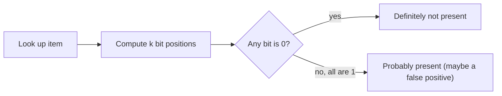

**Ek line mein:** <mark>Bloom filter ek bit array hai jisme k hash functions hote hain, jo batata hai ki item set mein hai ya nahi: false positive ho sakta hai, par false negative kabhi nahi</mark>. <Cite id="stream-counting-mmds-home" loc="§4.3" /> <Cite id="stream-counting-wiki-bloom" />

<Box kind="key">

**Har Bloom filter question mein ye points likho:**

- Parts: <mark>m bits ka bit array (shuru mein sab 0) aur k hash functions</mark>, har ek 0 se m-1 ke beech position deta hai.
- <mark>Insert: k bits ko 1 karo. Look up: koi bhi bit 0 ho to item definitely absent; saare 1 hon to probably present</mark>.
- <mark>No false negatives</mark>: bits kabhi clear nahi hote, isliye inserted item hamesha pass hota hai. Isiliye <mark>recall 100% hai</mark>.
- <mark>False positives possible hain</mark> (doosre items wahi bits set kar dete hain), isliye precision 100% se kam.
- Items <mark>delete nahi ho sakte</mark> (counting Bloom filter kar sakta hai), aur list bhi nahi kiye ja sakte.
- False-positive rate $\approx (1 - e^{-kn/m})^k$; best $k = (m/n)\ln 2$.
- Uses: <mark>spam aur malicious-URL checks, Cassandra aur HBase ka disk files skip karna, caches</mark>.

</Box>

## Core answer (5 marks, yahan ke har question ke liye)

<Box kind="definition">

A **Bloom filter** (Burton Bloom, 1970) is a small array of $m$ bits plus $k$ hash functions. It quickly answers "is this item in my set?" using very little memory. It may wrongly say "yes" for an item never added (**false positive**), but it **never says "no"** for an item that was added. <Cite id="stream-counting-mmds-home" loc="§4.3" /> <Cite id="stream-counting-wiki-bloom" />

</Box>

**Streams mein kyun chahiye:** items ek baar aate hain aur sab store nahi ho sakte. Mail server ko har sender ko ek arab good addresses ki list se check karna hai. List ko memory mein rakhna bahut bada hai, aur har baar disk look-up bahut slow. Bloom filter har address ke liye sirf kuch bits rakhta hai. <Cite id="stream-counting-gfg-bloom" />

**Kaise kaam karta hai:**

1. $m$ bits se shuru karo, sab 0, aur $k$ hash functions.
2. **Insert** $x$: $h_1(x), \dots, h_k(x)$ nikalo aur un bits ko 1 karo.
3. **Look up** $y$: wahi positions nikalo. Koi bhi 0 mile to **definitely not present**. Saare 1 hon to **probably present**.

<Cite id="stream-counting-gfg-bloom" loc="diagram" />

**Chhota example.** $m = 10$, $h_1(x) = x \bmod 10$, $h_2(x) = (3x+1) \bmod 10$. 15 insert karo (bits 5, 6), 22 (bits 2, 7) aur 9 (bits 9, 8). Array: bits 2, 5, 6, 7, 8, 9 are 1. Look-up 22: bits 2, 7 are 1, present. Look-up 13: bit 3 is 0, absent. Look-up 19: bits 9, 8 dono 1 hain, isliye present bolta hai par 19 kabhi insert nahi hua, ye **false positive** hai.

**Conclusion:** <mark>Bloom filter memory ki bahut badi bachat ke badle ek chhoti, control ki ja sakne wali false "yes" ki chance leta hai</mark>.

## Extended answer (10 marks): ye add karo

### 1. Recall 100% kyun hai

Recall $= \dfrac{TP}{TP + FN}$. Inserted item apne $k$ bits 1 kar deta hai, aur koi bit wapas 0 nahi hota. Look-up pe wahi bits abhi bhi 1 hain, isliye answer hamesha "possibly present" hota hai. To false negatives $FN = 0$ aur recall $= 100\%$. Saari errors doosri taraf hain: unrelated items bits share kar sakte hain, isliye precision 100% se kam hai. <Cite id="stream-counting-mmds-home" loc="§4.3" />

| Item looked up | Truth | Filter says | Result |
|---|---|---|---|
| Insert hua tha | present | possibly present | True positive (hamesha) |
| Kabhi insert nahi hua, ek bit 0 | absent | definitely absent | True negative |
| Kabhi insert nahi hua, saare bits doosron ne set kiye | absent | possibly present | **False positive** |
| Insert hua tha | present | definitely absent | **Impossible** |

### 2. False-positive rate ka analysis

Maano $m$ = bits, $n$ = inserted items, $k$ = hash functions. $kn$ hash operations ke baad ek given bit abhi bhi 0 hone ki probability $(1 - 1/m)^{kn} \approx e^{-kn/m}$ hai. Naya item tab galat se accept hota hai jab uske saare $k$ bits 1 hon:

$$
\text{false-positive rate} \approx \left(1 - e^{-kn/m}\right)^k
$$

Hashes ki best sankhya $k = \dfrac{m}{n}\ln 2$ hai, jisse lagbhag aadhe bits 1 hote hain. Bahut kam hashes weak filter dete hain; bahut zyada array bhar dete hain. <Cite id="web-bda-2-bloom-networks" />

<Sum>

<Given>

$n = 1000$ items aur $m = 8000$ bits.

</Given>

<Find>

$k = 1$, $2$, $6$ ke liye false-positive rate aur best $k$.

</Find>

<Steps>

1. $kn/m = k/8$.
2. $k = 1$: $(1 - e^{-0.125})^1 = 0.1175$, lagbhag 11.8 percent.
3. $k = 2$: $(1 - e^{-0.25})^2 = 0.2212^2 = 0.0489$, lagbhag 4.9 percent.
4. $k = 6$: $(1 - e^{-0.75})^6 = 0.5276^6 = 0.0216$, lagbhag 2.2 percent.
5. Best $k = 8 \ln 2 = 5.55$, isliye 5 aur 6 try karo: 0.02168 aur 0.02158. $k = 6$ use karo.

</Steps>

<Answer>

$k = 1, 2, 6$ ke liye lagbhag 11.8, 4.9 aur 2.2 percent; best $k$ 6 hai.

</Answer>

<Box kind="verify">

$k = 7$ ka $(1 - e^{-0.875})^7 = 0.0229$ aata hai, jo $k = 6$ se bada hai, isliye 6 hi minimum hai.

</Box>

</Sum>

### 3. Advantages, disadvantages, uses

| Advantages | Disadvantages |
|---|---|
| Bahut kam memory, har item ke kuch bits | False positives |
| $O(k)$ insert aur look-up, items ki sankhya pe depend nahi | Deletion nahi (counting Bloom filter counters se allow karta hai) |
| No false negatives, streams pe chalta hai | Items list nahi ho sakte; array bharne pe rate badhta hai |

**Uses:** spam aur malicious-URL lists, weak-password checks, aur Cassandra aur HBase har data file ke liye ek Bloom filter rakhte hain taaki jis file mein key surely nahi hai use skip kar sakein. <Cite id="stream-counting-cass-bloom" /> <Cite id="stream-counting-redis-bloom" /> <Cite id="stream-counting-gfg-counting-bloom" />

## Har question mein kaise fit karein

- **"Explain the concept of bloom filter with an example."** (5 marks) <PYQ id="2022-12-ce/q1d" /> <PYQ id="2024-05-ce/q1d" />: core answer, example aur diagram ke saath. Uses pe ek line add karo.
- **"Bloom filter for stream data mining"** (5 marks) <PYQ id="2024-05/q1d" />: core answer, aur stream wali wajah (items ek baar dikhte hain, memory limited, mail-server example) aur uses pe zor do.
- **"Bloom Filter with analysis."** (10 marks) <PYQ id="2025-05/q6a" />: core answer + section 2 (formula aur worked $n = 1000$, $m = 8000$ sum) + section 3.
- **"Why recall is 100% for blooms filter, explain in detail."** (5 marks) <PYQ id="2025-12-ce/q1d" />: one-line definition, phir section 1 poora (recall formula, "bits never cleared", table); end mein "only precision suffers".

## Exam tips

- **Hamesha draw karo:** bit array, har item se uske $k$ bits tak arrows, aur ek false positive mark karo.
- Do golden phrases likho: **"no false negatives"** aur **"false positives possible"**.
- Common galti: Bloom filter items delete kar sakta hai, ya "present" certain hai, aisa likhna. Sirf "absent" certain hai.

Exam mein English mein likho.
