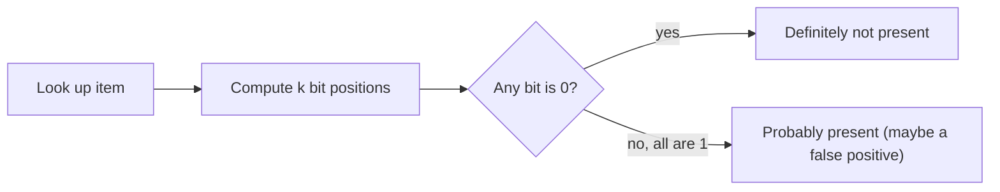

**In one line:** <mark>A Bloom filter is a bit array with k hash functions that tells whether an item is in a set: it may give a false positive, but never a false negative</mark>. <Cite id="stream-counting-mmds-home" loc="§4.3" /> <Cite id="stream-counting-wiki-bloom" />

<Box kind="key">

**Key points to write (any Bloom filter question):**

- Parts: <mark>a bit array of m bits (all 0 at the start) and k hash functions</mark>, each giving a position 0 to m-1.
- <mark>Insert: set the k bits to 1. Look up: if any bit is 0 the item is definitely absent; if all are 1 it is probably present</mark>.
- <mark>No false negatives</mark>: bits are never cleared, so an inserted item always passes. That is why <mark>recall is 100%</mark>.
- <mark>False positives are possible</mark> (other items set the same bits), so precision is below 100%.
- Items <mark>cannot be deleted</mark> (a counting Bloom filter can), and cannot be listed.
- False-positive rate $\approx (1 - e^{-kn/m})^k$; best $k = (m/n)\ln 2$.
- Uses: <mark>spam and malicious-URL checks, Cassandra and HBase skipping disk files, caches</mark>.

</Box>

## Core answer (5 marks, fits every question here)

<Box kind="definition">

A **Bloom filter** (Burton Bloom, 1970) is a small array of $m$ bits plus $k$ hash functions. It quickly answers "is this item in my set?" using very little memory. It may wrongly say "yes" for an item never added (**false positive**), but it **never says "no"** for an item that was added. <Cite id="stream-counting-mmds-home" loc="§4.3" /> <Cite id="stream-counting-wiki-bloom" />

</Box>

**Why it is needed in streams:** items arrive once and cannot all be stored. A mail server must check each sender against a list of a billion good addresses. Keeping the list in memory is too big, and a disk look-up each time is too slow. A Bloom filter keeps a few bits per address. <Cite id="stream-counting-gfg-bloom" />

**How it works:**

1. Start with $m$ bits, all 0, and $k$ hash functions.
2. **Insert** $x$: compute $h_1(x), \dots, h_k(x)$ and set those bits to 1.
3. **Look up** $y$: compute the same positions. Any 0 means **definitely not present**. All 1 means **probably present**.

<Cite id="stream-counting-gfg-bloom" loc="diagram" />

**Small example.** $m = 10$, $h_1(x) = x \bmod 10$, $h_2(x) = (3x+1) \bmod 10$. Insert 15 (bits 5, 6), 22 (bits 2, 7) and 9 (bits 9, 8). Array: bits 2, 5, 6, 7, 8, 9 are 1. Look-up 22: bits 2, 7 are 1, present. Look-up 13: bit 3 is 0, absent. Look-up 19: bits 9, 8 are both 1, so it says present but 19 was never inserted, a **false positive**.

**Conclusion:** <mark>a Bloom filter trades a small, controllable chance of a false "yes" for a huge saving in memory</mark>.

## Extended answer (10 marks): add these

### 1. Why recall is 100%

Recall $= \dfrac{TP}{TP + FN}$. An inserted item sets its $k$ bits to 1, and no bit is ever set back to 0. At look-up the same bits are still 1, so the answer is always "possibly present". So the false negatives $FN = 0$ and recall $= 100\%$. All errors are on the other side: unrelated items can share bits, so precision is below 100%. <Cite id="stream-counting-mmds-home" loc="§4.3" />

| Item looked up | Truth | Filter says | Result |
|---|---|---|---|
| Was inserted | present | possibly present | True positive (always) |
| Never inserted, one bit is 0 | absent | definitely absent | True negative |
| Never inserted, all bits set by others | absent | possibly present | **False positive** |
| Was inserted | present | definitely absent | **Impossible** |

### 2. Analysis of the false-positive rate

Let $m$ = bits, $n$ = items inserted, $k$ = hash functions. After $kn$ hash operations a given bit is still 0 with probability $(1 - 1/m)^{kn} \approx e^{-kn/m}$. A new item is wrongly accepted when all its $k$ bits are 1:

$$
\text{false-positive rate} \approx \left(1 - e^{-kn/m}\right)^k
$$

The best number of hashes is $k = \dfrac{m}{n}\ln 2$, which makes about half the bits 1. Too few hashes filter weakly; too many fill the array. <Cite id="web-bda-2-bloom-networks" />

<Sum>

<Given>

$n = 1000$ items and $m = 8000$ bits.

</Given>

<Find>

the false-positive rate for $k = 1$, $2$, $6$ and the best $k$.

</Find>

<Steps>

1. $kn/m = k/8$.
2. $k = 1$: $(1 - e^{-0.125})^1 = 0.1175$, about 11.8 percent.
3. $k = 2$: $(1 - e^{-0.25})^2 = 0.2212^2 = 0.0489$, about 4.9 percent.
4. $k = 6$: $(1 - e^{-0.75})^6 = 0.5276^6 = 0.0216$, about 2.2 percent.
5. Best $k = 8 \ln 2 = 5.55$, so try 5 and 6: 0.02168 and 0.02158. Use $k = 6$.

</Steps>

<Answer>

About 11.8, 4.9 and 2.2 percent for $k = 1, 2, 6$; the best $k$ is 6.

</Answer>

<Box kind="verify">

$k = 7$ gives $(1 - e^{-0.875})^7 = 0.0229$, larger than for $k = 6$, so 6 is the minimum.

</Box>

</Sum>

### 3. Advantages, disadvantages, uses

| Advantages | Disadvantages |
|---|---|
| Tiny memory, a few bits per item | False positives |
| $O(k)$ insert and look-up, independent of the number of items | No deletion (a counting Bloom filter uses counters to allow it) |
| No false negatives, works on streams | Cannot list the items; rate grows as the array fills |

**Uses:** spam and malicious-URL lists, weak-password checks, and Cassandra and HBase keep a Bloom filter per data file to skip files that surely lack a key. <Cite id="stream-counting-cass-bloom" /> <Cite id="stream-counting-redis-bloom" /> <Cite id="stream-counting-gfg-counting-bloom" />

## Fit it to each question

- **"Explain the concept of bloom filter with an example."** (5 marks) <PYQ id="2022-12-ce/q1d" /> <PYQ id="2024-05-ce/q1d" />: core answer including the small example and the diagram. Add one line on uses.
- **"Bloom filter for stream data mining"** (5 marks) <PYQ id="2024-05/q1d" />: core answer, and stress the stream reason (items seen once, memory limited, mail-server example) and the uses.
- **"Bloom Filter with analysis."** (10 marks) <PYQ id="2025-05/q6a" />: core answer + section 2 (formula and the worked $n = 1000$, $m = 8000$ sum) + section 3.
- **"Why recall is 100% for blooms filter, explain in detail."** (5 marks) <PYQ id="2025-12-ce/q1d" />: one-line definition, then section 1 in full (recall formula, "bits never cleared", the table); end with "only precision suffers".

## Exam tips

- **Always draw:** the bit array with arrows from each item to its $k$ bits, and mark one false positive.
- Write the two golden phrases: **"no false negatives"** and **"false positives possible"**.
- Common mistake: saying a Bloom filter can delete items, or that "present" is certain. Only "absent" is certain.
