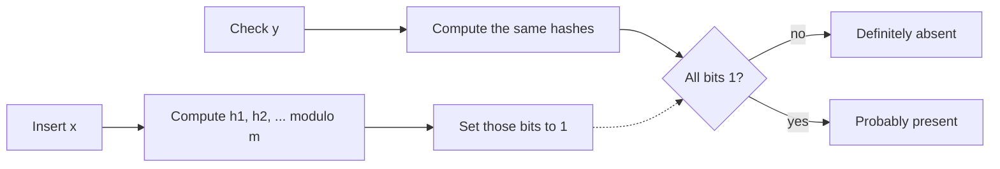
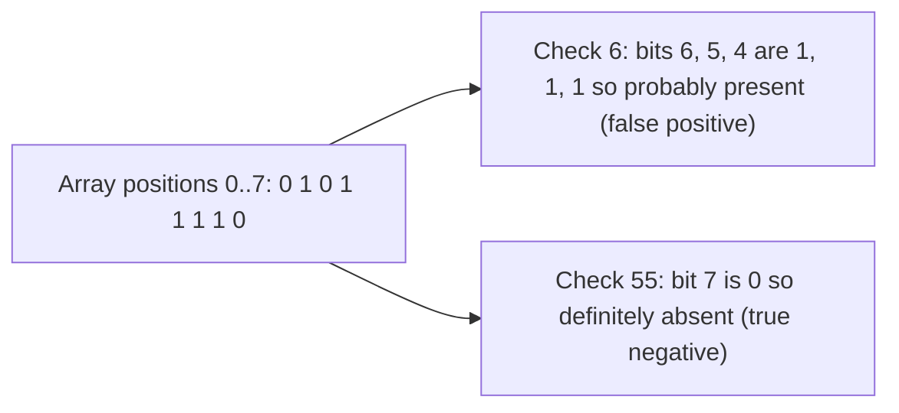

**Ek line mein:** <mark>Insert karne ke liye har hash function lagao aur un bits ko 1 karo; check karne ke liye wahi hashes lagao: koi bit 0 ho to definitely absent, saare 1 hon to probably present</mark>. <Cite id="stream-counting-wiki-bloom" /> <Cite id="stream-counting-gfg-bloom" />

<Box kind="key">

**Har Bloom filter sum mein ye points likho:**

- <mark>Bit array ko m boxes ki tarah likho, 0 se m-1 number ke saath, shuru mein sab 0.</mark>
- <mark>Table banao: element, h1, h2, h3 (jo bits wo set karta hai).</mark> Har insertion ke baad array dikhao.
- Check: <mark>koi bhi bit 0 = definitely not present (true negative); saare bits 1 = probably present</mark>.
- Agar element <mark>insert nahi hua par uske saare bits 1 hain, to wo false positive hai</mark>.
- <mark>No false negatives</mark>: har inserted element apna check pass karta hai.
- Kitne bits set hain wo fraction likho: zyada 1s matlab zyada false positives.

</Box>

## Core answer (5 marks, yahan ke har question ke liye): method

<Box kind="definition">

A **Bloom filter** is a bit array of $m$ bits, all 0 at the start, with $k$ hash functions. **Insert** $x$: set bits $h_1(x), \dots, h_k(x)$ to 1. **Check** $y$: if **any** of those bits is 0, $y$ is **definitely not** in the set; if **all** are 1, $y$ is **probably** in the set. <Cite id="stream-counting-wiki-bloom" /> <Cite id="stream-counting-mmds-home" loc="§4.3" />

</Box>

**Kyun use hota hai:** ye har item ke kuch bits mein stream ki membership test karta hai aur "no" certainty se bol sakta hai. <Cite id="stream-counting-gfg-bloom" />

**Sum ke steps:**

1. $0$ se $m-1$ tak number wale $m$ boxes banao, sab 0.
2. Har element ke liye har hash nikalo, **modulo $m$** (array ka size) lekar.
3. Un bit positions ko 1 karo (jo bit pehle se 1 hai wo 1 hi rehta hai).
4. Jo elements check karne hain unke positions nikalo aur bits dekho.
5. Decide karo: koi 0 mile to "definitely absent"; saare 1 hon to "probably present". Agar element kabhi insert nahi hua aur saare bits 1 hain, to wo **false positive** hai.

<Cite id="stream-counting-gfg-bloom" loc="diagram" />

**Conclusion:** <mark>Bloom filter memory bachata hai aur "no" certainty se bolta hai, par "yes" sirf probable hai</mark>.

## Extended answer (10 marks): ye add karo

### 1. Ek poora worked sum

<Sum>

<Given>

$m = 8$ bits (positions 0 se 7), sab 0. $h_1(x) = x \bmod 8$, $h_2(x) = (2x+1) \bmod 8$, $h_3(x) = (3x+2) \bmod 8$. 12, 25, 30, 5 insert karo. 6 aur 55 check karo.

</Given>

<Find>

final bit array, 6 aur 55 present bataye jaate hain ya nahi, aur kaunse results sahi hain.

</Find>

<Steps>

1. **Har element hash karo.** *Reason: ye wo bit positions hain jo wo set karega.*

   | $x$ | $h_1$ | $h_2$ | $h_3$ | Bits set |
   |---|---|---|---|---|
   | 12 | $12 \bmod 8 = 4$ | $25 \bmod 8 = 1$ | $38 \bmod 8 = 6$ | 1, 4, 6 |
   | 25 | $25 \bmod 8 = 1$ | $51 \bmod 8 = 3$ | $77 \bmod 8 = 5$ | 1, 3, 5 |
   | 30 | $30 \bmod 8 = 6$ | $61 \bmod 8 = 5$ | $92 \bmod 8 = 4$ | 4, 5, 6 |
   | 5 | $5 \bmod 8 = 5$ | $11 \bmod 8 = 3$ | $17 \bmod 8 = 1$ | 1, 3, 5 |

2. **Ek ek karke insert karo** (positions 0 se 7).

   | Insert ke baad | Bit array |
   |---|---|
   | (start) | 00000000 |
   | 12 | 01001010 |
   | 25 | 01011110 |
   | 30 | 01011110 (bits 4, 5, 6 pehle se 1) |
   | 5 | 01011110 (bits 1, 3, 5 pehle se 1) |

3. **6 check karo.** $h_1 = 6$, $h_2 = 13 \bmod 8 = 5$, $h_3 = 20 \bmod 8 = 4$. Bits 6, 5, 4 sab 1 hain, isliye filter "probably present" bolta hai.
4. **55 check karo.** $h_1 = 7$, $h_2 = 111 \bmod 8 = 7$, $h_3 = 167 \bmod 8 = 7$. Bit 7 0 hai, isliye "definitely not present".

</Steps>

<Answer>

Final array 01011110 (bits 1, 3, 4, 5, 6 set). **6** present bataya gaya par kabhi insert nahi hua: **false positive**. **55** absent bataya gaya aur sach mein absent hai: **true negative**.

</Answer>

<Box kind="verify">

Step 1 ke saare positions ka union: \{1, 4, 6\} ∪ \{1, 3, 5\} ∪ \{4, 5, 6\} = \{1, 3, 4, 5, 6\}, jo array se match karta hai. 8 mein se 5 bits set hain, to ek random naya element teeno bits pass kare uski chance lagbhag $(5/8)^3 \approx 0.24$ hai, isliye 6 jaisa false positive hairaani ki baat nahi.

</Box>

</Sum>

### 2. Results ka discussion

- **6 (false positive):** uske teeno bits (6, 5, 4) doosre elements (12 aur 30) ne set kiye the. Bits share hote hain, isliye collisions se ye hota hai.
- **55 (true negative):** ek 0 bit saabit karta hai ki wo kabhi insert nahi hua.
- **True positive:** dono checks mein se koi nahi. 12 jaise inserted element ko check karte to wo true positive hota. Bloom filter mein **no false negatives** hote hain.

### 3. Aur facts jodne ke liye

| Point | Detail |
|---|---|
| Set bits ka fraction | Yahan 8 mein 5; array jitna bhara, utne zyada false positives |
| Deletion | Possible nahi; counting Bloom filter counters use karta hai |
| False-positive rate | $\approx (1 - e^{-kn/m})^k$ |

<Cite id="stream-counting-gfg-counting-bloom" /> <Cite id="web-bda-2-bloom-networks" />

## Har question mein kaise fit karein

- **"Create a Bloom filter with m = 8 and h1(x) = x mod m, h2(x) = (2x + 1) mod m, h3(x) = (3x + 2) mod m. (i) Insert 12, 25, 30, 5. (ii) Check 6, 55. (iii) Discuss the results, identifying the true positive and true negative."** (10 marks) <PYQ id="2024-12-ce/q3b" />: ye upar wala worked sum hai, section 2 part (iii) ki tarah. Dhyan do ki dono checks mein koi true positive nahi hai.
- **"Discuss Blooms filter in detail and insert elements 10 and 7 in Blooms filter of size 5 using h1(x) = x mod 5 and h2(x) = (2x + 6) mod 5"** (10 marks) <PYQ id="2025-12-ce/q3a" />: definition aur working (core answer) likho, phir sum. 10 insert: $h_1 = 0$, $h_2 = 26 \bmod 5 = 1$, isliye bits 0 aur 1. 7 insert: $h_1 = 2$, $h_2 = 20 \bmod 5 = 0$, isliye bits 2 aur 0. Final array `11100`. Advantages, disadvantages aur uses notes se jodo.

## Exam tips

- **Hamesha draw karo:** numbered bit array, aur har insertion ke baad use dobara banao.
- Har hash value **working ke saath** dikhao (jaise $2 \times 12 + 1 = 25$, $25 \bmod 8 = 1$); marks working pe milte hain.
- Common galtiyan: **modulo** bhoolna, ya inserted-par-checked item ko false positive kehna. False positive wo item hai jo **kabhi insert nahi hua**.

Exam mein English mein likho.
