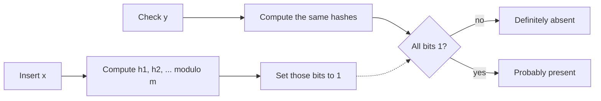
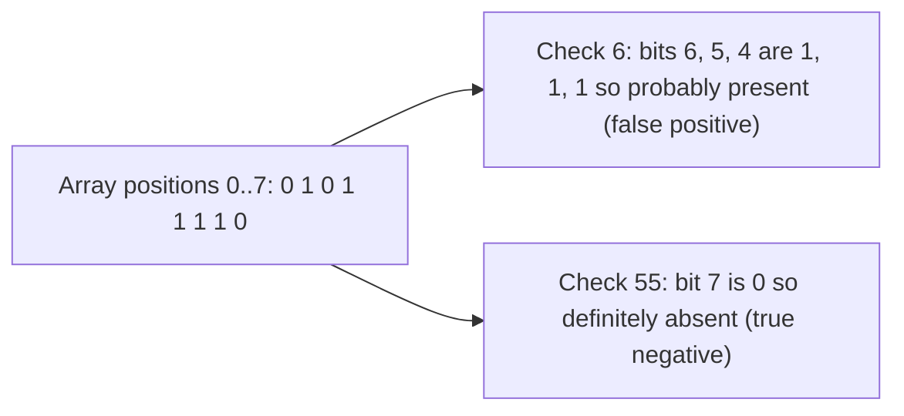

**In one line:** <mark>To insert, apply every hash function and set those bits to 1; to check, apply the same hashes: any 0 bit means definitely absent, all 1 means probably present</mark>. <Cite id="stream-counting-wiki-bloom" /> <Cite id="stream-counting-gfg-bloom" />

<Box kind="key">

**Key points to write (any Bloom filter sum):**

- <mark>Write the bit array as m boxes numbered 0 to m-1, all 0 at the start.</mark>
- <mark>Make a table: element, h1, h2, h3 (the bits it sets).</mark> Show the array after each insertion.
- Check: <mark>any 0 bit = definitely not present (true negative); all 1 bits = probably present</mark>.
- If an element was <mark>not inserted but all its bits are 1, it is a false positive</mark>.
- <mark>No false negatives</mark>: every inserted element passes its own check.
- Mention the fraction of bits set: more 1s means more false positives.

</Box>

## Core answer (5 marks, fits every question here): the method

<Box kind="definition">

A **Bloom filter** is a bit array of $m$ bits, all 0 at the start, with $k$ hash functions. **Insert** $x$: set bits $h_1(x), \dots, h_k(x)$ to 1. **Check** $y$: if **any** of those bits is 0, $y$ is **definitely not** in the set; if **all** are 1, $y$ is **probably** in the set. <Cite id="stream-counting-wiki-bloom" /> <Cite id="stream-counting-mmds-home" loc="§4.3" />

</Box>

**Why it is used:** it tests membership in a stream with a few bits per item and can say "no" with certainty. <Cite id="stream-counting-gfg-bloom" />

**Steps for a sum:**

1. Draw $m$ boxes numbered $0$ to $m-1$, all 0.
2. For each element compute every hash, **taking the remainder modulo $m$** (the size of the array).
3. Set those bit positions to 1 (a bit already 1 stays 1).
4. For each element to check, compute its positions and look at the bits.
5. Decide: any 0 gives "definitely absent"; all 1 gives "probably present". If the element was never inserted and all bits are 1, it is a **false positive**.

<Cite id="stream-counting-gfg-bloom" loc="diagram" />

**Conclusion:** <mark>a Bloom filter saves memory and says "no" with certainty, but "yes" is only probable</mark>.

## Extended answer (10 marks): add these

### 1. A full worked sum

<Sum>

<Given>

$m = 8$ bits (positions 0 to 7), all 0. $h_1(x) = x \bmod 8$, $h_2(x) = (2x+1) \bmod 8$, $h_3(x) = (3x+2) \bmod 8$. Insert 12, 25, 30, 5. Check 6 and 55.

</Given>

<Find>

the final bit array, whether 6 and 55 are reported present, and which results are right.

</Find>

<Steps>

1. **Hash each element.** *Reason: these are the bit positions it will set.*

   | $x$ | $h_1$ | $h_2$ | $h_3$ | Bits set |
   |---|---|---|---|---|
   | 12 | $12 \bmod 8 = 4$ | $25 \bmod 8 = 1$ | $38 \bmod 8 = 6$ | 1, 4, 6 |
   | 25 | $25 \bmod 8 = 1$ | $51 \bmod 8 = 3$ | $77 \bmod 8 = 5$ | 1, 3, 5 |
   | 30 | $30 \bmod 8 = 6$ | $61 \bmod 8 = 5$ | $92 \bmod 8 = 4$ | 4, 5, 6 |
   | 5 | $5 \bmod 8 = 5$ | $11 \bmod 8 = 3$ | $17 \bmod 8 = 1$ | 1, 3, 5 |

2. **Insert one by one** (positions 0 to 7).

   | After inserting | Bit array |
   |---|---|
   | (start) | 00000000 |
   | 12 | 01001010 |
   | 25 | 01011110 |
   | 30 | 01011110 (bits 4, 5, 6 already 1) |
   | 5 | 01011110 (bits 1, 3, 5 already 1) |

3. **Check 6.** $h_1 = 6$, $h_2 = 13 \bmod 8 = 5$, $h_3 = 20 \bmod 8 = 4$. Bits 6, 5, 4 are all 1, so the filter says "probably present".
4. **Check 55.** $h_1 = 7$, $h_2 = 111 \bmod 8 = 7$, $h_3 = 167 \bmod 8 = 7$. Bit 7 is 0, so "definitely not present".

</Steps>

<Answer>

Final array 01011110 (bits 1, 3, 4, 5, 6 set). **6** is reported present but was never inserted: a **false positive**. **55** is reported absent and really is absent: a **true negative**.

</Answer>

<Box kind="verify">

Union of all positions from step 1: \{1, 4, 6\} ∪ \{1, 3, 5\} ∪ \{4, 5, 6\} = \{1, 3, 4, 5, 6\}, matching the array. With 5 of 8 bits set, a random new element passes all three bits with chance about $(5/8)^3 \approx 0.24$, so a false positive like 6 is not surprising.

</Box>

</Sum>

### 2. Discussion of the results

- **6 (false positive):** its three bits (6, 5, 4) were set by other elements (12 and 30). Bits are shared, so collisions cause this.
- **55 (true negative):** one 0 bit proves it was never inserted.
- **True positive:** neither check. Checking an inserted element such as 12 would be one. A Bloom filter has **no false negatives**.

### 3. Other facts to add

| Point | Detail |
|---|---|
| Fraction of bits set | 5 of 8 here; the fuller the array, the more false positives |
| Deletion | Not possible; a counting Bloom filter uses counters |
| False-positive rate | $\approx (1 - e^{-kn/m})^k$ |

<Cite id="stream-counting-gfg-counting-bloom" /> <Cite id="web-bda-2-bloom-networks" />

## Fit it to each question

- **"Create a Bloom filter with m = 8 and h1(x) = x mod m, h2(x) = (2x + 1) mod m, h3(x) = (3x + 2) mod m. (i) Insert 12, 25, 30, 5. (ii) Check 6, 55. (iii) Discuss the results, identifying the true positive and true negative."** (10 marks) <PYQ id="2024-12-ce/q3b" />: this is the worked sum above, with section 2 as part (iii). Note that neither check is a true positive.
- **"Discuss Blooms filter in detail and insert elements 10 and 7 in Blooms filter of size 5 using h1(x) = x mod 5 and h2(x) = (2x + 6) mod 5"** (10 marks) <PYQ id="2025-12-ce/q3a" />: write the definition and working (core answer), then the sum. Insert 10: $h_1 = 0$, $h_2 = 26 \bmod 5 = 1$, so bits 0 and 1. Insert 7: $h_1 = 2$, $h_2 = 20 \bmod 5 = 0$, so bits 2 and 0. Final array `11100`. Add advantages, disadvantages and uses from the notes.

## Exam tips

- **Always draw:** the numbered bit array, and redraw it after every insertion.
- Show each hash value **with its working** (for example $2 \times 12 + 1 = 25$, $25 \bmod 8 = 1$); the marks are in the working.
- Common mistakes: forgetting the **modulo**, or calling an inserted-but-checked item a false positive. A false positive is an item that was **never inserted**.
