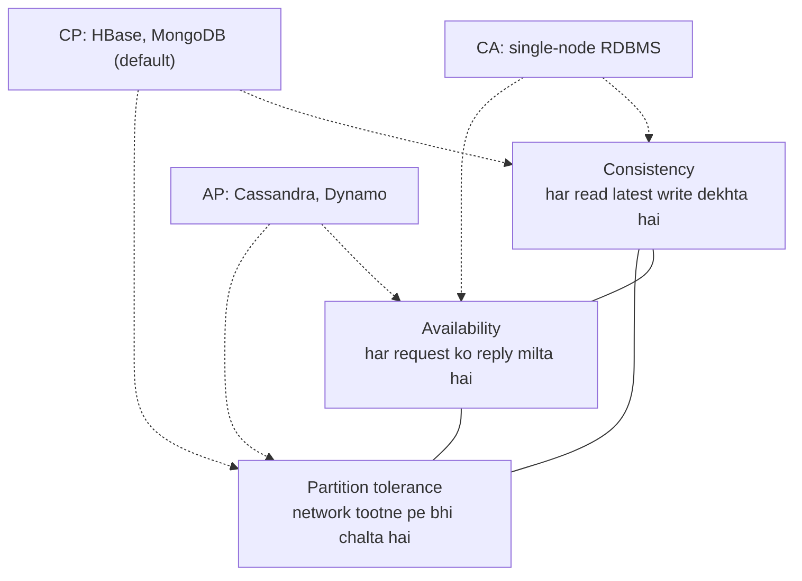

**Ek line mein:** <mark>CAP theorem kehta hai ki distributed data store Consistency, Availability aur Partition tolerance teeno ek saath guarantee nahi kar sakta; network partition ke time use consistency ya availability chunni padti hai, jabki ACID ek single database transaction ki guarantees batata hai</mark>. <Cite id="nosql-intro-wiki-cap" /> <Cite id="nosql-intro-brewer-cap12" />

<Box kind="key">

**CAP aur ACID ke question mein ye points likho:**

- <mark>Consistency (C): har read latest write dekhta hai</mark>.
- <mark>Availability (A): chalte hue node ko bheji har request ka response milta hai</mark>.
- <mark>Partition tolerance (P): network ke tootne pe bhi system chalta rehta hai</mark>.
- <mark>Distributed system teeno ek saath nahi de sakta; partitions hongi hi, isliye asli choice CP ya AP hai</mark>.
- <mark>ACID: Atomicity, Consistency, Isolation, Durability, database ke andar transactions ke liye</mark>.
- <mark>ACID ka C (data rules follow kare) CAP ke C (saare nodes same latest value dikhayein) se alag hai</mark>.
- Bahut NoSQL systems **BASE** follow karte hain: Basically Available, Soft state, Eventually consistent.

</Box>

## Core answer (5 marks, yahan ke har question ke liye)

<Box kind="definition">

**CAP theorem** (Eric Brewer): a distributed data store cannot provide all three of Consistency, Availability and Partition tolerance at the same time when the network breaks. <Cite id="nosql-intro-wiki-cap" /> <Cite id="nosql-intro-gfg-cap" />

</Box>

- **Consistency (C):** har read sabse recent write deta hai, isliye saare nodes same data dikhate hain.
- **Availability (A):** chalte hue node ko bheji har request ka answer milta hai.
- **Partition tolerance (P):** network tootne aur nodes ke aapas mein baat na kar paane pe bhi system chalta rehta hai.

Cluster mein partitions hongi hi, isliye P asal mein optional nahi hai. Partition ke time choice karni padti hai: kuch requests refuse karke correct raho (**CP**), ya shayad purana data dekar up raho (**AP**). Partition na ho to dono mil sakte hain. Brewer khud kehte hain ki "teen mein se do chuno" ek misleading simplification hai. <Cite id="nosql-intro-brewer-cap12" />

<Cite id="nosql-intro-gfg-cap" loc="diagram" /> <Cite id="nosql-intro-mongo-cap" /> <Cite id="nosql-intro-ibm-cap" />

**ACID** woh hai jo ek achha single-database transaction promise karta hai: <Cite id="nosql-intro-wiki-acid" />

- **Atomicity:** saare steps hote hain ya koi nahi.
- **Consistency:** data ek valid state se doosri valid state mein jata hai (rules hamesha hold karte hain).
- **Isolation:** ek saath chalte transactions ek-doosre ko disturb nahi karte.
- **Durability:** save hua result crash ke baad bhi bacha rehta hai.

| Point | ACID | CAP |
|---|---|---|
| Kis baare mein | Database ke andar transactions | Network fail hone pe distributed system |
| Properties | Atomicity, Consistency, Isolation, Durability | Consistency, Availability, Partition tolerance |
| "Consistency" ka matlab | Data rules follow karta hai (valid state) | Saare nodes latest value dete hain |
| Goal | Correct transactions | Correctness aur uptime ke beech trade-off |
| Typical systems | RDBMS | Distributed NoSQL stores |
| Style | Strict | BASE: available, eventually consistent |

**Conclusion:** <mark>ACID ek database mein ek transaction ko protect karta hai, CAP woh trade-off batata hai jo distributed store ko network fail hone pe karna padta hai</mark>.

## Extended answer (10 marks): ye add karo

### 1. BASE

Bahut NoSQL systems ACID ki jagah **BASE** follow karte hain: **B**asically **A**vailable (system answer deta hai), **S**oft state (copies sync hone tak data bina input ke badal sakta hai), **E**ventually consistent (naye writes na aayein to saari copies agree ho jati hain). <Cite id="nosql-intro-wiki-ec" />

### 2. Replicas se consistency tune karna

Dynamo-style stores $N$ copies rakhte hain. Write ko $W$ copies confirm karti hain aur read $R$ copies se puchta hai. Agar $R + W > N$ ho to har read set har write set se overlap karta hai, isliye read ko latest write milta hai. <Cite id="nosql-intro-dynamo" /> <Cite id="nosql-intro-cassandra-dynamo" />

<Sum>

<Given>

$N = 3$ copies of each item. Compare (a) $W = 2, R = 2$; (b) $W = 1, R = 1$; (c) $W = 3, R = 1$.

</Given>

<Find>

which settings always return the latest write and which gives the fastest writes.

</Find>

<Steps>

1. Rule: a read meets the latest write if $R + W > N$; the sets then share at least $R + W - N$ nodes.
2. (a) $2 + 2 = 4 > 3$, overlap at least 1. Consistent.
3. (b) $1 + 1 = 2 \not> 3$, overlap can be 0. Not guaranteed (eventual consistency).
4. (c) $3 + 1 = 4 > 3$, overlap 1. Consistent.
5. Writes wait for $W$ replies, so (b) has the fastest writes but no guarantee. Among consistent ones, (a) balances reads and writes; (c) has the fastest reads but a write fails if any node is down.

</Steps>

<Answer>

(a) and (c) always read the latest write; (b) does not. (b) writes fastest but is only eventually consistent.

</Answer>

<Box kind="verify">

Try (b): the write reaches node 1 only and the read asks node 3, which still has the old value, so the read is stale. Try (a): any 2 nodes written and any 2 nodes read out of 3 must share a node, so the read sees the new value.

</Box>

</Sum>

### 3. Example systems

| Choice | Partition ke time matlab | Examples |
|---|---|---|
| CP | Consistent rehne ke liye kuch requests refuse | HBase, MongoDB (default) |
| AP | Available rehta hai, purana data de sakta hai, baad mein repair | Cassandra, Dynamo |
| CA | Partition handle nahi karta (sirf single node mein) | Single-node RDBMS |

## Har question mein kaise fit karein

- **"Explain CAP theorem. State how it is different from ACID properties."** (5 marks) <PYQ id="2023-12/q1c" />: **core answer**: CAP definition aur teen properties, triangle, ACID list aur **CAP versus ACID table**.
- **"Explain CAP. How is CAP different from ACID property in databases?"** (5 marks) <PYQ id="2024-12-ce/q1a" />: wahi core answer; table mein "consistency" ke do matlab pe zor do. Behtar answer ke liye BASE (section 1) add karo.

## Exam tips

- **CAP ke teeno letters ki ek-ek line definition** likho aur CP, AP aur CA pairs ke saath triangle draw karo.
- **Pitfall likho**: "ACID mein consistency ka matlab rules bane rehna hai; CAP mein matlab saare nodes ko same value dikhna".
- Likho ki asli cluster mein **P chhod nahi sakte**, isliye asli choice C ya A hai.
