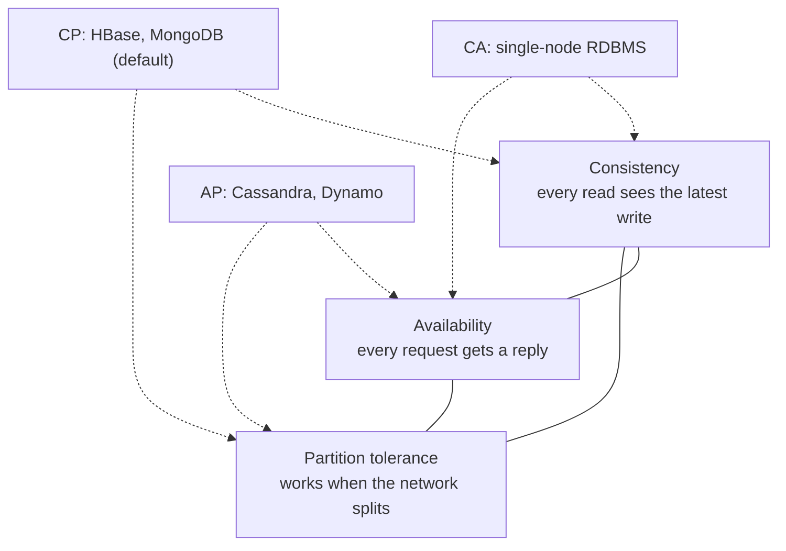

**In one line:** <mark>The CAP theorem says a distributed data store cannot guarantee Consistency, Availability and Partition tolerance all at once; during a network partition it must choose consistency or availability, whereas ACID describes the guarantees of a single database transaction</mark>. <Cite id="nosql-intro-wiki-cap" /> <Cite id="nosql-intro-brewer-cap12" />

<Box kind="key">

**Key points to write (CAP and ACID):**

- <mark>Consistency (C): every read sees the latest write</mark>.
- <mark>Availability (A): every request to a working node gets a response</mark>.
- <mark>Partition tolerance (P): the system keeps working when the network splits</mark>.
- <mark>A distributed system cannot give all three at once; partitions will happen, so the real choice is CP or AP</mark>.
- <mark>ACID: Atomicity, Consistency, Isolation, Durability, for transactions inside a database</mark>.
- <mark>The C of ACID (data follows the rules) is different from the C of CAP (all nodes show the same latest value)</mark>.
- Many NoSQL systems follow **BASE**: Basically Available, Soft state, Eventually consistent.

</Box>

## Core answer (5 marks, fits every question here)

<Box kind="definition">

**CAP theorem** (Eric Brewer): a distributed data store cannot provide all three of Consistency, Availability and Partition tolerance at the same time when the network breaks. <Cite id="nosql-intro-wiki-cap" /> <Cite id="nosql-intro-gfg-cap" />

</Box>

- **Consistency (C):** every read returns the most recent write, so all nodes show the same data.
- **Availability (A):** every request to a working node gets an answer.
- **Partition tolerance (P):** the system keeps working even when the network splits and nodes cannot talk to each other.

In a cluster partitions will happen, so P is not really optional. During a partition you choose: refuse some requests to stay correct (**CP**), or answer with possibly old data to stay up (**AP**). Without a partition you can have both. Brewer himself says "pick two of three" is a misleading simplification. <Cite id="nosql-intro-brewer-cap12" />

<Cite id="nosql-intro-gfg-cap" loc="diagram" /> <Cite id="nosql-intro-mongo-cap" /> <Cite id="nosql-intro-ibm-cap" />

**ACID** is what a good single-database transaction promises: <Cite id="nosql-intro-wiki-acid" />

- **Atomicity:** all steps happen or none.
- **Consistency:** data moves from one valid state to another (rules always hold).
- **Isolation:** transactions running together do not disturb each other.
- **Durability:** a saved result survives a crash.

| Point | ACID | CAP |
|---|---|---|
| About | Transactions inside a database | A distributed system when the network fails |
| Properties | Atomicity, Consistency, Isolation, Durability | Consistency, Availability, Partition tolerance |
| Meaning of "consistency" | Data obeys the rules (valid state) | All nodes return the latest value |
| Goal | Correct transactions | Trade-off between correctness and uptime |
| Typical systems | RDBMS | Distributed NoSQL stores |
| Style | Strict | BASE: available, eventually consistent |

**Conclusion:** <mark>ACID protects one transaction in one database, CAP describes the trade-off a distributed store must make when the network fails</mark>.

## Extended answer (10 marks): add these

### 1. BASE

Many NoSQL systems follow **BASE** instead of ACID: **B**asically **A**vailable (the system answers), **S**oft state (data may change without input as copies sync), **E**ventually consistent (all copies agree if no new writes arrive). <Cite id="nosql-intro-wiki-ec" />

### 2. Tuning consistency with replicas

Dynamo-style stores keep $N$ copies. A write must be confirmed by $W$ copies and a read asks $R$ copies. If $R + W > N$, every read set overlaps every write set, so a read sees the latest write. <Cite id="nosql-intro-dynamo" /> <Cite id="nosql-intro-cassandra-dynamo" />

<Sum>

<Given>

$N = 3$ copies of each item. Compare (a) $W = 2, R = 2$; (b) $W = 1, R = 1$; (c) $W = 3, R = 1$.

</Given>

<Find>

which settings always return the latest write and which gives the fastest writes.

</Find>

<Steps>

1. Rule: a read meets the latest write if $R + W > N$; the sets then share at least $R + W - N$ nodes.
2. (a) $2 + 2 = 4 > 3$, overlap at least 1. Consistent.
3. (b) $1 + 1 = 2 \not> 3$, overlap can be 0. Not guaranteed (eventual consistency).
4. (c) $3 + 1 = 4 > 3$, overlap 1. Consistent.
5. Writes wait for $W$ replies, so (b) has the fastest writes but no guarantee. Among consistent ones, (a) balances reads and writes; (c) has the fastest reads but a write fails if any node is down.

</Steps>

<Answer>

(a) and (c) always read the latest write; (b) does not. (b) writes fastest but is only eventually consistent.

</Answer>

<Box kind="verify">

Try (b): the write reaches node 1 only and the read asks node 3, which still has the old value, so the read is stale. Try (a): any 2 nodes written and any 2 nodes read out of 3 must share a node, so the read sees the new value.

</Box>

</Sum>

### 3. Example systems

| Choice | Meaning during a partition | Examples |
|---|---|---|
| CP | Refuse some requests to stay consistent | HBase, MongoDB (default) |
| AP | Stay available, may return old data, repair later | Cassandra, Dynamo |
| CA | No partition handling (only in a single node) | Single-node RDBMS |

## Fit it to each question

- **"Explain CAP theorem. State how it is different from ACID properties."** (5 marks) <PYQ id="2023-12/q1c" />: the **core answer**: CAP definition and three properties, the triangle, the ACID list and the **CAP versus ACID table**.
- **"Explain CAP. How is CAP different from ACID property in databases?"** (5 marks) <PYQ id="2024-12-ce/q1a" />: the same core answer; stress the two meanings of "consistency" in the table. Add BASE (section 1) for a stronger answer.

## Exam tips

- **Define all three CAP letters in one line each** and draw the triangle with CP, AP and CA pairs.
- **Write the pitfall**: "consistency in ACID means rules are kept; in CAP it means all nodes see the same value".
- Mention that **P cannot be dropped** in a real cluster, so the real choice is C or A.
