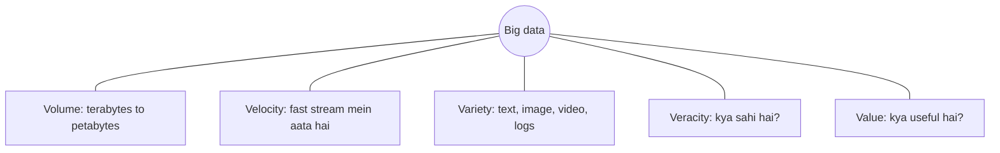
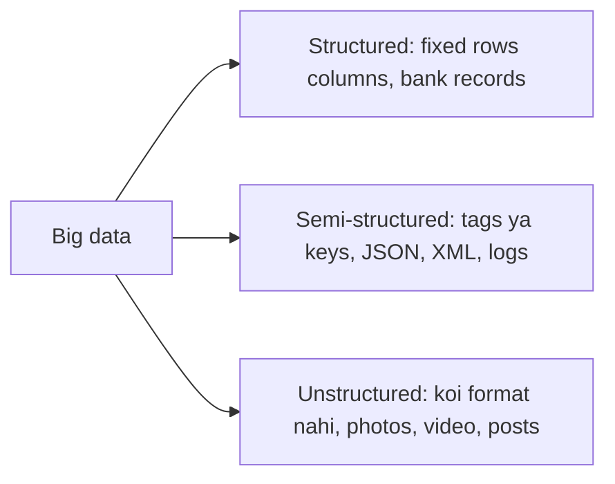

**Ek line mein:** <mark>Big data woh data hai jo bahut bada (volume) hai, bahut tez (velocity) aata hai aur bahut alag-alag type (variety) ka hai, isliye traditional database use store aur process nahi kar sakta</mark>; veracity aur value judne se **5 V's** bante hain. <Cite id="big-data-intro-wiki" /> <Cite id="web-bda-1-nist-defs" />

<Box kind="key">

**Har "characteristics of big data" question mein ye points likho:**

- <mark>Volume = data ki matra (amount)</mark> (terabytes se petabytes aur usse bhi zyada).
- <mark>Velocity = data kitni tez bante hai aur kitni tez process karna hai</mark> (aksar real time mein).
- <mark>Variety = bahut saare formats</mark>: structured, semi-structured aur unstructured (text, image, audio, video, logs).
- <mark>Veracity = data kitna sahi aur bharosemand hai</mark> (noise, spam, fake data).
- <mark>Value = data se milne wala useful result</mark>; jis data ko koi use nahi kar sakta woh sirf kharcha hai.
- **3 V's** classic list hai (volume, velocity, variety); **5 V's** mein veracity aur value add hote hain; kuch books variability ko 6th V bolti hain.
- **Har V ke saath ek example likho** (social media site sabse pasandida example hai).

</Box>

## Core answer (5 marks, yahan ke har question ke liye)

<Box kind="definition">

**Big data** means data sets so large or complex that traditional data-processing software cannot capture, store, search or analyse them in reasonable time. It is described by its characteristics, the **V's**. <Cite id="big-data-intro-tp" /> <Cite id="big-data-intro-wiki" />

</Box>

**V's kyun important hain:** normal database ek server pe chalta hai, aur jab inme se koi bhi V bahut bada ho jaye to woh fail ho jata hai, isliye big data ko machines ke cluster pe rakhna padta hai. <Cite id="big-data-intro-ibm" />

<Cite id="big-data-intro-gfg" loc="diagram" />

| V | Matlab | Social media site (jaise Facebook ya Instagram) |
|---|---|---|
| Volume | Kitna data | Roz lakhon users text, photo, video upload karte hain: petabytes |
| Velocity | Kitni tez aata hai | Har second likes, comments, messages; feed turant update hona chahiye |
| Variety | Kitna mixed | Text, emoji, image, video, audio, location, friend links |
| Veracity | Kitna reliable | Fake accounts, spam, bots aur afwahein |
| Value | Kitna useful | Recommendations, targeted ads, trend aur abuse detection |

<Cite id="big-data-intro-av" /> <Cite id="web-bda-1-gcloud-bigdata" />

**Conclusion:** <mark>big data sirf bahut saara data nahi hai: iska volume, velocity aur variety traditional single-server database ko tod dete hain</mark>, isliye ise clusters pe store aur process karte hain.

## Extended answer (10 marks): ye add karo

### 1. V's detail mein (har V pe 2 se 3 lines likho)

- **Volume:** data gigabytes se petabytes tak badhta hai (sensors, social media, logs). Ek disk ya server mein nahi aata, isliye bahut saare nodes mein baant dete hain.
- **Velocity:** data lagatar bante rehta hai aur near real time mein handle karna padta hai, jaise stock trades ya live trending list. Der se mile result ki value kam ho jati hai.
- **Variety:** ek hi system ko tables, JSON, free text, photos aur video milte hain. Fixed table design sab nahi rakh sakta.
- **Veracity:** galat, duplicate ya noisy data galat decisions deta hai, isliye data ko clean aur check karna padta hai.
- **Value:** asli goal; analysis ko raw data se decisions banane chahiye jaise fraud alert ya product suggestion.
- **Variability (extra):** context ke saath data ka matlab badalta hai, jaise ek hi word alag posts mein alag matlab rakhta hai. <Cite id="big-data-intro-ibm" /> <Cite id="big-data-intro-wiki" />

### 2. Data ke types (variety detail mein)

<Cite id="big-data-intro-gfg" loc="diagram" />

### 3. Do case studies (jab question "give two case studies" bole)

| Case study | Kaunsa V | Justification |
|---|---|---|
| Stock exchange | Velocity | Buy sell orders har second bahut zyada aate hain aur ek minute late price signal bekaar hai, isliye stream ki tarah process karna padta hai |
| Hospital records | Variety | Ek patient ka table data, doctor notes, X-ray images aur monitor readings hote hain; ek fixed table sab nahi rakh sakta |
| Social media site | Volume | Har user ki har photo aur video store hoti hai, petabytes tak |

<Cite id="big-data-intro-tp" /> <Cite id="big-data-intro-ibm" />

### 4. Advantages aur challenges

| Advantages | Challenges |
|---|---|
| Better data-driven decisions | Bahut bada data store aur move karna |
| Personalised offers, fraud aur risk detection | Kharab data quality (veracity) |
| Prediction (machine failure, demand) | Privacy aur security rules |

## Har question mein kaise fit karein

- **"Mention four characteristics of big data. Elaborate these characteristics with respect to social media websites."** (2023 mein 5 marks, 2025 mein 10 marks) <PYQ id="2023-05-ce/q1c" /> <PYQ id="2025-12-ce/q5b" />: volume, velocity, variety, veracity chuno aur table ka **social media column** use karo. 5 marks ke liye core answer likho. 10 marks ke liye section 1 add karo, har V mein ek social media sentence ke saath.
- **"Mention four characteristics of big data and explain in detail."** (5 marks) <PYQ id="2024-05-ce/q1b" /> <PYQ id="2025-05-ce/q1a" />: definition, chaar V's (volume, velocity, variety, veracity) table ke saath (social media column hata do ya example ki tarah rakho), diagram, conclusion.
- **"What are the 3 V's of big data? Give two big data case studies indicating respective V's with justification."** (5 marks) <PYQ id="2023-12-ce/q1b" />: definition, sirf teen V's, phir **section 3** (velocity ke liye stock exchange, variety ke liye hospital).
- **"Big Data and its characteristics"** (5 marks) <PYQ id="2024-05/q1a" />: definition, 3 ya 5 V's diagram aur har ek ke ek example ke saath.
- **"Explain 5 V's of big data."** (5 marks) <PYQ id="2024-12/q1a" />: paanchon V's diagram aur table ke saath; veracity aur value chhootne nahi chahiye.

## Exam tips

- **Hamesha draw karo** V's ka diagram (beech mein circle, paanch spokes) aur **har V ka ek line example** do.
- **Har V ki definition ek clean sentence** mein likho; examiner keywords pe tick lagata hai (amount, speed, formats, trust, usefulness).
- **Velocity** (aane ki speed) ko **variability** (badalta matlab) se confuse mat karo.
