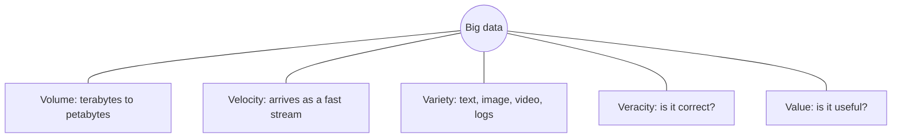
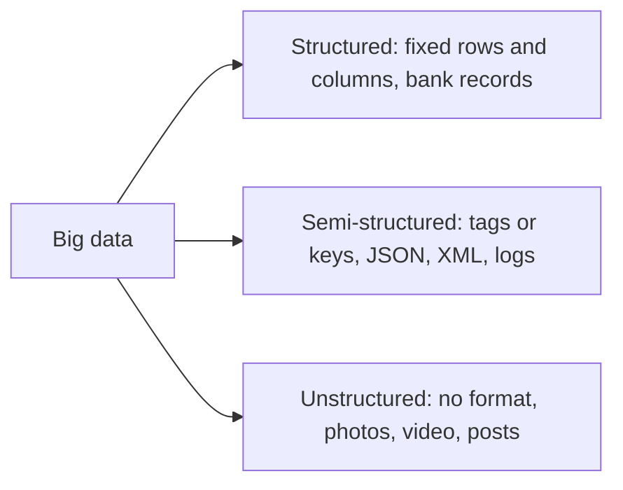

**In one line:** <mark>Big data is data that is too large (volume), arrives too fast (velocity) and is too varied (variety) for a traditional database to store and process</mark>; veracity and value make it the **5 V's**. <Cite id="big-data-intro-wiki" /> <Cite id="web-bda-1-nist-defs" />

<Box kind="key">

**Key points to write (any "characteristics of big data" question):**

- <mark>Volume = the amount of data</mark> (terabytes to petabytes and more).
- <mark>Velocity = the speed at which data is created and must be processed</mark> (often in real time).
- <mark>Variety = many formats</mark>: structured, semi-structured and unstructured (text, image, audio, video, logs).
- <mark>Veracity = how correct and trustworthy the data is</mark> (noise, spam, fake data).
- <mark>Value = the useful result we get from the data</mark>; data nobody can use is only a cost.
- **3 V's** are the classic list (volume, velocity, variety); **5 V's** add veracity and value; some books add variability as a sixth.
- **Always link each V to an example** (a social media site is the favourite).

</Box>

## Core answer (5 marks, fits every question here)

<Box kind="definition">

**Big data** means data sets so large or complex that traditional data-processing software cannot capture, store, search or analyse them in reasonable time. It is described by its characteristics, the **V's**. <Cite id="big-data-intro-tp" /> <Cite id="big-data-intro-wiki" />

</Box>

**Why the V's matter:** a normal database on one server fails when any one of them becomes very big, so big data needs a cluster of machines. <Cite id="big-data-intro-ibm" />

<Cite id="big-data-intro-gfg" loc="diagram" />

| V | Meaning | Social media site (for example Facebook or Instagram) |
|---|---|---|
| Volume | How much data | Millions of users upload text, photos and videos daily: petabytes |
| Velocity | How fast it arrives | Likes, comments and messages every second; the feed must update at once |
| Variety | How mixed | Text, emoji, image, video, audio, location, friend links |
| Veracity | How reliable | Fake accounts, spam, bots and rumours |
| Value | How useful | Recommendations, targeted ads, trend and abuse detection |

<Cite id="big-data-intro-av" /> <Cite id="web-bda-1-gcloud-bigdata" />

**Conclusion:** <mark>big data is not just a lot of data: its volume, velocity and variety break the traditional single-server database</mark>, so it is stored and processed on clusters.

## Extended answer (10 marks): add these

### 1. The V's in detail (write 2 to 3 lines each)

- **Volume:** data grows from gigabytes to petabytes (sensors, social media, logs). One disk or server cannot hold it, so it is split over many nodes.
- **Velocity:** data is generated continuously and has to be handled in near real time, like stock trades or a live trending list. Late results lose their worth.
- **Variety:** the same system gets tables, JSON, free text, photos and video. A fixed table design cannot hold all of it.
- **Veracity:** wrong, duplicate or noisy data gives wrong decisions, so data must be cleaned and checked.
- **Value:** the real goal; analysis must turn raw data into decisions such as fraud alerts or product suggestions.
- **Variability (extra):** the meaning of data changes with context, for example the same word means different things in different posts. <Cite id="big-data-intro-ibm" /> <Cite id="big-data-intro-wiki" />

### 2. Types of data (the "variety" in detail)

<Cite id="big-data-intro-gfg" loc="diagram" />

### 3. Two case studies (if the question asks "give two case studies")

| Case study | V it shows | Justification |
|---|---|---|
| Stock exchange | Velocity | Buy and sell orders arrive in huge numbers every second and a price signal a minute late is useless, so it must be processed as a stream |
| Hospital records | Variety | One patient has table data, doctor notes, X-ray images and monitor readings; one fixed table cannot hold all |
| Social media site | Volume | Every photo and video of every user is stored, growing to petabytes |

<Cite id="big-data-intro-tp" /> <Cite id="big-data-intro-ibm" />

### 4. Advantages and challenges

| Advantages | Challenges |
|---|---|
| Better data-driven decisions | Storing and moving huge data |
| Personalised offers, fraud and risk detection | Poor data quality (veracity) |
| Prediction (machine failure, demand) | Privacy and security rules |

## Fit it to each question

- **"Mention four characteristics of big data. Elaborate these characteristics with respect to social media websites."** (5 marks in 2023, 10 marks in 2025) <PYQ id="2023-05-ce/q1c" /> <PYQ id="2025-12-ce/q5b" />: pick volume, velocity, variety, veracity and use the **social media column** of the table. For 5 marks write the core answer. For 10 marks add section 1 with a social media sentence in every V.
- **"Mention four characteristics of big data and explain in detail."** (5 marks) <PYQ id="2024-05-ce/q1b" /> <PYQ id="2025-05-ce/q1a" />: definition, four V's (volume, velocity, variety, veracity) with the table (drop the social media column or keep it as the example), diagram, conclusion.
- **"What are the 3 V's of big data? Give two big data case studies indicating respective V's with justification."** (5 marks) <PYQ id="2023-12-ce/q1b" />: definition, the three V's only, then **section 3** (stock exchange for velocity, hospital for variety).
- **"Big Data and its characteristics"** (5 marks) <PYQ id="2024-05/q1a" />: definition, 3 or 5 V's with the diagram and one example each.
- **"Explain 5 V's of big data."** (5 marks) <PYQ id="2024-12/q1a" />: all five V's with the diagram and table; veracity and value must not be missed.

## Exam tips

- **Always draw** the V's diagram (circle with five spokes) and give a **one-line example for each V**.
- Write the definition of **each V as one clean sentence**; examiners tick the keywords (amount, speed, formats, trust, usefulness).
- Do not confuse **velocity** (speed of arrival) with **variability** (changing meaning).
