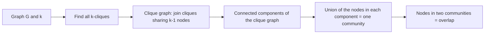
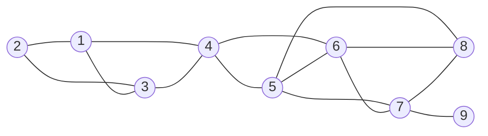
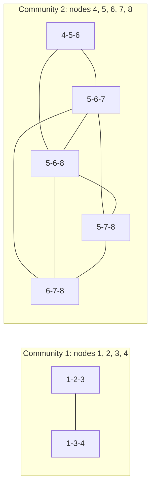

**Ek line mein:** <mark>Clique Percolation Method (CPM) communities dhoondhta hai: wo k-cliques jodta hai jo k-1 nodes share karte hain; aise cliques ke beech hop karke jo kuch pahunche ja sake wo ek community hai, aur communities overlap kar sakti hain</mark>. <Cite id="social-network-graphs-palla2005" /> <Cite id="social-network-graphs-wiki-cpm" />

<Box kind="key">

**Har CPM question mein ye points likho:**

- <mark>k-clique wo group hai jisme k nodes hon aur har pair connected ho</mark> (k = 3: triangle).
- <mark>Do k-cliques adjacent hain agar wo k-1 nodes share karein</mark> (k = 3: do nodes, yaani ek edge).
- Algorithm: <mark>saare k-cliques dhoondho; clique graph banao (har clique ek node, adjacent hon to edge); uske connected components lo; ek component ke nodes ka union ek community hai</mark>.
- <mark>Jo node do components ke cliques mein ho wo dono communities ka hai: communities overlap karti hain.</mark> Jo node kisi k-clique mein nahi wo kisi community mein nahi.
- Bada k kam, dense communities deta hai; <mark>k = 3 aam shuruaat hai</mark>.
- Check: jitne triangles likhe unki ginti kisi doosre tareeke se bhi match kare (jaise ek 4-clique mein 4 triangles hote hain).

</Box>

## Core answer (5 marks, yahan ke har question ke liye): method

<Box kind="definition">

The **Clique Percolation Method (CPM)** (Palla et al., 2005) finds communities in a graph by joining small cliques. A **$k$-clique** is a group of $k$ nodes where every pair is connected (for $k = 3$, a triangle). Two $k$-cliques are **adjacent** if they share $k-1$ nodes. A community is everything reachable by hopping between adjacent $k$-cliques. <Cite id="social-network-graphs-palla2005" /> <Cite id="social-network-graphs-wiki-cpm" />

</Box>

**Kyun chahiye:** real life mein insaan kayi groups mein hota hai (ghar, college, hobby). CPM communities ko **overlap** hone deta hai, jo Girvan-Newman jaise methods nahi karte. <Cite id="social-network-graphs-cs224w-overlap" />

**Analogy.** Graph pe ek triangle wala stamp ghumao: do corners fixed rakho aur teesre ko naye node pe ghumao. Stamp jo kuch pahunch sake wo ek community hai.

**Algorithm (CPM)**, input graph $G$ aur integer $k \ge 3$:

1. $G$ ke saare $k$-cliques dhoondho.
2. **Clique graph** banao: har $k$-clique ek node, aur do cliques ke beech edge agar wo $k-1$ nodes share karein.
3. Clique graph ke connected components dhoondho.
4. Ek component ke cliques ke nodes ka union ek community hai.
5. Jo node kayi components ke cliques mein ho wo overlap node hai. Jo node kisi $k$-clique mein nahi wo kisi community mein nahi.

<Cite id="social-network-graphs-wiki-cpm" loc="diagram" />

**Conclusion:** <mark>CPM un triangles ko communities banata hai jo do nodes share karte hain, aur nodes ek se zyada community ke ho sakte hain</mark>.

## Extended answer (10 marks): ye add karo

### 1. Ek poora worked sum

Graph mein nodes 1 se 9 aur edges 1-2, 1-3, 1-4, 2-3, 3-4, 4-5, 4-6, 5-6, 5-7, 5-8, 6-7, 6-8, 7-8, 7-9 hain. $k = 3$ lo.

<Sum>

<Given>

Upar wala graph, $k = 3$.

</Given>

<Find>

3-cliques aur CPM se mili communities.

</Find>

<Steps>

1. **Saare triangles dhoondho.** \{1, 2, 3\}, \{1, 3, 4\}, \{4, 5, 6\}, \{5, 6, 7\}, \{5, 6, 8\}, \{5, 7, 8\}, \{6, 7, 8\}. Yaani 7 triangles. Node 9 ka sirf ek edge (7-9) hai, isliye wo kisi triangle mein nahi.
2. **$k - 1 = 2$ nodes share karne wale triangles ko jodo.** \{1, 2, 3\} aur \{1, 3, 4\} 1 aur 3 share karte hain. \{4, 5, 6\} aur \{5, 6, 7\} 5 aur 6 share karte hain. Triangles \{5, 6, 7\}, \{5, 6, 8\}, \{5, 7, 8\} aur \{6, 7, 8\} ek doosre ke saath do nodes share karte hain (jaise \{5, 6, 7\} aur \{6, 7, 8\} 6 aur 7 share karte hain), isliye wo \{4, 5, 6\} wali chain mein judte hain.
3. \{1, 3, 4\} aur \{4, 5, 6\} sirf node 4 share karte hain (ek node, do nahi), isliye wo **nahi** jude.
4. **Clique graph ke components.** Pehla: \{1, 2, 3\} aur \{1, 3, 4\}. Doosra: \{4, 5, 6\}, \{5, 6, 7\}, \{5, 6, 8\}, \{5, 7, 8\}, \{6, 7, 8\}.
5. **Nodes ka union.** Community 1 $= \{1, 2, 3, 4\}$. Community 2 $= \{4, 5, 6, 7, 8\}$.

</Steps>

<Answer>

Do communities: \{1, 2, 3, 4\} aur \{4, 5, 6, 7, 8\}. Node 4 dono mein hai (overlap). Node 9 kisi mein nahi.

</Answer>

<Box kind="verify">

Triangles ginne ka doosra tareeka: \{5, 6, 7, 8\} mein saare 6 possible edges hain, isliye wo 4-clique hai jisme $\binom{4}{3} = 4$ triangles hain. \{4, 5, 6\}, \{1, 2, 3\} aur \{1, 3, 4\} jodo to $4 + 3 = 7$, jo step 1 se match karta hai. $k = 4$ ke saath sirf 4-clique \{5, 6, 7, 8\} hai, isliye ek hi community milegi.

</Box>

</Sum>

<Cite id="social-network-graphs-cs224w-overlap" loc="diagram" />

### 2. k chunna, aur limits

- Bada $k$ kam, dense communities deta hai; $k = 3$ aam shuruaat hai.
- Bade graphs mein cliques dhoondhna slow ho sakta hai, aur jo nodes kisi $k$-clique mein nahi (jaise 9) wo bahar rah jaate hain. <Cite id="social-network-graphs-networkx-kclique" /> <Cite id="social-network-graphs-wiki-bron-kerbosch" />

### 3. CPM vs Girvan-Newman

| Point | CPM | Girvan-Newman |
|---|---|---|
| Idea | k-1 nodes share karne wale cliques jodo | High-betweenness edges hatao |
| Overlap | Allowed | Allowed nahi (har node ek community mein) |
| Kisi clique mein na hone wale nodes | Bahar rehte hain | Hamesha kisi community mein |

## Har question mein kaise fit karein

- **"What is clique percolation method? Write an algorithm on (CPM). Also show how the CPM finds clique for the following graph. Explain with steps."** (10 marks) <PYQ id="2024-05/q5b" />: definition aur paanch-step algorithm (core answer), phir section 1 ka worked sum graph, triangle list, linking aur do communities ke saath, aur clique-graph diagram.
- **"Write an algorithm for the Clique Percolation Method and discover the communities in the given below graph using Clique Percolation Method with clique k=3."** (10 marks) <PYQ id="2024-12-ce/q5a" />: paanch-step algorithm, phir figure pe lagao. Node names P1, P2, P3, Q1, Q2, Q3, R2, R3 (upar, beech aur neeche ki rows) ke saath triangles \{P1, P2, Q1\}, \{P2, Q1, Q2\}, \{Q2, Q3, R2\}, \{Q2, Q3, R3\}, \{Q2, R2, R3\}, \{Q3, R2, R3\} hain; pehle do do nodes share karte hain, aur aakhri chaar bhi, par \{P2, Q1, Q2\} aur \{Q2, Q3, R2\} sirf Q2 share karte hain. Communities: \{P1, P2, Q1, Q2\} aur \{Q2, Q3, R2, R3\}, Q2 pe overlap; P3 kisi mein nahi. Nodes ke naam apne paper ki figure ke hisaab se badal lo.

## Exam tips

- **Hamesha draw karo:** graph, triangles ki list, aur chhota clique graph jo dikhaye kaunse triangles jude hain.
- **Jodne ka rule** likho: $k-1$ nodes share karein (triangles ke liye do nodes). Sirf ek node share karna kaafi **nahi** hai.
- End mein overlap nodes aur bahar rahe nodes likho; isse dikhta hai ki aapne CPM samjha.

Exam mein English mein likho.
