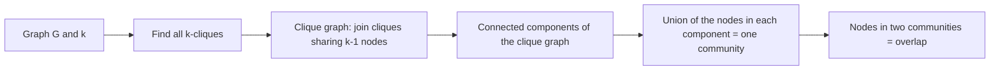
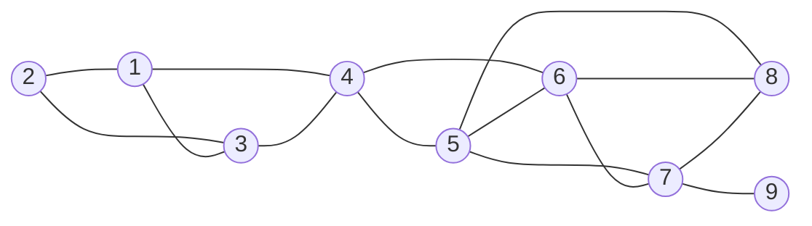
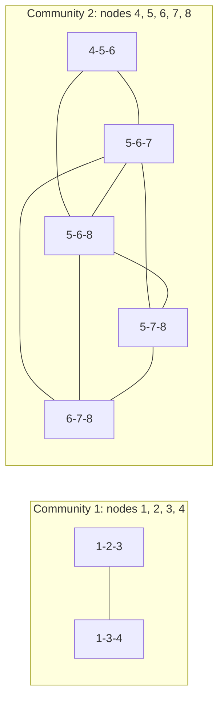

**In one line:** <mark>The Clique Percolation Method (CPM) finds communities by joining k-cliques that share k-1 nodes; everything reachable by hopping between such cliques is one community, and communities may overlap</mark>. <Cite id="social-network-graphs-palla2005" /> <Cite id="social-network-graphs-wiki-cpm" />

<Box kind="key">

**Key points to write (any CPM question):**

- <mark>A k-clique is a group of k nodes where every pair is connected</mark> (k = 3: a triangle).
- <mark>Two k-cliques are adjacent if they share k-1 nodes</mark> (k = 3: two nodes, an edge).
- Algorithm: <mark>find all k-cliques; build a clique graph (one node per clique, edge if adjacent); take its connected components; the union of the nodes in a component is one community</mark>.
- <mark>A node in cliques of two components belongs to both: communities overlap.</mark> A node in no k-clique belongs to no community.
- Larger k gives fewer, denser communities; <mark>k = 3 is the usual start</mark>.
- Check: the number of triangles you list equals the count you get another way (for example, a 4-clique holds 4 triangles).

</Box>

## Core answer (5 marks, fits every question here): the method

<Box kind="definition">

The **Clique Percolation Method (CPM)** (Palla et al., 2005) finds communities in a graph by joining small cliques. A **$k$-clique** is a group of $k$ nodes where every pair is connected (for $k = 3$, a triangle). Two $k$-cliques are **adjacent** if they share $k-1$ nodes. A community is everything reachable by hopping between adjacent $k$-cliques. <Cite id="social-network-graphs-palla2005" /> <Cite id="social-network-graphs-wiki-cpm" />

</Box>

**Why it is needed:** in real life a person belongs to several groups (home, college, hobby). CPM allows communities to **overlap**, which methods like Girvan-Newman do not. <Cite id="social-network-graphs-cs224w-overlap" />

**Analogy.** Roll a triangular stamp over the graph: keep two corners fixed and swing the third to a new node. Everything the stamp can reach is one community.

**Algorithm (CPM)** with input graph $G$ and integer $k \ge 3$:

1. Find all $k$-cliques of $G$.
2. Build a **clique graph**: one node per $k$-clique, with an edge between two cliques if they share $k-1$ nodes.
3. Find the connected components of the clique graph.
4. The union of the nodes of the cliques in one component is one community.
5. A node in cliques of several components is an overlap node. A node in no $k$-clique belongs to no community.

<Cite id="social-network-graphs-wiki-cpm" loc="diagram" />

**Conclusion:** <mark>CPM turns triangles that share two nodes into communities, and nodes can belong to more than one</mark>.

## Extended answer (10 marks): add these

### 1. A full worked sum

The graph has nodes 1 to 9 and edges 1-2, 1-3, 1-4, 2-3, 3-4, 4-5, 4-6, 5-6, 5-7, 5-8, 6-7, 6-8, 7-8, 7-9. Take $k = 3$.

<Sum>

<Given>

The graph above with $k = 3$.

</Given>

<Find>

the 3-cliques and the communities found by CPM.

</Find>

<Steps>

1. **Find all triangles.** \{1, 2, 3\}, \{1, 3, 4\}, \{4, 5, 6\}, \{5, 6, 7\}, \{5, 6, 8\}, \{5, 7, 8\}, \{6, 7, 8\}. That is 7 triangles. Node 9 has one edge only (7-9), so it is in no triangle.
2. **Link triangles that share $k - 1 = 2$ nodes.** \{1, 2, 3\} and \{1, 3, 4\} share 1 and 3. \{4, 5, 6\} and \{5, 6, 7\} share 5 and 6. Triangles \{5, 6, 7\}, \{5, 6, 8\}, \{5, 7, 8\} and \{6, 7, 8\} share two nodes with one another (for example \{5, 6, 7\} and \{6, 7, 8\} share 6 and 7), so they join the same chain as \{4, 5, 6\}.
3. \{1, 3, 4\} and \{4, 5, 6\} share only node 4 (one node, not two), so they are **not** linked.
4. **Components of the clique graph.** First: \{1, 2, 3\} and \{1, 3, 4\}. Second: \{4, 5, 6\}, \{5, 6, 7\}, \{5, 6, 8\}, \{5, 7, 8\}, \{6, 7, 8\}.
5. **Union of nodes.** Community 1 $= \{1, 2, 3, 4\}$. Community 2 $= \{4, 5, 6, 7, 8\}$.

</Steps>

<Answer>

Two communities: \{1, 2, 3, 4\} and \{4, 5, 6, 7, 8\}. Node 4 is in both (overlap). Node 9 is in none.

</Answer>

<Box kind="verify">

Another way to count triangles: \{5, 6, 7, 8\} has all 6 possible edges, so it is a 4-clique holding $\binom{4}{3} = 4$ triangles. Add \{4, 5, 6\}, \{1, 2, 3\} and \{1, 3, 4\} to get $4 + 3 = 7$, matching step 1. With $k = 4$ the only 4-clique is \{5, 6, 7, 8\}, so you would get one community.

</Box>

</Sum>

<Cite id="social-network-graphs-cs224w-overlap" loc="diagram" />

### 2. Choosing k, and limits

- A bigger $k$ gives fewer, denser communities; $k = 3$ is the usual start.
- Finding cliques can be slow on big graphs, and nodes outside any $k$-clique (like 9) are left out. <Cite id="social-network-graphs-networkx-kclique" /> <Cite id="social-network-graphs-wiki-bron-kerbosch" />

### 3. CPM versus Girvan-Newman

| Point | CPM | Girvan-Newman |
|---|---|---|
| Idea | Join cliques that share k-1 nodes | Remove high-betweenness edges |
| Overlap | Allowed | Not allowed (each node in one community) |
| Nodes outside every clique | Left out | Always placed in some community |

## Fit it to each question

- **"What is clique percolation method? Write an algorithm on (CPM). Also show how the CPM finds clique for the following graph. Explain with steps."** (10 marks) <PYQ id="2024-05/q5b" />: definition and the five-step algorithm (core answer), then the worked sum of section 1 with the graph, the triangle list, the linking and the two communities, and the clique-graph diagram.
- **"Write an algorithm for the Clique Percolation Method and discover the communities in the given below graph using Clique Percolation Method with clique k=3."** (10 marks) <PYQ id="2024-12-ce/q5a" />: the five-step algorithm, then apply it to the figure. With node names P1, P2, P3, Q1, Q2, Q3, R2, R3 (top, middle and bottom rows), the triangles are \{P1, P2, Q1\}, \{P2, Q1, Q2\}, \{Q2, Q3, R2\}, \{Q2, Q3, R3\}, \{Q2, R2, R3\}, \{Q3, R2, R3\}; the first two share two nodes, and so do the last four, but \{P2, Q1, Q2\} and \{Q2, Q3, R2\} share only Q2. Communities: \{P1, P2, Q1, Q2\} and \{Q2, Q3, R2, R3\}, overlapping at Q2; P3 is in none. Rename the nodes as in your paper's figure.

## Exam tips

- **Always draw:** the graph, the list of triangles, and the small clique graph that shows which triangles are linked.
- State the **rule for linking**: share $k-1$ nodes (two nodes for triangles). Sharing only one node is **not** enough.
- Write the overlap nodes and the left-out nodes at the end; they show you understood CPM.
