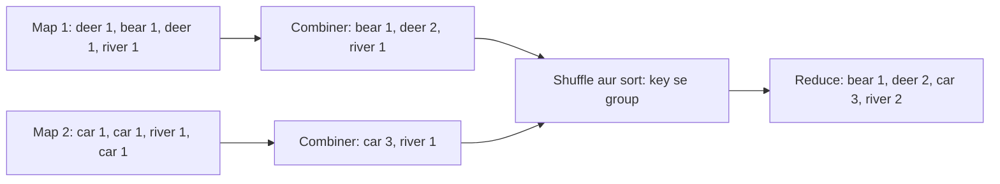

**Ek line mein:** <mark>Shuffle aur sort ek key ki saari values ko sorted order mein ek reducer tak laate hain, reducer unhe combine karta hai, aur optional combiner map output ko local pe pehle add karke network traffic kam karta hai</mark>. <Cite id="hadoop-ecosystem-mmds" loc="§2.2" /> <Cite id="hadoop-ecosystem-dean2004" loc="§4.3" />

<Box kind="key">

**Combiner, shuffle aur sort, reducer ke question mein ye points likho:**

- <mark>Shuffle: har reducer apna bucket har map task se network pe copy karta hai</mark>.
- <mark>Sort: pairs key se sort hote hain aur equal keys (key, list of values) ki tarah group hoti hain</mark>.
- <mark>Reducer: har key pe ek baar chalta hai, list combine karta hai aur final output HDFS mein likhta hai</mark>.
- <mark>Combiner: map node pe mini reducer jo shuffle se pehle map output ko add kar deta hai</mark>.
- <mark>Combiner sirf optimisation hai: iske saath ya bina answer same hona chahiye</mark>.
- <mark>Ye sirf associative aur commutative operations ke liye chalta hai (sum, count, max, min), seedhe average ke liye nahi</mark>.
- Partitioner: **hash(key) mod R** reducer tay karta hai.

</Box>

## Core answer (5 marks, yahan ke har question ke liye)

<Box kind="definition">

A **combiner** is a small reduce function run on the mapper's own node, on the mapper's own output, before the shuffle. It adds up (car,1), (car,1), (car,1) to (car,3) locally, so less data moves over the network. <Cite id="hadoop-ecosystem-mmds" loc="§2.2.4" /> <Cite id="hadoop-ecosystem-dean2004" loc="§4.3" />

</Box>

**Map aur output ke beech ke steps:** <Cite id="mapreduce-gfg-mr" />

1. **Combiner (optional):** har map node pe pairs ko pehle sum karta hai.
2. **Partition:** har pair bucket hash(key) mod R mein jata hai, isliye same key hamesha same reducer ke paas jati hai.
3. **Shuffle:** har reducer apna bucket saare map tasks se copy karta hai.
4. **Sort aur merge:** reducer pieces ko merge karta hai taki equal keys saath aayein, (key, [v1, v2, ...]) milta hai.
5. **Reduce:** har key pe ek call list ko add ya combine karke (key, result) HDFS mein emit karta hai.

<Cite id="mapreduce-gfg-wordcount" loc="diagram" /> <Cite id="mapreduce-av" loc="diagram" />

| Point | Combiner | Reducer |
|---|---|---|
| Kahan chalta hai | Mapper ke node pe, apne output pe | Reducer node pe, ek key ke saare data pe |
| Purpose | Network pe bheja data kam karna | Final result banana |
| Zaroori? | Nahi, optional, zero ya zyada baar chal sakta hai | Haan |
| Condition | Operation associative aur commutative ho | Koi nahi |

**Conclusion:** <mark>combiner network traffic bachata hai, shuffle aur sort keys group karte hain, aur reducer final answer deta hai</mark>.

## Extended answer (10 marks): ye add karo

### 1. Combiner kyun help karta hai, numbers ke saath

Teen mappers `deer bear deer river`, `car car river car` aur `deer car bear bear` padhte hain. Map output 12 pairs hai; combiner ke baad $3 + 2 + 3 = 8$ pairs, yani shuffle mein **4 pairs kam**. Final counts same: bear 3, deer 3, car 4, river 2 (total 12, input words ke barabar). <Cite id="mapreduce-gfg-wordcount" />

### 2. Average mein savdhani kyun

<Sum>

<Given>

One key has values 1, 2, 3 on mapper A and 10 on mapper B.

</Given>

<Find>

the true average, the wrong "average of averages", and the right combiner method.

</Find>

<Steps>

1. True average $= (1+2+3+10) \div 4 = 4$.
2. Wrong combiner: A sends average 2, B sends average 10, the reducer gives $(2 + 10) \div 2 = 6$. *Reason: it gives A (3 values) and B (1 value) equal weight.*
3. Right combiner: send (sum, count): A sends (6, 3), B sends (10, 1). The reducer adds $6 + 10 = 16$ and $3 + 1 = 4$, then divides: $16 \div 4 = 4$.

</Steps>

<Answer>

True average 4. Average of averages gives 6 (wrong). The (sum, count) method gives 4 (right).

</Answer>

<Box kind="verify">

The (sum, count) totals are the totals of the whole data, so the result does not depend on how values are split between mappers. A combiner may run zero or many times, so its output must be safe to combine again.

</Box>

</Sum>

### 3. Shuffle aur sort detail mein

- **Partitioner:** default hash(key) mod R hai, isliye ek key kabhi do reducers mein nahi bantti.
- **Map side:** output memory buffer mein rehta hai, phir local disk pe spill hota hai **pehle se partitioned aur sorted** (aur combined). Spill files end mein merge hoti hain.
- **Reduce side:** shuffle job ki akeli badi network movement hai. Reduce function tabhi shuru hota hai jab **saare** maps khatam ho jayein. <Cite id="hadoop-ecosystem-apache-mr-tutorial" />
- Reducer ko apni keys **sorted order** mein milti hain, har ek ki poori values list ke saath.

### 4. Reducer phase

Ek reduce task apne bucket ke groups leta hai; reduce function har key pe ek baar chalta hai. Output HDFS mein `part-r-00000`, `part-r-00001` ki tarah jata hai, har reducer ka ek file. <Cite id="hadoop-ecosystem-mmds" loc="§2.2.3" />

## Har question mein kaise fit karein

- **"Explain Shuffle & Sort phase and Reducer phase in Map Reduce."** (5 marks) <PYQ id="2025-05-ce/q1b" />: core answer ke steps 2 se 5 aur diagram, section 3 aur 4 do-do line mein. Combiner pe yahan sirf ek line chahiye.
- **"What is the role of a combiner in the map reduce framework? Explain with the help of an example."** (5 marks) <PYQ id="2025-12-ce/q1a" />: combiner ki definition, section 1 ka **word count example** (12 pairs se 8), combiner versus reducer table aur condition (associative aur commutative).

## Exam tips

- Combiner ke liye **hamesha word count example numbers ke saath** do (12 pairs se 8).
- **Condition** likho: associative aur commutative, aur average wali galti extra point ki tarah.
- Shuffle aur sort mein **partition, copy, merge** isi order mein likho.
