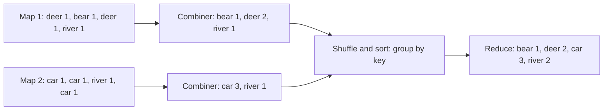

**In one line:** <mark>Shuffle and sort bring all values of the same key to one reducer in sorted order, the reducer then combines them, and an optional combiner pre-adds the map output locally to cut network traffic</mark>. <Cite id="hadoop-ecosystem-mmds" loc="§2.2" /> <Cite id="hadoop-ecosystem-dean2004" loc="§4.3" />

<Box kind="key">

**Key points to write (combiner, shuffle and sort, reducer):**

- <mark>Shuffle: each reducer copies its bucket from every map task over the network</mark>.
- <mark>Sort: the pairs are sorted by key and equal keys are grouped as (key, list of values)</mark>.
- <mark>Reducer: called once per key, combines the list and writes the final output to HDFS</mark>.
- <mark>Combiner: a mini reducer on the map node that adds up map output before the shuffle</mark>.
- <mark>Combiner is only an optimisation: the answer must be the same with or without it</mark>.
- <mark>It works only for associative and commutative operations (sum, count, max, min), not for plain average</mark>.
- Partitioner: **hash(key) mod R** decides the reducer.

</Box>

## Core answer (5 marks, fits every question here)

<Box kind="definition">

A **combiner** is a small reduce function run on the mapper's own node, on the mapper's own output, before the shuffle. It adds up (car,1), (car,1), (car,1) to (car,3) locally, so less data moves over the network. <Cite id="hadoop-ecosystem-mmds" loc="§2.2.4" /> <Cite id="hadoop-ecosystem-dean2004" loc="§4.3" />

</Box>

**Steps between map and output:** <Cite id="mapreduce-gfg-mr" />

1. **Combiner (optional):** pre-sums the pairs on each map node.
2. **Partition:** each pair goes to bucket hash(key) mod R, so the same key always goes to the same reducer.
3. **Shuffle:** every reducer copies its bucket from all map tasks.
4. **Sort and merge:** the reducer merges the pieces so equal keys sit together, giving (key, [v1, v2, ...]).
5. **Reduce:** one call per key adds or combines the list and emits (key, result) to HDFS.

<Cite id="mapreduce-gfg-wordcount" loc="diagram" /> <Cite id="mapreduce-av" loc="diagram" />

| Point | Combiner | Reducer |
|---|---|---|
| Runs on | Mapper's node, on its own output | Reducer node, on all data for a key |
| Purpose | Reduce data sent over the network | Produce the final result |
| Required? | No, optional, may run zero or more times | Yes |
| Condition | Operation must be associative and commutative | None |

**Conclusion:** <mark>the combiner saves network traffic, shuffle and sort group the keys, and the reducer gives the final answer</mark>.

## Extended answer (10 marks): add these

### 1. Why the combiner helps, with numbers

Three mappers read `deer bear deer river`, `car car river car` and `deer car bear bear`. Map output is 12 pairs; after the combiner it is $3 + 2 + 3 = 8$ pairs, so **4 pairs fewer** are shuffled. The final counts are the same: bear 3, deer 3, car 4, river 2 (total 12, equal to the number of input words). <Cite id="mapreduce-gfg-wordcount" />

### 2. Why average needs care

<Sum>

<Given>

One key has values 1, 2, 3 on mapper A and 10 on mapper B.

</Given>

<Find>

the true average, the wrong "average of averages", and the right combiner method.

</Find>

<Steps>

1. True average $= (1+2+3+10) \div 4 = 4$.
2. Wrong combiner: A sends average 2, B sends average 10, the reducer gives $(2 + 10) \div 2 = 6$. *Reason: it gives A (3 values) and B (1 value) equal weight.*
3. Right combiner: send (sum, count): A sends (6, 3), B sends (10, 1). The reducer adds $6 + 10 = 16$ and $3 + 1 = 4$, then divides: $16 \div 4 = 4$.

</Steps>

<Answer>

True average 4. Average of averages gives 6 (wrong). The (sum, count) method gives 4 (right).

</Answer>

<Box kind="verify">

The (sum, count) totals are the totals of the whole data, so the result does not depend on how values are split between mappers. A combiner may run zero or many times, so its output must be safe to combine again.

</Box>

</Sum>

### 3. Shuffle and sort in more detail

- **Partitioner:** the default is hash(key) mod R, so one key is never split between two reducers.
- **Map side:** the output is held in a memory buffer, then spilled to local disk **already partitioned and sorted** (and combined). The spill files are merged at the end.
- **Reduce side:** the shuffle is the only big network movement in the job. The reduce function starts only after **all** maps finish. <Cite id="hadoop-ecosystem-apache-mr-tutorial" />
- The reducer sees its keys in **sorted order**, each with the full list of values.

### 4. Reducer phase

One reduce task takes the groups of its bucket; the reduce function is called once per key. Output goes to HDFS as `part-r-00000`, `part-r-00001`, one file per reducer. <Cite id="hadoop-ecosystem-mmds" loc="§2.2.3" />

## Fit it to each question

- **"Explain Shuffle & Sort phase and Reducer phase in Map Reduce."** (5 marks) <PYQ id="2025-05-ce/q1b" />: core answer steps 2 to 5 and the diagram, with section 3 and 4 in two lines each. The combiner needs only one line here.
- **"What is the role of a combiner in the map reduce framework? Explain with the help of an example."** (5 marks) <PYQ id="2025-12-ce/q1a" />: the combiner definition, the **word count example** from section 1 (12 pairs reduced to 8), the combiner versus reducer table and the condition (associative and commutative).

## Exam tips

- For the combiner **always use the word count example with numbers** (12 pairs down to 8).
- Write the **condition**: associative and commutative, and give the average pitfall as an extra point.
- In shuffle and sort, name **partition, copy, merge** in that order.
