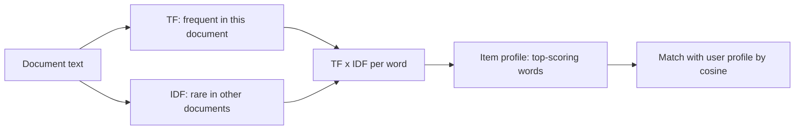

**Ek line mein:** <mark>Content-based recommendation har item ko uski properties se describe karta hai, user ne kya pasand kiya uska profile banata hai, aur wo unseen items recommend karta hai jinki properties us profile ke sabse paas hain</mark>. <Cite id="recommendation-systems-mmds-book" loc="Ch. 9" /> <Cite id="recommendation-systems-google-cb" />

<Box kind="key">

**Har content-based question mein ye points likho:**

- <mark>Wo items recommend karo jo user ke pasand kiye items jaise hon, item ki apni properties se judge karke</mark> (genre, actors, keywords), doosre users se nahi.
- Chaar steps: <mark>item profile, user profile, match (cosine similarity), top items recommend</mark>.
- Text ke liye item profile: <mark>TF-IDF, document ke important words</mark>.
- <mark>TF = term is document mein kitni baar aaya (sabse frequent term ke count se divide). IDF = log2(N / n_i), term saare documents mein kitna rare hai. TF-IDF = TF x IDF.</mark>
- Jo word har document mein hai uska $n_i = N$, isliye <mark>IDF = 0</mark> aur wo bekaar hai.
- Advantages: <mark>doosre users nahi chahiye, naye items pe kaam, explain kar sakta hai</mark>. Disadvantages: <mark>achhe features chahiye, over-specialisation, naye user ka cold start</mark>.

</Box>

## Core answer (5 marks, yahan ke har question ke liye)

<Box kind="definition">

A **content-based recommender** suggests items similar to the items a user liked before, where "similar" is judged from the item's own properties (genre, cast, important words). <Cite id="recommendation-systems-mmds-slides" /> <Cite id="recommendation-systems-gfg-cb" />

</Box>

**Kyun chahiye:** shop ya streaming site mein itne items hote hain jitne koi browse nahi kar sakta. Content-based filtering ko doosre users ka data nahi chahiye, isliye naye item ya chhoti site pe bhi kaam karta hai. <Cite id="recommendation-systems-google-cb" />

**Steps:** <Cite id="web-bda-2-mmds-recsys" loc="slides 15-17" />

1. **Item profile:** har item ko features ke vector se describe karo: movie ko genre, director aur actors se (1 = hai, 0 = nahi); text ko uske important words (TF-IDF) se.
2. **User profile:** user ne jo items pasand kiye ya high rate kiye unke profiles ko combine (average) karo.
3. **Match:** user profile aur har unseen item ke beech similarity nikalo, aam taur pe cosine: $\cos(u, i) = \dfrac{u \cdot i}{\lVert u \rVert \, \lVert i \rVert}$.
4. Top-scoring items **recommend** karo.

<Cite id="recommendation-systems-gfg-cb" loc="diagram" />

**TF aur IDF ek jagah.** Word document ko tab achhe se describe karta hai jab wo **us document mein frequent (TF)** ho par **baaki documents mein rare (IDF)** ho. Score $\text{TF} \times \text{IDF}$ hai. <Cite id="recommendation-systems-wiki-tfidf" />

**Conclusion:** <mark>content-based filtering wo products recommend karta hai jinki properties user ke pehle pasand kiye items se match karti hain</mark>.

## Extended answer (10 marks): ye add karo

### 1. TF aur IDF detail mein

Document $j$ mein term $i$ ka **TF (term frequency)**, jahan $f_{ij}$ wo count hai ki $i$, $j$ mein kitni baar aaya:

$$
\text{TF}_{ij} = \frac{f_{ij}}{\max_k f_{kj}}
$$

**IDF (inverse document frequency).** $N$ documents mein se $n_i$ mein term $i$ ho to:

$$
\text{IDF}_i = \log_2 \frac{N}{n_i}, \qquad \text{TF-IDF}_{ij} = \text{TF}_{ij} \times \text{IDF}_i
$$

"the" jaisa word har document mein hai, isliye $n_i = N$, IDF $= 0$ aur uska score 0. Doosri books aur libraries thode alag versions use karti hain, isliye likh do ki aap kaunsa use kar rahe ho. <Cite id="web-bda-2-sklearn-tfidf" />

**Example.** $N = 8$ articles. Article 1 mein "robot" 6 baar (sabse zyada), "movie" 4 baar aata hai. "Robot" 2 articles mein hai aur "movie" saare 8 mein.

| Word | TF | IDF | TF-IDF |
|---|---|---|---|
| robot | 6/6 = 1 | $\log_2(8/2) = 2$ | 2 |
| movie | 4/6 = 0.67 | $\log_2(8/8) = 0$ | 0 |

"Robot" article 1 ko describe karta hai. "Movie" har jagah common hai, isliye bekaar.

### 2. Worked example: movie recommendation

<Sum>

<Given>

Features (Action, Sci-fi, Romance), 1 = hai, 0 = nahi. Pasand kiye: M1 = (1, 1, 0), M2 = (1, 0, 0). Unseen: M3 = (0, 0, 1), M4 = (1, 1, 1), M5 = (0, 1, 0).

</Given>

<Find>

pehle kaunsi unseen movie recommend karein.

</Find>

<Steps>

1. **User profile** = M1 aur M2 ka average $= ((1+1)/2, (1+0)/2, (0+0)/2) = (1, 0.5, 0)$. *Reason: user ko Action poori tarah pasand hai aur Sci-fi aadhi baar.* Uski length $\sqrt{1 + 0.25 + 0} = 1.118$.
2. **M3:** dot product $= 1\cdot0 + 0.5\cdot0 + 0\cdot1 = 0$, isliye cosine $= 0$.
3. **M4:** dot $= 1 + 0.5 + 0 = 1.5$; M4 ki length $= \sqrt3 = 1.732$; cosine $= 1.5 / (1.118 \times 1.732) = 0.775$.
4. **M5:** dot $= 0.5$; length 1; cosine $= 0.5 / 1.118 = 0.447$.
5. Cosine se rank: M4, M5, M3.

</Steps>

<Answer>

M4 recommend karo (0.775), phir M5 (0.447); M3 (0) recommend nahi hoti.

</Answer>

<Box kind="verify">

Common sense bhi yahi kehta hai: M4 mein Action aur Sci-fi hain, dono pasand; M5 mein sirf Sci-fi; M3 pure Romance hai, jisme user ne kabhi interest nahi dikhaya. Aur $\sqrt{1.25} \times \sqrt{3} = \sqrt{3.75} = 1.936$.

</Box>

</Sum>

### 3. Case study: movie streaming app

User ne *Inception* aur *Interstellar* pasand ki. App har movie ko genre features se describe karta hai, pasand ki movies se user profile banata hai, aur unseen movies ko cosine similarity se rank karta hai, isliye *The Matrix* kisi romance se pehle dikhti hai. Music services bhi yahi karti hain: Pandora ka Music Genome Project songs ko attributes se describe karta hai. <Cite id="recommendation-systems-wiki-genome" />

### 4. Advantages aur disadvantages

| Advantages | Disadvantages |
|---|---|
| Doosre users ka data nahi chahiye, isliye naye items ka cold start nahi | Achhe features dhoondhna mushkil (music, images, video) |
| Naye aur unpopular items recommend kar sakta hai | Over-specialisation: sirf usi jaisa aur |
| Wajah bata sakta hai (shared genre ya actor) | Naye user ka profile nahi (cold start) |

<Cite id="recommendation-systems-wiki-recsys" />

## Har question mein kaise fit karein

- **"How recommendation is done based on properties of product? Elaborate with a suitable example."** (10 marks) <PYQ id="2022-12-ce/q6b" />: core answer (chaar steps, flowchart) + section 2 (worked example) + section 4. Example mein product (movie ya book) lo.
- **"How recommendation is done based on properties of the product? Explain with the help of an example."** (10 marks) <PYQ id="2023-12-ce/q6b" />: wahi answer.
- **"Justify the use of a Content-Based Recommendation System with a specific case study."** (10 marks) <PYQ id="2024-12-ce/q6b" />: marks justification pe lagao: advantages (section 4: doosre users nahi, naye items, explainable, unusual tastes) aur section 3 ka case study, flowchart ke saath; limits aur "aksar collaborative filtering ke saath combine hota hai" bhi jodo.
- **"Explain Movie recommendation using Content-based filtering."** (10 marks) <PYQ id="2025-05/q5b" />: core answer jisme items movies hain, worked example (section 2), plot text ke liye TF-IDF (section 1), aur advantages table.
- **"Describe terms TF and IDF with respect to content based filtering"** (5 marks) <PYQ id="2025-12-ce/q1c" />: "TF aur IDF ek jagah" wali line, phir section 1 poora (dono formulas, robot aur movie table) aur ek line ki top words item profile kaise banate hain.

## Exam tips

- **Hamesha draw karo:** flowchart (items, item profiles, user profile, cosine, top-N).
- Formulas likho: **TF = f / max f**, **IDF = log2(N / n_i)**, **cosine = u.i / (|u||i|)**.
- Saaf likho ki match **item properties se hota hai, doosre users se nahi**; collaborative filtering se yehi farq hai.

Exam mein English mein likho.
