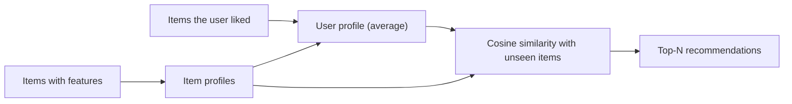
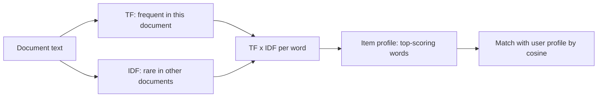

**In one line:** <mark>Content-based recommendation describes every item by its properties, builds a profile of what the user liked, and recommends the unseen items whose properties are closest to that profile</mark>. <Cite id="recommendation-systems-mmds-book" loc="Ch. 9" /> <Cite id="recommendation-systems-google-cb" />

<Box kind="key">

**Key points to write (any content-based question):**

- <mark>Recommend items similar to what the user liked, judged by the item's own properties</mark> (genre, actors, keywords), not by other users.
- Four steps: <mark>item profile, user profile, match (cosine similarity), recommend the top items</mark>.
- Item profile for text: <mark>TF-IDF, the important words of the document</mark>.
- <mark>TF = how often a term appears in this document (divided by the count of the most frequent term). IDF = log2(N / n_i), how rare the term is across all documents. TF-IDF = TF x IDF.</mark>
- A word in every document has $n_i = N$, so <mark>IDF = 0</mark> and it is useless.
- Advantages: <mark>needs no other users, works for new items, can explain</mark>. Disadvantages: <mark>needs good features, over-specialisation, new-user cold start</mark>.

</Box>

## Core answer (5 marks, fits every question here)

<Box kind="definition">

A **content-based recommender** suggests items similar to the items a user liked before, where "similar" is judged from the item's own properties (genre, cast, important words). <Cite id="recommendation-systems-mmds-slides" /> <Cite id="recommendation-systems-gfg-cb" />

</Box>

**Why it is needed:** a shop or a streaming site has far more items than anyone can browse. Content-based filtering needs no data from other users, so it works for a new item or a small site. <Cite id="recommendation-systems-google-cb" />

**Steps:** <Cite id="web-bda-2-mmds-recsys" loc="slides 15-17" />

1. **Item profile:** describe each item by a vector of features: a movie by genre, director and actors (1 = has it, 0 = does not); a text by its important words (TF-IDF).
2. **User profile:** combine (average) the profiles of the items the user liked or rated high.
3. **Match:** compute the similarity, usually cosine, between the user profile and each unseen item: $\cos(u, i) = \dfrac{u \cdot i}{\lVert u \rVert \, \lVert i \rVert}$.
4. **Recommend** the top-scoring items.

<Cite id="recommendation-systems-gfg-cb" loc="diagram" />

**TF and IDF in one place.** A word describes a document well if it is **frequent in that document (TF)** but **rare in the other documents (IDF)**. The score is $\text{TF} \times \text{IDF}$. <Cite id="recommendation-systems-wiki-tfidf" />

**Conclusion:** <mark>content-based filtering recommends the products whose properties match what the user already liked</mark>.

## Extended answer (10 marks): add these

### 1. TF and IDF in detail

**TF (term frequency)** of term $i$ in document $j$, where $f_{ij}$ is the number of times $i$ appears in $j$:

$$
\text{TF}_{ij} = \frac{f_{ij}}{\max_k f_{kj}}
$$

**IDF (inverse document frequency).** With $N$ documents and $n_i$ of them containing term $i$:

$$
\text{IDF}_i = \log_2 \frac{N}{n_i}, \qquad \text{TF-IDF}_{ij} = \text{TF}_{ij} \times \text{IDF}_i
$$

A word such as "the" is in every document, so $n_i = N$, IDF $= 0$ and its score is 0. Other books and libraries use slightly different versions, so write which one you use. <Cite id="web-bda-2-sklearn-tfidf" />

**Example.** $N = 8$ articles. In article 1 "robot" appears 6 times (the most), "movie" 4 times. "Robot" is in 2 articles and "movie" in all 8.

| Word | TF | IDF | TF-IDF |
|---|---|---|---|
| robot | 6/6 = 1 | $\log_2(8/2) = 2$ | 2 |
| movie | 4/6 = 0.67 | $\log_2(8/8) = 0$ | 0 |

"Robot" describes article 1. "Movie" is common everywhere, so it is useless.

### 2. A worked example: movie recommendation

<Sum>

<Given>

Features (Action, Sci-fi, Romance) as 1 = has it, 0 = does not. Liked: M1 = (1, 1, 0), M2 = (1, 0, 0). Unseen: M3 = (0, 0, 1), M4 = (1, 1, 1), M5 = (0, 1, 0).

</Given>

<Find>

which unseen movie to recommend first.

</Find>

<Steps>

1. **User profile** = average of M1 and M2 $= ((1+1)/2, (1+0)/2, (0+0)/2) = (1, 0.5, 0)$. *Reason: the user likes Action fully and Sci-fi half the time.* Its length is $\sqrt{1 + 0.25 + 0} = 1.118$.
2. **M3:** dot product $= 1\cdot0 + 0.5\cdot0 + 0\cdot1 = 0$, so cosine $= 0$.
3. **M4:** dot $= 1 + 0.5 + 0 = 1.5$; length of M4 $= \sqrt3 = 1.732$; cosine $= 1.5 / (1.118 \times 1.732) = 0.775$.
4. **M5:** dot $= 0.5$; length 1; cosine $= 0.5 / 1.118 = 0.447$.
5. Rank by cosine: M4, M5, M3.

</Steps>

<Answer>

recommend M4 (0.775), then M5 (0.447); M3 (0) is not recommended.

</Answer>

<Box kind="verify">

Common sense agrees: M4 has Action and Sci-fi, both liked; M5 has only Sci-fi; M3 is pure Romance, which the user never showed interest in. Also $\sqrt{1.25} \times \sqrt{3} = \sqrt{3.75} = 1.936$.

</Box>

</Sum>

### 3. Case study: a movie streaming app

A user liked *Inception* and *Interstellar*. The app describes each movie by genre features, builds the user profile from the liked movies, and ranks unseen movies by cosine similarity to it, so *The Matrix* is shown before a romance. Music services do the same: Pandora's Music Genome Project describes songs by attributes. <Cite id="recommendation-systems-wiki-genome" />

### 4. Advantages and disadvantages

| Advantages | Disadvantages |
|---|---|
| Needs no data from other users, so no cold start for new items | Good features are hard to find (music, images, video) |
| Can recommend new and unpopular items | Over-specialisation: only more of the same |
| Can explain the reason (shared genre or actor) | A new user has no profile (cold start) |

<Cite id="recommendation-systems-wiki-recsys" />

## Fit it to each question

- **"How recommendation is done based on properties of product? Elaborate with a suitable example."** (10 marks) <PYQ id="2022-12-ce/q6b" />: core answer (four steps, flowchart) + section 2 (worked example) + section 4. Use a product (movie or book) as the example.
- **"How recommendation is done based on properties of the product? Explain with the help of an example."** (10 marks) <PYQ id="2023-12-ce/q6b" />: the same answer.
- **"Justify the use of a Content-Based Recommendation System with a specific case study."** (10 marks) <PYQ id="2024-12-ce/q6b" />: spend the marks on the justification: advantages (section 4: no other users, new items, explainable, unusual tastes) and the case study of section 3, with the flowchart; add the limits and "often combined with collaborative filtering".
- **"Explain Movie recommendation using Content-based filtering."** (10 marks) <PYQ id="2025-05/q5b" />: core answer with movies as the items, the worked example (section 2), TF-IDF for the plot text (section 1), and the advantages table.
- **"Describe terms TF and IDF with respect to content based filtering"** (5 marks) <PYQ id="2025-12-ce/q1c" />: the "TF and IDF in one place" line, then section 1 in full (both formulas, the robot and movie table) and one line on how the top words form the item profile.

## Exam tips

- **Always draw:** the flowchart (items, item profiles, user profile, cosine, top-N).
- Write the formulas: **TF = f / max f**, **IDF = log2(N / n_i)**, **cosine = u.i / (|u||i|)**.
- Say clearly that the match uses **item properties, not other users**; that is the difference from collaborative filtering.
