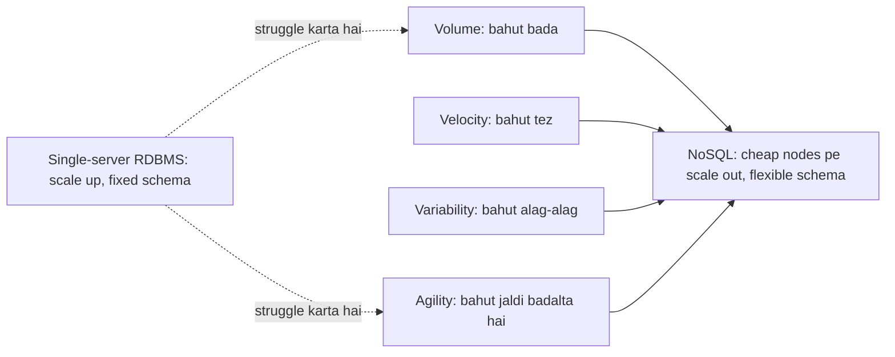
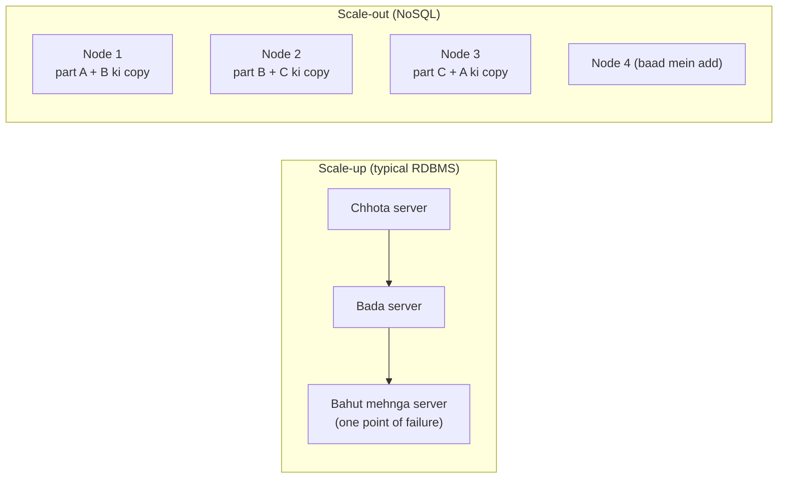

**Ek line mein:** <mark>NoSQL ke core business drivers volume, velocity, variability aur agility hain: data bahut bada, bahut tez, bahut alag-alag aur bahut jaldi badalne wala ho gaya, jo rigid single-server relational model ke liye bahut tha</mark>. <Cite id="big-data-intro-nosql" /> <Cite id="nosql-intro-ibm-nosql" />

<Box kind="key">

**NoSQL ke business drivers ke question mein ye points likho:**

- <mark>Volume: data terabytes aur petabytes tak badhta hai, isliye scale up nahi, cheap nodes pe scale out karna padta hai</mark>.
- <mark>Velocity: bahut tez reads aur writes aur users ke achanak burst</mark>.
- <mark>Variability: data ke kai shapes, isliye bahut NULL columns wala rigid schema fit nahi baithta</mark>.
- <mark>Agility: teams ko data layout badalna aur jaldi release karna padta hai</mark>.
- **Business driver** woh business need hai jo company ko technology badalne pe majboor karti hai.
- Volume aur velocity **size aur speed** ke baare mein hain; variability aur agility **badlav** ke baare mein.
- Har ek ke liye likho **RDBMS kyun struggle karta hai** aur **NoSQL kya karta hai**.

</Box>

## Core answer (5 marks, yahan ke har question ke liye)

<Box kind="definition">

**NoSQL** ("Not only SQL") is a group of databases (key-value, document, column family, graph) that do not use the fixed table-and-join model of an RDBMS and are built to run on clusters of cheap machines. A **business driver** is a business need that pushes a company to adopt it. <Cite id="big-data-intro-wiki-nosql" /> <Cite id="nosql-intro-gfg-intro" />

</Box>

McCreary aur Kelly chaar drivers batate hain: <Cite id="big-data-intro-nosql" />

| Driver | Business need | RDBMS kyun struggle karta hai | NoSQL kya karta hai |
|---|---|---|---|
| **Volume** | Data gigabytes se terabytes aur usse zyada (clicks, sensors, posts) | Ek server ki limit hai; bada server bahut mehnga | Bahut cheap nodes pe scale out |
| **Velocity** | Bahut tez reads aur writes, users ke achanak burst (sale, viral post) | Strict locking aur joins heavy load mein slow ho jate hain | Key se simple access, data nodes pe baanta, relaxed consistency |
| **Variability** | Data ke kai shapes; naye fields aate rehte hain | Har row fixed schema mein fit ho; bahut NULL columns; schema change takleef deta hai | Flexible, schema-less records |
| **Agility** | Features jaldi release karna aur data layout aksar badalna | Object-relational mismatch aur schema changes developers ko slow karte hain | Object jaisa hai waisa store (jaise JSON document) |

**Conclusion:** <mark>volume aur velocity speed aur size ke baare mein hain, variability aur agility badlav ke baare mein; saath mein unhone kaha ki data model simple rakho, data paas-paas rakho aur machines jodkar badho</mark>. <Cite id="nosql-intro-fowler-agg" />

## Extended answer (10 marks): ye add karo

### 1. Har driver kuch lines mein

- **Volume.** Click streams, sensor readings aur social posts terabytes tak badhte hain. Ek bada server (scale up) kharidna tezi se mehnga hota hai aur uski limit hai. NoSQL data ko bahut cheap nodes pe baantta hai (sharding) aur copies rakhta hai (replication). <Cite id="nosql-intro-aws-nosql" />
- **Velocity.** Sale ya viral post achanak bahut reads aur writes bhejti hai. Strict transactions, locks aur joins RDBMS ko slow karte hain. NoSQL stores simple key-based requests bahut nodes se ek saath handle karte hain.
- **Variability.** Products, profiles aur logs record-record mein alag hote hain. RDBMS ko har table ke liye ek fixed columns ka set chahiye, jisse bahut empty (NULL) cells aur takleefdeh schema changes hote hain. NoSQL har record ko uske apne fields ke saath rakhta hai.
- **Agility.** Developers code mein objects rakhte hain par RDBMS tables rakhta hai, isliye har change ke liye mapping aur schema change chahiye. Document store object ko JSON document ki tarah rakhta hai, isliye changes jaldi hote hain.

### 2. Scale up versus scale out

<Cite id="nosql-intro-gfg-intro" loc="diagram" />

### 3. Advantages aur jo keemat chukani padti hai

| Advantages | Limitations |
|---|---|
| Cheap machines pe scale out | Joins kamzor ya nahi; related data saath store |
| Flexible schema, jaldi badalta hai | Aksar sirf eventual consistency |
| Key se fast simple reads aur writes | Koi common query language nahi |
| Built-in replication aur availability | SQL se kam mature tools aur kam experts |

<Cite id="nosql-intro-ibm-nosql" /> <Cite id="nosql-intro-aws-nosql" />

### 4. Replacement nahi

SQL ya NoSQL har case mein behtar nahi. Bahut applications dono use karti hain (polyglot persistence): paise aur orders ke liye SQL, sessions, catalogues aur social data ke liye NoSQL.

## Har question mein kaise fit karein

- **"List and explain the core business drivers behind the NoSQL movement."** (5 marks) <PYQ id="2023-05-ce/q1b" /> <PYQ id="2024-05-ce/q1c" /> <PYQ id="2024-12-ce/q1c" />: sirf **core answer**: NoSQL pe ek line, chaar-driver table (time kam ho to need aur NoSQL jawab tak chhota karo), diagram aur ek line ka conclusion. Teeno ke liye wahi answer chalta hai, isliye ek baar yaad karo.

## Exam tips

- **Chaar words order mein yaad rakho**: volume, velocity, variability, agility. Ek driver chhoota to ek mark gaya.
- **Har driver ki ek line need aur ek line NoSQL ka jawab** do.
- Big data ke 5 V's se mix mat karo; ye **NoSQL** ke drivers hain, aur variability aur agility yahan alag hain.
