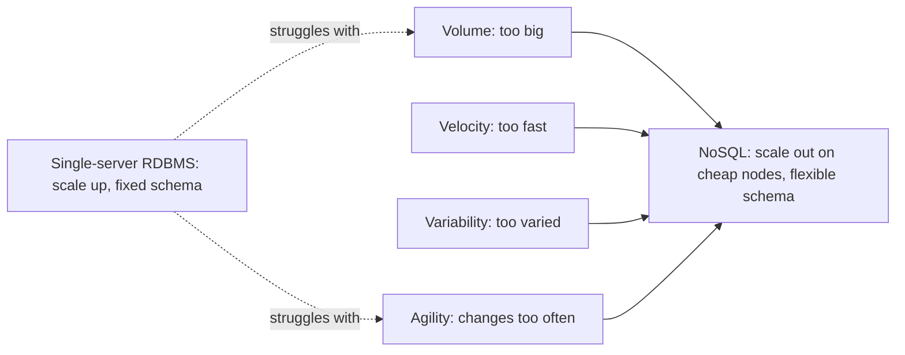
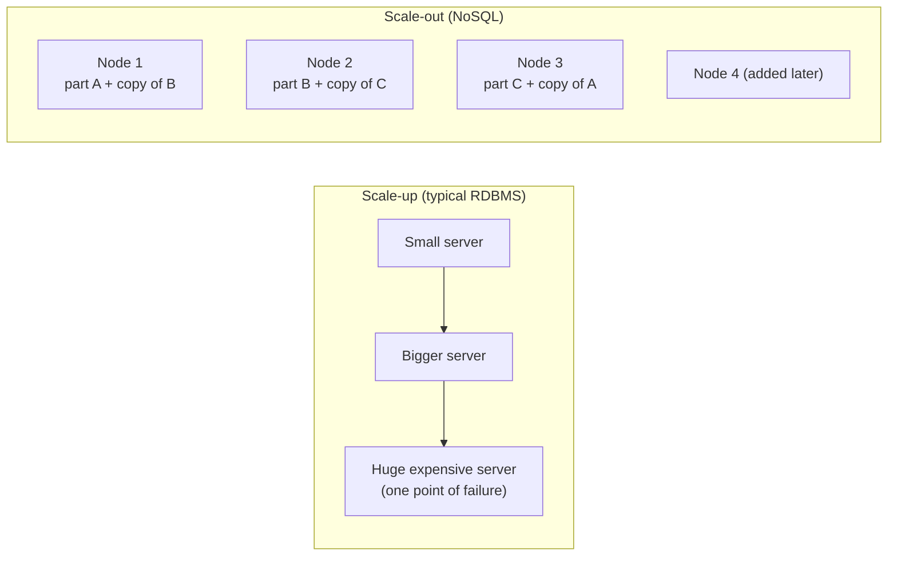

**In one line:** <mark>The core business drivers behind NoSQL are volume, velocity, variability and agility: data became too big, too fast, too varied and too quickly changing for the rigid single-server relational model</mark>. <Cite id="big-data-intro-nosql" /> <Cite id="nosql-intro-ibm-nosql" />

<Box kind="key">

**Key points to write (business drivers of NoSQL):**

- <mark>Volume: data grows to terabytes and petabytes, so we must scale out on cheap nodes, not scale up</mark>.
- <mark>Velocity: very fast reads and writes and sudden bursts of users</mark>.
- <mark>Variability: data of many shapes, so a rigid schema with many NULL columns does not fit</mark>.
- <mark>Agility: teams must change the data layout and release quickly</mark>.
- A **business driver** is a business need that pushes a company to change technology.
- Volume and velocity are about **size and speed**; variability and agility are about **change**.
- Explain **why an RDBMS struggles** and **what NoSQL does** for each.

</Box>

## Core answer (5 marks, fits every question here)

<Box kind="definition">

**NoSQL** ("Not only SQL") is a group of databases (key-value, document, column family, graph) that do not use the fixed table-and-join model of an RDBMS and are built to run on clusters of cheap machines. A **business driver** is a business need that pushes a company to adopt it. <Cite id="big-data-intro-wiki-nosql" /> <Cite id="nosql-intro-gfg-intro" />

</Box>

McCreary and Kelly name four drivers: <Cite id="big-data-intro-nosql" />

| Driver | The business need | Why an RDBMS struggles | What NoSQL does |
|---|---|---|---|
| **Volume** | Data grows from gigabytes to terabytes and beyond (clicks, sensors, posts) | One server has a limit; a bigger one costs far more | Scale out over many cheap nodes |
| **Velocity** | Very fast reads and writes, sudden bursts of users (a sale, a viral post) | Strict locking and joins slow down under heavy load | Simple access by key, data spread over nodes, relaxed consistency |
| **Variability** | Data of many shapes; new fields appear often | Every row must fit the fixed schema; many NULL columns; schema changes hurt | Flexible, schema-less records |
| **Agility** | Release features quickly and change data layout often | Object-relational mismatch and schema changes slow developers | Store the object as it is (for example a JSON document) |

**Conclusion:** <mark>volume and velocity are about speed and size, variability and agility are about change; together they said keep the data model simple, store data close together and grow by adding machines</mark>. <Cite id="nosql-intro-fowler-agg" />

## Extended answer (10 marks): add these

### 1. Each driver in a few lines

- **Volume.** Click streams, sensor readings and social posts grow to terabytes. Buying one bigger server (scale up) gets steeply expensive and has a limit. NoSQL spreads data over many cheap nodes (sharding) and keeps copies (replication). <Cite id="nosql-intro-aws-nosql" />
- **Velocity.** A sale or a viral post sends sudden bursts of reads and writes. Strict transactions, locks and joins slow an RDBMS. NoSQL stores answer simple key-based requests from many nodes at once.
- **Variability.** Products, profiles and logs differ from record to record. An RDBMS needs one fixed set of columns per table, giving many empty (NULL) cells and painful schema changes. NoSQL keeps each record with its own fields.
- **Agility.** Developers keep objects in code but an RDBMS keeps tables, so each change needs mapping and a schema change. A document store keeps the object as a JSON document, so changes are quick.

### 2. Scale up versus scale out

<Cite id="nosql-intro-gfg-intro" loc="diagram" />

### 3. Advantages and the price paid

| Advantages | Limitations |
|---|---|
| Scales out on cheap machines | Weak or no joins; related data stored together |
| Flexible schema, fast to change | Often only eventual consistency |
| Fast simple reads and writes by key | No common query language |
| Built-in replication and availability | Less mature tools and fewer experts than SQL |

<Cite id="nosql-intro-ibm-nosql" /> <Cite id="nosql-intro-aws-nosql" />

### 4. Not a replacement

Neither SQL nor NoSQL is better in every case. Many applications use both (polyglot persistence): SQL for money and orders, NoSQL for sessions, catalogues and social data.

## Fit it to each question

- **"List and explain the core business drivers behind the NoSQL movement."** (5 marks) <PYQ id="2023-05-ce/q1b" /> <PYQ id="2024-05-ce/q1c" /> <PYQ id="2024-12-ce/q1c" />: the **core answer** only: one line on NoSQL, the four-driver table (shorten to need and NoSQL answer if short of time), the diagram, and the one-line conclusion. The same answer fits all three, so learn it once.

## Exam tips

- **Learn the four words in order**: volume, velocity, variability, agility. A missing driver costs a mark.
- **Give each driver one line of need and one line of NoSQL answer.**
- Do not mix with the 5 V's of big data; these are the drivers of **NoSQL**, and variability and agility are specific to it.
