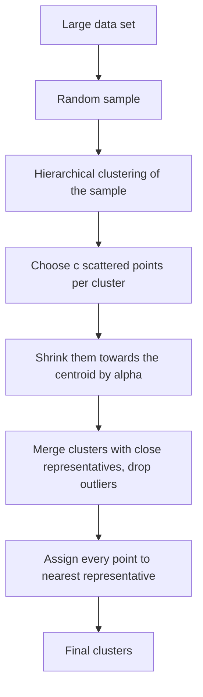

**Ek line mein:** <mark>CURE (Clustering Using REpresentatives) har cluster ko kuch well-scattered points se describe karta hai jo centre ki taraf khiske hote hain, isliye wo kisi bhi shape ke clusters dhoondhta hai, outliers ko ignore karta hai aur sampling se bade data pe chalta hai</mark>. <Cite id="cure-stream-clustering-guha1998" loc="§1.2" /> <Cite id="cure-stream-clustering-basile-slides" loc="slides 26-30" />

<Box kind="key">

**Har CURE question mein ye points likho:**

- <mark>CURE = Clustering Using REpresentatives</mark>, bade data ke liye hierarchical method, Euclidean space mein (Guha, Rastogi, Shim, 1998).
- Cluster ko <mark>c well-scattered representative points</mark> se describe karte hain, ek centre (k-means) ya saare points se nahi.
- <mark>Har representative ko centroid ki taraf alpha fraction shrink karo</mark> (jaise 0.2); isse outliers ka asar kam hota hai.
- Steps: <mark>sample, sample ko hierarchically cluster, representatives chuno, shrink, jin clusters ke representatives paas hon unhe merge, aur saare points ko nearest representative ke cluster mein label</mark>.
- Advantages: <mark>arbitrary shapes, alag sizes, outlier-resistant, sampling se scalable</mark>.
- Limits: parameters chahiye (c, alpha, sample size, k) aur Euclidean space.

</Box>

## Core answer (5 marks, yahan ke har question ke liye)

<Box kind="definition">

**CURE (Clustering Using REpresentatives)** is a clustering algorithm for large data sets. Instead of one centre point (like k-means) or all points, it represents each cluster by a few **well-scattered representative points**, moved a little towards the cluster centre. <Cite id="cure-stream-clustering-guha1998" loc="§1.2" /> <Cite id="cure-stream-clustering-wiki-cure" />

</Box>

**Kyun chahiye:** k-means sirf round, ek jaise size ke clusters dhoondhta hai aur outliers se khichta hai; hierarchical clustering bade data ke liye bahut slow hai. CURE dono ke beech mein hai: kuch representatives shape pakad lete hain aur fast hain. <Cite id="cure-stream-clustering-guha1998" loc="§1.1" />

**Steps:**

1. Data ka random **sample** lo jo memory mein aa jaye (bahut bade data mein sample ko bhi partition karte hain).
2. **Sample ko hierarchically cluster karo**: har point ek cluster se shuru, sabse paas wala pair baar baar merge, jab tak $k$ clusters bachein.
3. **Representatives chuno:** har cluster mein $c$ well-scattered points (pehla centroid se sabse door, har agla pehle chune hue points se sabse door).
4. Har representative ko centroid ki taraf $\alpha$ fraction **shrink** karo: $p_{\text{new}} = p + \alpha(\text{centroid} - p)$.
5. Do clusters **merge** karo agar unke koi representatives paas hon, aur naye representatives chuno. Chhote, dheere badhne wale clusters ko outliers maanke hata do.
6. **Saare data ko label karo:** har point us cluster mein jaata hai jiska representative sabse paas hai.

<Cite id="cure-stream-clustering-gfg-cure" loc="diagram" />

**Conclusion:** <mark>shrunken representative points aur sampling se CURE odd shapes pe zyada accurate, outliers ke prati robust aur scalable hai</mark>.

## Extended answer (10 marks): ye add karo

### 1. Representatives aur shrinking kyun kaam karte hain

- **Scattered points** lambe ya curved cluster ki shape pakadte hain; ek centre point nahi pakad sakta.
- **Shrinking** door ke points ko andar kheenchti hai, isliye ek bhatka hua point ya outliers ka patla bridge do clusters ko galat se jodta nahi. Door ke points sabse zyada khiskte hain.
- Example: centroid $(5, 5)$, representative $(9, 9)$, $\alpha = 0.2$: naya point $= 9 + 0.2(5 - 9) = 8.2$ har coordinate mein, yaani $(8.2, 8.2)$. <Cite id="cure-stream-clustering-basile-slides" loc="slides 26-30" />

### 2. Merge ke liye cluster distance

Do clusters ka distance unke **sabse paas wale representatives ke pair** ka distance hai. Sabse paas wala pair merge karo, phir naye representatives dono clusters ke purane representatives mein se chuno (saare points mein se nahi), isliye cost chhoti rehti hai.

### 3. Traditional clustering ke mukable advantages

| Point | k-means / centroid methods | CURE |
|---|---|---|
| Cluster shape | Sirf round (spherical) | Arbitrary shapes, jaise lambe ya ring-jaise clusters |
| Cluster size | Ek jaise sizes pasand | Alag sizes handle karta hai |
| Outliers | Centroid ko kheenchte hain | Shrinking aur outlier removal asar kam karte hain |
| Large data | Saare data pe kayi passes | Sample + ek labelling pass |
| Representation | Ek centre | Har cluster ke kayi representatives |

<Cite id="cure-stream-clustering-tp-cure" /> <Cite id="web-bda-2-sklearn-clustering" />

### 4. Limitations

- Parameters $c$, $\alpha$, sample size aur $k$ chahiye.
- Euclidean space mein chalta hai, kyunki centroids use karta hai.
- Chhota sample ek chhote cluster ko miss kar sakta hai. <Cite id="cure-stream-clustering-gfg-cure" />

## Har question mein kaise fit karein

- **"Explain CURE algorithm."** (10 marks) <PYQ id="2023-12/q4b" /> <PYQ id="2024-05/q6b" />: core answer (steps aur flowchart) + sections 1 aur 2 + advantages table.
- **"Cure Algorithm."** (10 marks) <PYQ id="2025-05/q6b" />: wahi answer: definition, chhe steps, flowchart, shrink example, advantages aur limitations.
- **"Explain CURE algorithm with its advantages over traditional clustering algorithm."** (10 marks) <PYQ id="2024-12/q6a" />: core answer, phir extra marks section 3 pe lagao: k-means aur hierarchical clustering ke saath poori comparison table, aur chaaron advantages sentences mein.

## Exam tips

- **Hamesha draw karo:** flowchart, aur ek cluster ki chhoti picture jisme representatives centre ki taraf khiske hon.
- Shrink line likho: **"move each representative a fraction alpha (for example 20 percent) towards the centroid"**.
- Common galti: ye likhna ki CURE sirf centroid use karta hai. Wo **kayi representatives** use karta hai aur centroid sirf shrink karne ki disha ke liye hai.

Exam mein English mein likho.
