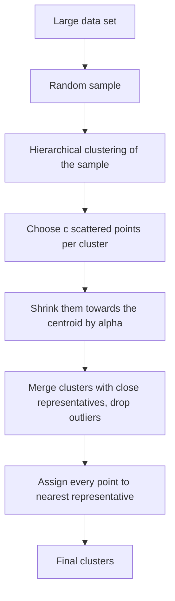

**In one line:** <mark>CURE (Clustering Using REpresentatives) describes each cluster by a few well-scattered points moved towards the centre, so it finds clusters of any shape, ignores outliers and works on big data by sampling</mark>. <Cite id="cure-stream-clustering-guha1998" loc="§1.2" /> <Cite id="cure-stream-clustering-basile-slides" loc="slides 26-30" />

<Box kind="key">

**Key points to write (any CURE question):**

- <mark>CURE = Clustering Using REpresentatives</mark>, a hierarchical method for large data in Euclidean space (Guha, Rastogi, Shim, 1998).
- A cluster is described by <mark>c well-scattered representative points</mark>, not by one centre (k-means) or all points.
- <mark>Shrink each representative towards the centroid by a fraction alpha</mark> (for example 0.2); this reduces the effect of outliers.
- Steps: <mark>sample, cluster the sample hierarchically, pick representatives, shrink, merge clusters whose representatives are close, label all points by the nearest representative</mark>.
- Advantages: <mark>arbitrary shapes, different sizes, outlier-resistant, scalable by sampling</mark>.
- Limits: needs parameters (c, alpha, sample size, k) and a Euclidean space.

</Box>

## Core answer (5 marks, fits every question here)

<Box kind="definition">

**CURE (Clustering Using REpresentatives)** is a clustering algorithm for large data sets. Instead of one centre point (like k-means) or all points, it represents each cluster by a few **well-scattered representative points**, moved a little towards the cluster centre. <Cite id="cure-stream-clustering-guha1998" loc="§1.2" /> <Cite id="cure-stream-clustering-wiki-cure" />

</Box>

**Why it is needed:** k-means finds only round clusters of similar size and is pulled by outliers; hierarchical clustering is too slow for huge data. CURE sits between the two: a handful of representatives capture the shape and are fast. <Cite id="cure-stream-clustering-guha1998" loc="§1.1" />

**Steps:**

1. **Sample** the data randomly so it fits in memory (for huge data, partition the sample too).
2. **Cluster the sample hierarchically**: start with each point as a cluster and repeatedly merge the closest pair, until $k$ clusters are left.
3. **Pick representatives:** in each cluster choose $c$ well-scattered points (the first is the farthest from the centroid, each next is farthest from those already chosen).
4. **Shrink** each representative towards the centroid by a fraction $\alpha$: $p_{\text{new}} = p + \alpha(\text{centroid} - p)$.
5. **Merge** two clusters if any of their representatives are close, and choose new representatives. Remove tiny, slow-growing clusters as outliers.
6. **Label all data:** every point is assigned to the cluster of its nearest representative.

<Cite id="cure-stream-clustering-gfg-cure" loc="diagram" />

**Conclusion:** <mark>by using shrunken representative points and sampling, CURE is more accurate on odd shapes, more robust to outliers and scalable</mark>.

## Extended answer (10 marks): add these

### 1. Why representatives and shrinking work

- **Scattered points** capture the shape of a long or curved cluster; one centre point cannot.
- **Shrinking** pulls far points inward, so a stray point or a thin bridge of outliers does not join two clusters wrongly. Far points move most.
- Example: centroid $(5, 5)$, representative $(9, 9)$, $\alpha = 0.2$: new point $= 9 + 0.2(5 - 9) = 8.2$ in each coordinate, so $(8.2, 8.2)$. <Cite id="cure-stream-clustering-basile-slides" loc="slides 26-30" />

### 2. The cluster distance used for merging

The distance of two clusters is the distance between their **closest pair of representatives**. Merge the closest pair, then choose the new representatives from the old representatives of the two clusters (not from all their points), so the cost stays small.

### 3. Advantages over traditional clustering

| Point | k-means / centroid methods | CURE |
|---|---|---|
| Cluster shape | Round (spherical) only | Arbitrary shapes, such as long or ring-like clusters |
| Cluster size | Prefers similar sizes | Handles different sizes |
| Outliers | Pull the centroid | Shrinking and outlier removal reduce their effect |
| Large data | Needs many passes over all data | Works on a sample plus one labelling pass |
| Representation | One centre | Several representatives per cluster |

<Cite id="cure-stream-clustering-tp-cure" /> <Cite id="web-bda-2-sklearn-clustering" />

### 4. Limitations

- Needs the parameters $c$, $\alpha$, the sample size and $k$.
- Works in Euclidean space, because it uses centroids.
- A small cluster can be missed by a small sample. <Cite id="cure-stream-clustering-gfg-cure" />

## Fit it to each question

- **"Explain CURE algorithm."** (10 marks) <PYQ id="2023-12/q4b" /> <PYQ id="2024-05/q6b" />: core answer (steps and flowchart) + sections 1 and 2 + the advantages table.
- **"Cure Algorithm."** (10 marks) <PYQ id="2025-05/q6b" />: the same answer: definition, six steps, flowchart, shrink example, advantages and limitations.
- **"Explain CURE algorithm with its advantages over traditional clustering algorithm."** (10 marks) <PYQ id="2024-12/q6a" />: core answer, then spend the extra marks on section 3: the full comparison table with k-means and hierarchical clustering, with the four advantages written as sentences.

## Exam tips

- **Always draw:** the flowchart, and a small picture of a cluster with its representatives moved towards the centre.
- Write the shrink line: **"move each representative a fraction alpha (for example 20 percent) towards the centroid"**.
- Common mistake: saying CURE uses the centroid only. It uses **several representatives** and a centroid just to shrink towards.
