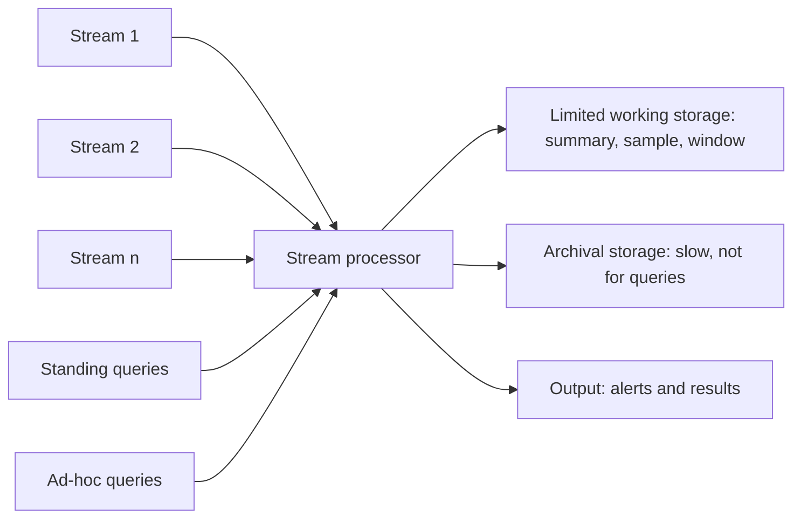
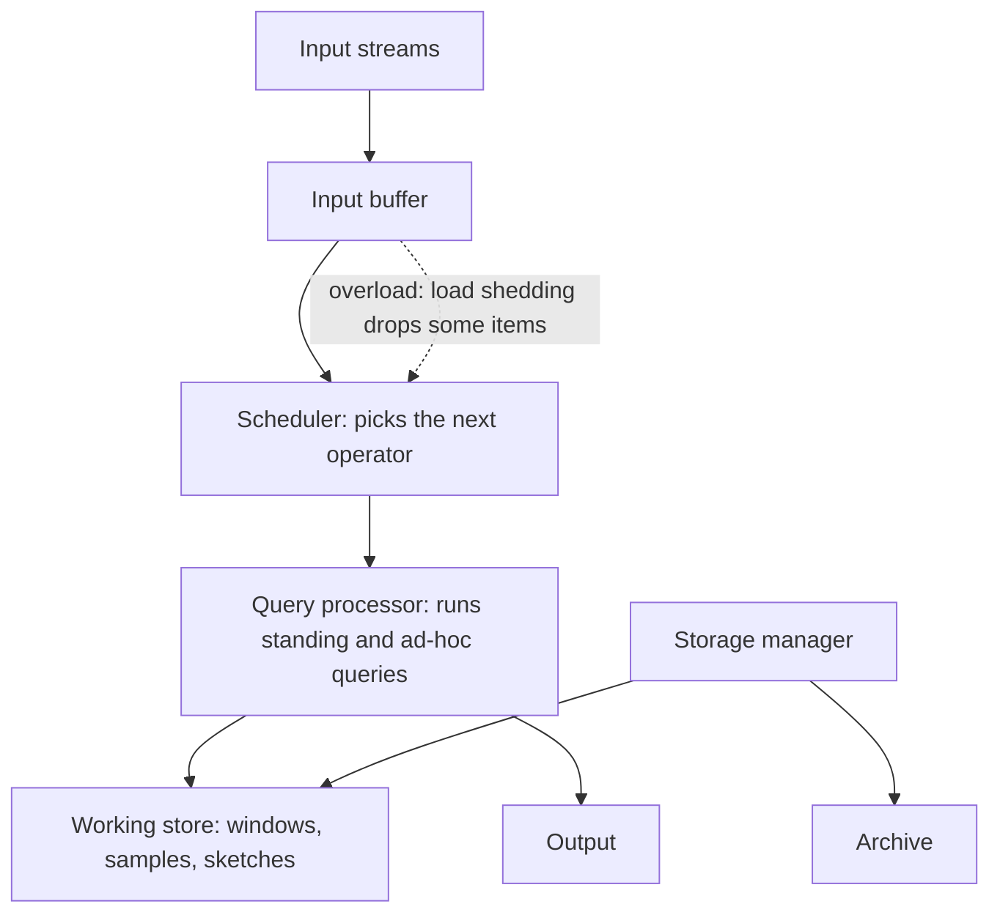

**Ek line mein:** <mark>Data Stream Management System (DSMS) tez, kabhi na khatam hone wali streams leta hai, limited memory mein sirf chhota summary rakhta hai, aur us par standing aur ad-hoc queries ke answer deta hai</mark>. <Cite id="stream-data-model-wiki-dsms" /> <Cite id="stream-data-model-babcock2002" />

<Box kind="key">

**Har DSMS architecture question mein ye points likho:**

- <mark>Kayi input streams ek stream processor mein aati hain</mark>; system unki speed control nahi kar sakta.
- <mark>Standing queries</mark> system mein stored hoti hain aur har naye element pe hamesha chalti hain.
- <mark>Ad-hoc queries</mark> kisi bhi moment pe pooche jaate hain; wo <mark>sirf limited working storage</mark> (window, sample, summary) use kar sakte hain.
- <mark>Archival storage</mark> poori stream ko baad ke offline analysis ke liye rakhta hai, par queries ke liye bahut slow hai.
- <mark>Output</mark>: alerts, results ya kisi aur system ko feed.
- DSMS har element ko <mark>sirf ek baar</mark> padhta hai aur aksar <mark>approximate</mark> answer deta hai.

</Box>

## Core answer (5 marks, yahan ke har question ke liye)

<Box kind="definition">

A **data stream** is a sequence of elements that arrive continuously and so fast that they cannot all be stored (sensor readings, clicks, stock ticks). A **Data Stream Management System (DSMS)** takes in streams and answers questions about them as the data flows past, using only a small amount of memory. <Cite id="stream-data-model-wiki-dsms" /> <Cite id="stream-data-model-babcock2002" />

</Box>

**DBMS kyun kaafi nahi:** DBMS pehle data store karta hai aur baad mein query karta hai, aur poora finite data set maanta hai. Stream endless, tez aur ek baar dekhi jaati hai, isliye system ko chhote summary se answer dena padta hai.

<Cite id="stream-data-model-cs246-slides" loc="slide 7" /> <Cite id="stream-counting-mmds-home" loc="§4.1" />

**Architecture ke parts:**

1. **Input streams:** kayi sources apni speed se elements bhejte hain. Har stream ek sequence hai, jaise (sensor id, time, temperature).
2. **Stream processor:** wo engine jo har element ek baar padhta hai aur answers update karta hai.
3. **Standing queries:** permanent queries (jaise "temperature 40 se upar jaye to alert") jo har naye element pe evaluate hoti hain.
4. **Ad-hoc queries:** kisi bhi time ek baar pooche gaye sawal (jaise "last 10 minutes mein kitne users login hue?").
5. **Limited working storage:** main memory (kabhi disk) jisme windows aur summaries hote hain, poori stream kabhi nahi.
6. **Archival storage:** bahut bada, slow storage (warehouse ya tape) jahan stream copy ho sakti hai; fast queries ke liye use nahi hota.
7. **Output:** results, alerts ya dashboards.

**Conclusion:** <mark>DSMS sirf windows aur summaries rakhke real-time answers deta hai, aur baaki archive kar deta hai</mark>. <Cite id="stream-data-model-geisler" />

## Extended answer (10 marks): ye add karo

### 1. Stream processor ke andar

- **Input buffer** elements ko process hone tak rakhta hai; **scheduler** decide karta hai kaunsa operator agla chalega.
- Overload mein system **load shed** kar sakta hai, yaani jaan-boojhkar kuch elements drop karna aur chhoti error accept karna. <Cite id="stream-data-model-geisler" /> <Cite id="stream-data-model-jiang" />
- Queries **sliding windows** (last $N$ items ya last $T$ minutes) use karti hain, kyunki purana data nahi rakha jaata.

### 2. Standing vs ad-hoc queries

| Point | Standing query | Ad-hoc query |
|---|---|---|
| Kab poocha jaata hai | Ek baar, phir hamesha chalti hai | Ek baar, user ke chune moment pe |
| Example | Ab tak ka highest temperature batao | Last 10 minutes ke logins |
| Data | Har naya element | Sirf working storage |
| Answer | Lagataar update hota hai | Abhi ek answer |

### 3. DSMS vs DBMS

| Point | DBMS | DSMS |
|---|---|---|
| Data | Stored, finite tables | Continuous, unbounded stream |
| Queries | One-time, demand pe | Continuous standing queries (aur ad-hoc) |
| Reads | Kayi passes allowed | Ek pass, har element ek baar |
| Memory | Bada disk | Chhoti main memory |
| Answers | Exact | Aksar approximate |

<Cite id="stream-data-model-gfg-dbms-dsms" />

### 4. Applications

Sensor networks, stock-market feeds, network traffic monitoring, web click analysis.

## Har question mein kaise fit karein

- **"With a neat sketch, explain the architecture of the data-stream management system."** (10 marks) <PYQ id="2022-12-ce/q4b" /> <PYQ id="2023-05-ce/q4b" /> <PYQ id="2025-05-ce/q4b" />: core answer (definition, bada diagram, saat parts) + sections 1 se 3. Sketch ka har box label karo.
- **"Draw a neat sketch, explain the architecture of the data-stream management system."** (10 marks) <PYQ id="2025-05/q4a" />: wahi answer; sketch se shuru karo, phir har box ko order mein samjhao, phir DBMS comparison.

## Exam tips

- **Hamesha draw karo:** left mein streams, beech mein processor (standing aur ad-hoc queries ke saath), aur right mein working storage, archive aur output. Sab label karo.
- Saaf likho: **"ad-hoc queries can use only the working store"** aur **"archive is too slow for queries"**.
- "Poori stream store karta hai" mat likho. DSMS sirf summary ya window rakhta hai.

Exam mein English mein likho.
