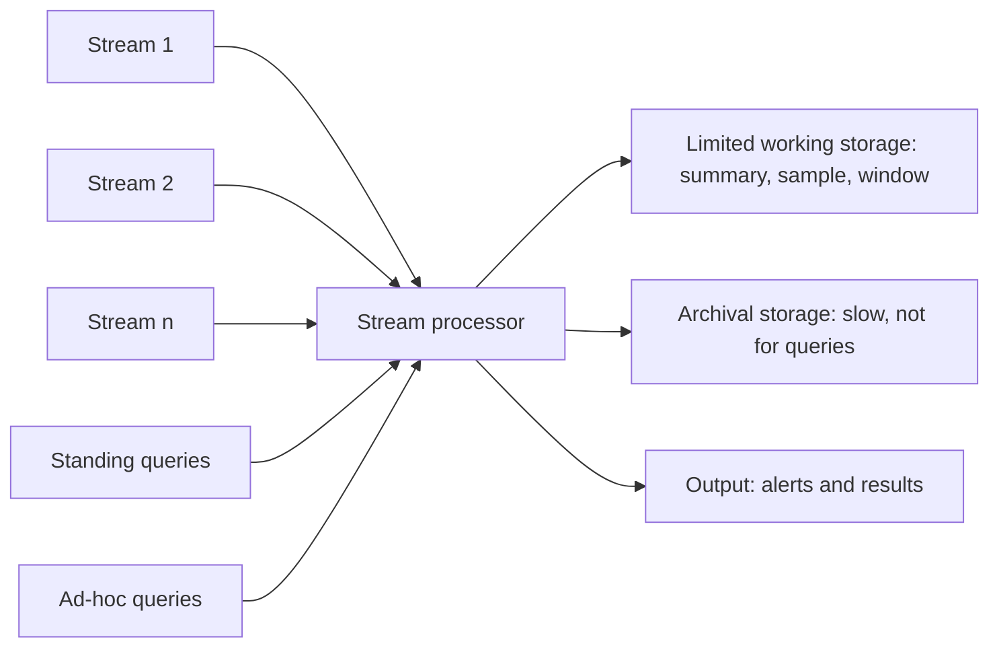
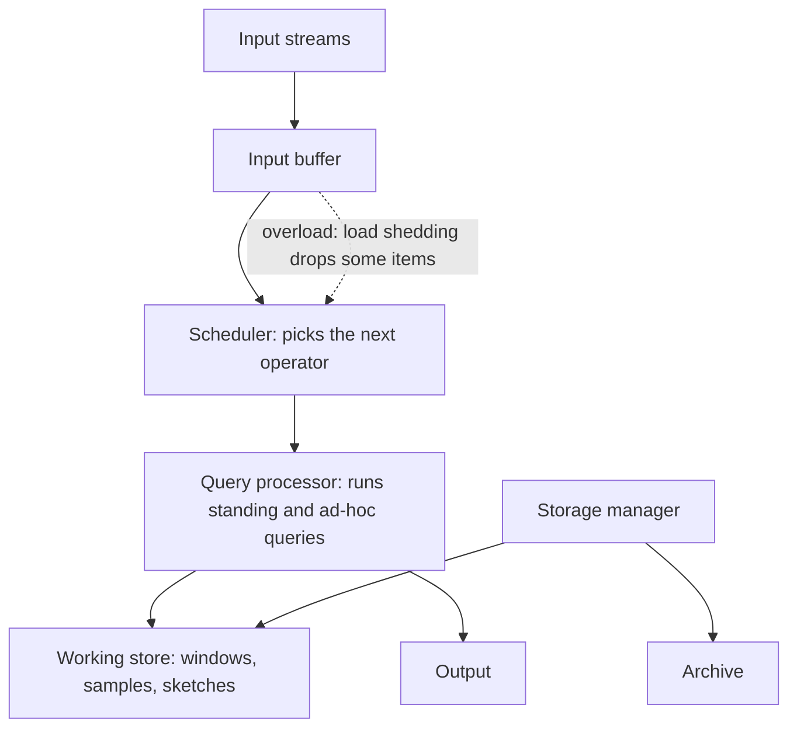

**In one line:** <mark>A Data Stream Management System (DSMS) takes in fast, endless streams, keeps only a small summary in limited memory, and answers standing and ad-hoc queries on it</mark>. <Cite id="stream-data-model-wiki-dsms" /> <Cite id="stream-data-model-babcock2002" />

<Box kind="key">

**Key points to write (any DSMS architecture question):**

- <mark>Several input streams enter one stream processor</mark>; the system cannot control their speed.
- <mark>Standing queries</mark> are stored in the system and run all the time on every new element.
- <mark>Ad-hoc queries</mark> are asked at any moment; they can use <mark>only the limited working storage</mark> (window, sample, summary).
- <mark>Archival storage</mark> keeps the full stream for later offline analysis, but it is too slow to answer queries.
- <mark>Output</mark>: alerts, results or a feed into another system.
- A DSMS reads each element <mark>once</mark> and gives often <mark>approximate</mark> answers.

</Box>

## Core answer (5 marks, fits every question here)

<Box kind="definition">

A **data stream** is a sequence of elements that arrive continuously and so fast that they cannot all be stored (sensor readings, clicks, stock ticks). A **Data Stream Management System (DSMS)** takes in streams and answers questions about them as the data flows past, using only a small amount of memory. <Cite id="stream-data-model-wiki-dsms" /> <Cite id="stream-data-model-babcock2002" />

</Box>

**Why a DBMS is not enough:** a DBMS stores data first and queries it later, and expects the full, finite data set. A stream is endless, fast and seen once, so the system must answer from a small summary.

<Cite id="stream-data-model-cs246-slides" loc="slide 7" /> <Cite id="stream-counting-mmds-home" loc="§4.1" />

**Parts of the architecture:**

1. **Input streams:** many sources send elements at their own rate. Each is a sequence such as (sensor id, time, temperature).
2. **Stream processor:** the engine that reads each element once and updates the answers.
3. **Standing queries:** permanent queries (for example "alert if temperature exceeds 40") evaluated on every new element.
4. **Ad-hoc queries:** questions asked once at any time (for example "how many users logged in during the last 10 minutes?").
5. **Limited working storage:** main memory (sometimes disk) holding windows and summaries, never the whole stream.
6. **Archival storage:** huge, slow storage (a warehouse or tape) where the stream may be copied; not used for fast queries.
7. **Output:** results, alerts or dashboards.

**Conclusion:** <mark>a DSMS gives real-time answers by keeping only windows and summaries, and archives the rest</mark>. <Cite id="stream-data-model-geisler" />

## Extended answer (10 marks): add these

### 1. Inside the stream processor

- An **input buffer** holds elements until they are processed; a **scheduler** decides which operator runs next.
- Under overload the system may **shed load**, that is, drop some elements on purpose and accept a small error. <Cite id="stream-data-model-geisler" /> <Cite id="stream-data-model-jiang" />
- Queries use **sliding windows** (the last $N$ items or the last $T$ minutes), because old data is not kept.

### 2. Standing versus ad-hoc queries

| Point | Standing query | Ad-hoc query |
|---|---|---|
| Asked | Once, then runs forever | Once, at a moment the user picks |
| Example | Report the highest temperature so far | Number of logins in the last 10 minutes |
| Data used | Every new element | Only working storage |
| Answer | Updated continuously | One answer now |

### 3. DSMS versus DBMS

| Point | DBMS | DSMS |
|---|---|---|
| Data | Stored, finite tables | Continuous, unbounded stream |
| Queries | One-time, on demand | Continuous standing queries (plus ad-hoc) |
| Reads | Many passes allowed | One pass, each element seen once |
| Memory | Large disk | Small main memory |
| Answers | Exact | Often approximate |

<Cite id="stream-data-model-gfg-dbms-dsms" />

### 4. Applications

Sensor networks, stock-market feeds, network traffic monitoring, web click analysis.

## Fit it to each question

- **"With a neat sketch, explain the architecture of the data-stream management system."** (10 marks) <PYQ id="2022-12-ce/q4b" /> <PYQ id="2023-05-ce/q4b" /> <PYQ id="2025-05-ce/q4b" />: core answer (definition, big diagram, seven parts) + sections 1 to 3. Label every box of the sketch.
- **"Draw a neat sketch, explain the architecture of the data-stream management system."** (10 marks) <PYQ id="2025-05/q4a" />: the same answer; start with the sketch, then explain each box in order, then the DBMS comparison.

## Exam tips

- **Always draw:** streams on the left, the processor in the middle with standing and ad-hoc queries, and working storage, archive and output on the right. Label all of them.
- Say clearly: **"ad-hoc queries can use only the working store"** and **"archive is too slow for queries"**.
- Do not write "stores the whole stream". A DSMS keeps only a summary or a window.
