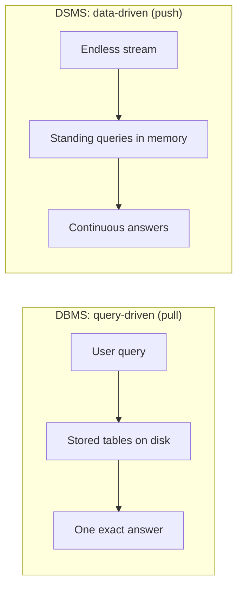
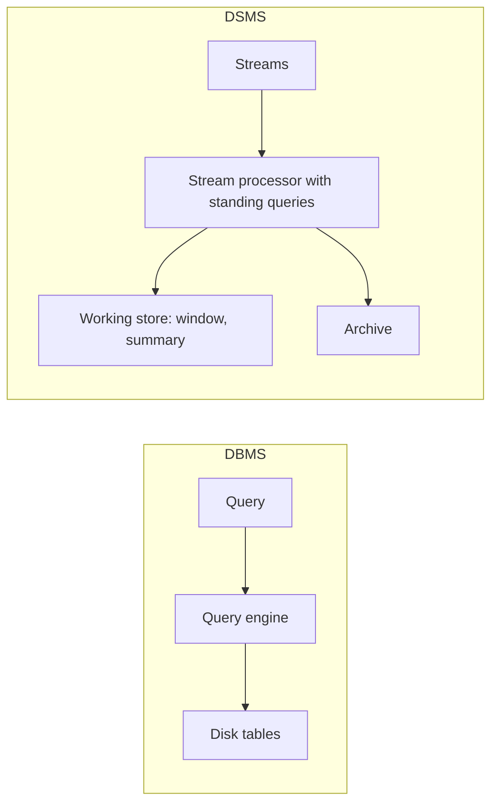

**Ek line mein:** <mark>DBMS data store karta hai aur uspe one-time queries ke answer deta hai; DSMS aise data ko dekhta hai jo lagataar aa raha hai aur standing queries ke answer baar baar deta hai</mark>. <Cite id="stream-data-model-gfg-dbms-dsms" /> <Cite id="stream-data-model-wiki-dsms" />

<Box kind="key">

**Ye points likho:**

- DBMS: <mark>persistent (stored) data, random access, one-time queries, exact answers</mark>, bada disk.
- DSMS: <mark>transient (flowing) data, sequential one-pass access, continuous standing queries, aksar approximate answers</mark>, bounded main memory.
- <mark>DBMS query-driven (pull) hai; DSMS data-driven (push) hai</mark>: DBMS query ko stored data tak le jaata hai, DSMS data ko stored queries ke saamne se guzaarta hai.
- Update rate: <mark>DBMS mein low, DSMS mein bahut high</mark>; real time sirf DSMS mein chahiye.
- Dono ka ek ek example do.

</Box>

## Core answer (5 marks, yahan ke har question ke liye)

<Box kind="definition">

A **DBMS** (database management system) stores data in tables and answers questions asked once. A **DSMS** (data stream management system) takes in endless, fast streams and keeps answering **standing** questions as new data arrives, keeping only a small summary in memory. <Cite id="stream-data-model-gfg-dbms-dsms" /> <Cite id="stream-data-model-wiki-dsms" />

</Box>

| Point | DBMS | DSMS |
|---|---|---|
| Data | Stable, stored (persistent) | Endless, fast-moving streams (transient) |
| Access | Random access | Sequential, one pass |
| Queries | One-time queries | Continuous (standing) queries, plus ad-hoc ones |
| Model | Query-driven (pull): user poochta hai | Data-driven (push): naya data results trigger karta hai |
| Query plan | Shuru mein ek baar optimise | Adaptive; stream ke saath badal sakta hai |
| Update rate | Low | Bahut high |
| Answers | Exact | Exact ya approximate |
| Real time | Zaroori nahi | Zaroori |
| Storage | Bada secondary storage | Bounded main memory |

<Cite id="stream-data-model-babcock2002" loc="§2.1" />

**Example.** DBMS "pichhle mahine ki total sales kya thi?" ka answer deta hai. DSMS readings aate rehne pe lagataar answer deta hai "koi bhi sensor 40 degree se upar jaye to alert do".

**Conclusion:** <mark>stored data aur exact answers ke liye DBMS; live streams jinhe quick, aksar approximate answers chahiye unke liye DSMS</mark>.

## Extended answer (10 marks): ye add karo

### 1. Ye farq kyun hain

- Stream **unbounded** hai, isliye DSMS sab store nahi kar sakta; wo windows aur summaries rakhta hai. DBMS finite data set maanta hai. <Cite id="stream-data-model-babcock2002" />
- Stream **ek baar dikhti hai**, isliye jin operators ko poora input chahiye (sort, full join) unki jagah window versions lagte hain. <Cite id="stream-data-model-geisler" />
- Overload mein DSMS **data drop** kar sakta hai (load shedding), jo DBMS kabhi nahi karta.

### 2. Architecture ka contrast

<Cite id="stream-data-model-cs246-slides" loc="slide 7" />

### 3. Examples

| System | Typical use |
|---|---|
| DBMS | Bank account records, student results, inventory tables |
| DSMS | Sensor monitoring, stock-market ticks, network traffic, click streams |

## Har question mein kaise fit karein

- **"Compare DBMS VS DSMS."** (5 marks) <PYQ id="2023-12/q1d" />: core answer: dono ki one-line definition, comparison table (kam se kam 6 rows), example aur one-line conclusion. Jagah ho to do mein se ek diagram jodo.

## Exam tips

- **Hamesha draw karo:** kam se kam chhe rows ki table; "compare" questions mein table se achhe marks milte hain.
- Keywords use karo **"persistent vs transient", "pull vs push", "one-time vs continuous", "exact vs approximate"**.
- Dono ka example likho; isse dikhta hai ki aapne farq samjha hai.

Exam mein English mein likho.
