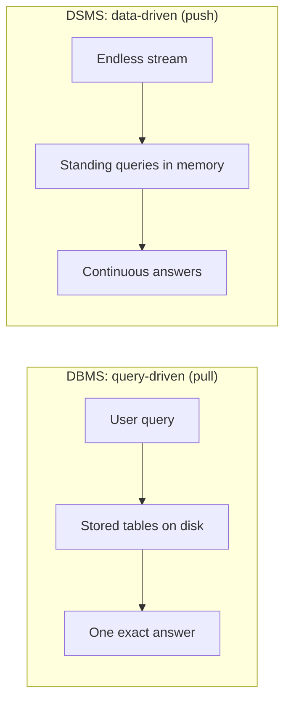
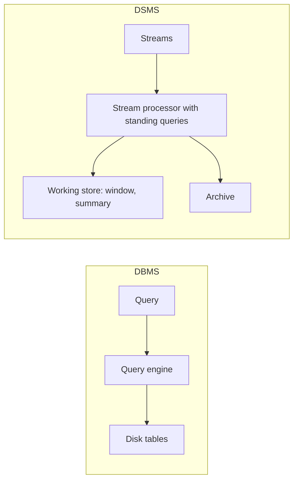

**In one line:** <mark>A DBMS stores data and answers one-time queries on it; a DSMS watches data that keeps flowing in and answers standing queries again and again</mark>. <Cite id="stream-data-model-gfg-dbms-dsms" /> <Cite id="stream-data-model-wiki-dsms" />

<Box kind="key">

**Key points to write:**

- DBMS: <mark>persistent (stored) data, random access, one-time queries, exact answers</mark>, large disk.
- DSMS: <mark>transient (flowing) data, sequential one-pass access, continuous standing queries, often approximate answers</mark>, bounded main memory.
- <mark>DBMS is query-driven (pull); DSMS is data-driven (push)</mark>: a DBMS brings the query to stored data, a DSMS brings the data past stored queries.
- Update rate: <mark>low in a DBMS, very high in a DSMS</mark>; real time is needed only in a DSMS.
- Give one example for each.

</Box>

## Core answer (5 marks, fits every question here)

<Box kind="definition">

A **DBMS** (database management system) stores data in tables and answers questions asked once. A **DSMS** (data stream management system) takes in endless, fast streams and keeps answering **standing** questions as new data arrives, keeping only a small summary in memory. <Cite id="stream-data-model-gfg-dbms-dsms" /> <Cite id="stream-data-model-wiki-dsms" />

</Box>

| Point | DBMS | DSMS |
|---|---|---|
| Data | Stable, stored (persistent) | Endless, fast-moving streams (transient) |
| Access | Random access | Sequential, one pass |
| Queries | One-time queries | Continuous (standing) queries, plus ad-hoc ones |
| Model | Query-driven (pull): the user asks | Data-driven (push): new data triggers results |
| Query plan | Optimised once, at the start | Adaptive; may change with the stream |
| Update rate | Low | Very high |
| Answers | Exact | Exact or approximate |
| Real time | Not required | Needed |
| Storage | Large secondary storage | Bounded main memory |

<Cite id="stream-data-model-babcock2002" loc="§2.1" />

**Example.** A DBMS answers "what was last month's sales total?". A DSMS keeps answering "alert me when any sensor goes above 40 degrees" as readings arrive.

**Conclusion:** <mark>use a DBMS for stored data and exact answers; use a DSMS for live streams that need quick, often approximate answers</mark>.

## Extended answer (10 marks): add these

### 1. Why the differences exist

- A stream is **unbounded**, so a DSMS cannot store it all; it keeps windows and summaries. A DBMS assumes a finite data set. <Cite id="stream-data-model-babcock2002" />
- A stream is **seen once**, so operators that need all the input (sort, full join) must be replaced by window versions. <Cite id="stream-data-model-geisler" />
- A DSMS may **drop data** under overload (load shedding), which a DBMS never does.

### 2. Architecture contrast

<Cite id="stream-data-model-cs246-slides" loc="slide 7" />

### 3. Examples

| System | Typical use |
|---|---|
| DBMS | Bank account records, student results, inventory tables |
| DSMS | Sensor monitoring, stock-market ticks, network traffic, click streams |

## Fit it to each question

- **"Compare DBMS VS DSMS."** (5 marks) <PYQ id="2023-12/q1d" />: core answer: one-line definition each, the comparison table (at least 6 rows), the example and a one-line conclusion. Add one of the two diagrams if space allows.

## Exam tips

- **Always draw:** a table of at least six rows; tables score well for "compare" questions.
- Use the keywords **"persistent vs transient", "pull vs push", "one-time vs continuous", "exact vs approximate"**.
- Write the example of each; it shows that you understand the difference.
