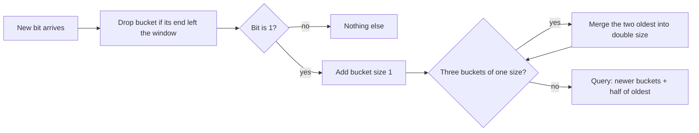
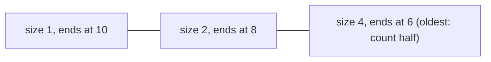

**Ek line mein:** <mark>DGIM 0/1 stream ke last N bits mein 1s ginta hai, sirf lagbhag log N buckets (sizes power of 2) se, aur uska answer true count ke 50 percent ke andar hota hai</mark>. <Cite id="stream-counting-mmds-home" loc="§4.6" />

<Box kind="key">

**Har DGIM question mein ye points likho:**

- Problem: <mark>stream ke last N bits mein 1s ginna</mark>; exact counting ke liye saare N bits memory mein chahiye.
- <mark>Bucket apna size (1s ki sankhya, power of 2) aur right end ka timestamp store karta hai</mark>.
- Rules: <mark>right end 1 ho; har size ke ek ya do buckets; peeche jaate hue sizes kabhi kam nahi hote; window se bahar gaya bucket drop</mark>.
- Update: <mark>naya 1 size-1 bucket banata hai; agar teen buckets ka size same ho to do sabse purane merge karke double size ka ek bucket</mark>. 0 sirf time aage badhata hai.
- Query: <mark>sabse purane bucket B se naye saare buckets jodo, aur B ka aadha</mark>.
- Error: <mark>zyada se zyada 50 percent</mark>; memory: <mark>O(log² N) bits</mark>.

</Box>

## Core answer (5 marks, yahan ke har question ke liye)

<Box kind="definition">

The **DGIM algorithm** (Datar, Gionis, Indyk, Motwani, 2002) estimates the number of 1s in the last $N$ bits of a binary stream. It stores a small list of **buckets**; each bucket summarises a group of 1s by its **size** and the **timestamp of its most recent (right) end**. <Cite id="stream-counting-mmds-home" loc="§4.6" /> <Cite id="stream-counting-wiki-dsm" />

</Box>

**Kyun chahiye:** stream store nahi ho sakti. Last $N$ bits ki exact counting ke liye $N$ bits memory chahiye; DGIM ko sirf lagbhag $\log^2 N$ bits chahiye.

**Buckets ke rules (constraints):**

1. Har bucket ka right end 1 hai; har 1 ek hi bucket mein hai.
2. Har size ke **ek ya do buckets** hote hain.
3. Har size **power of 2** hai.
4. Peeche jaate hue sizes **kabhi kam nahi** hote (purane buckets bade ya barabar).
5. Jab bucket ka right end window se bahar jaye to bucket drop.

**Time $t$ pe bit aaye to update:**

1. Sabse purana bucket drop karo agar uska timestamp $\le t - N$ ho.
2. **0** aaye: aur kuch nahi.
3. **1** aaye: size 1 ka naya bucket, timestamp $t$.
4. Agar ab teen buckets ka size same hai to unme se **do sabse purane merge** karo, double size ka (naya timestamp rakho). Agle size ke liye repeat.

**Query:** window ke sabse purane bucket $B$ se naye saare buckets ke sizes jodo, phir **$B$ ke size ka aadha** jodo.

<Cite id="stream-counting-cs246-slides" loc="diagram" />

**Conclusion:** <mark>DGIM N bits ki window ko lagbhag log N buckets se replace karta hai aur phir bhi count known error ke andar batata hai</mark>.

## Extended answer (10 marks): ye add karo

### 1. Worked example

<Sum>

<Given>

Stream (time 1 pehle): `1 0 1 1 0 1 1 1 0 1` (10 bits). Window $N = 8$. Bucket ko (size, timestamp) likhte hain.

</Given>

<Find>

har 1 ke baad buckets, aur last 8 bits mein 1s ka estimate.

</Find>

<Steps>

1. Update rules bit by bit lagao (0 se kuch nahi badalta, isliye sirf 1s dikhaye hain):

   | $t$ | Bit | Buckets after (newest first) | Kyun |
   |---|---|---|---|
   | 1 | 1 | (1,1) | naya bucket |
   | 3 | 1 | (1,3) (1,1) | size 1 ke do allowed hain |
   | 4 | 1 | (1,4) (2,3) | size 1 ke teen, isliye (1,3) aur (1,1) merge hoke (2,3) |
   | 6 | 1 | (1,6) (1,4) (2,3) | size 1 ke do |
   | 7 | 1 | (1,7) (2,6) (2,3) | size 1 ke teen, isliye (1,6) aur (1,4) merge hoke (2,6) |
   | 8 | 1 | (1,8) (1,7) (2,6) (2,3) | allowed |
   | 10 | 1 | (1,10) (2,8) (4,6) | (1,8) aur (1,7) merge hoke (2,8); phir size 2 ke teen, isliye (2,6) aur (2,3) merge hoke (4,6) |

2. $t = 10$ pe window mein time 3 se 10 hain, isliye kuch drop nahi hota.
3. Window ka sabse purana bucket $B = (4,6)$ hai. Isse naye buckets mein $1 + 2 = 3$ ones hain.
4. $B$ ka aadha jodo: $4 / 2 = 2$. Estimate $= 3 + 2 = 5$.

</Steps>

<Answer>

Final buckets (1,10) (2,8) (4,6). Last 8 bits mein 1s ka estimate $= 5$.

</Answer>

<Box kind="verify">

Seedha ginke dekho: time 3 se 10 ke bits `1 1 0 1 1 1 0 1` hain, jisme chhe 1s hain (3, 4, 6, 7, 8, 10 pe). Estimate 5, 1 se door hai, jo $B$ ke aadhe (2) ke andar hai. Buckets stream ke saare saat 1s rakhte hain: $1 + 2 + 4 = 7$.

</Box>

</Sum>

### 2. Error zyada se zyada 50 percent kyun

Maano sabse purane bucket $B$ ka size $2^r$ hai. Uske kuch 1s window ke bahar ho sakte hain, isliye pata nahi kitne andar hain: 1 se $2^r$ ke beech. Aadha $2^{r-1}$ maanne pe galti zyada se zyada $2^{r-1}$ hai. Naye buckets mein har chhote size ka kam se kam ek bucket hai, isliye kam se kam $1 + 2 + \dots + 2^{r-1} = 2^r - 1$ ones, to true count kam se kam $2^r$ hai. Error $\le 2^{r-1} / 2^r = 50\%$. <Cite id="stream-counting-mmds-home" loc="§4.6" />

### 3. Memory aur use

- $O(\log N)$ buckets hain, aur har ek ke timestamp ke liye $O(\log N)$ bits, isliye memory $O(\log^2 N)$ bits.
- Kisi bhi $k \le N$ ke liye last $k$ bits ginne ke liye wahi buckets aur wahi rule use karo.
- Har size ke zyada buckets allow karke error aur chhota kiya ja sakta hai.

| Advantages | Disadvantages |
|---|---|
| Bahut kam memory | Answer approximate hai |
| Fast update | Plain DGIM 0/1 streams ke liye hai |
| Guaranteed error bound | Timestamp bookkeeping chahiye |

<Cite id="stream-counting-wiki-streaming" />

## Har question mein kaise fit karein

- **"Explain DGIM algorithm."** (10 marks) <PYQ id="2023-12/q3b" /> <PYQ id="2024-05/q4b" />: core answer (problem, bucket, rules, update, query, flowchart) + section 2 (error) + section 3. Section 1 ka chhota example na pucha ho tab bhi madad karta hai.
- **"Explain DGIM algorithm for counting ones in a stream with example."** (10 marks) <PYQ id="2023-12-ce/q4b" /> <PYQ id="2024-05-ce/q4b" /> <PYQ id="2025-05/q4b" />: core answer + section 1 ka poora worked example, bucket table aur final box diagram ke saath, phir error line.

## Exam tips

- **Hamesha draw karo:** buckets ki final row (size, timestamp), newest left mein.
- **Merge rule** exactly likho: "three buckets of the same size, merge the two oldest".
- Common galtiyan: query mein **sabse purane bucket ka aadha** bhoolna, ya do sabse purane ki jagah do sabse naye merge karna.

Exam mein English mein likho.
