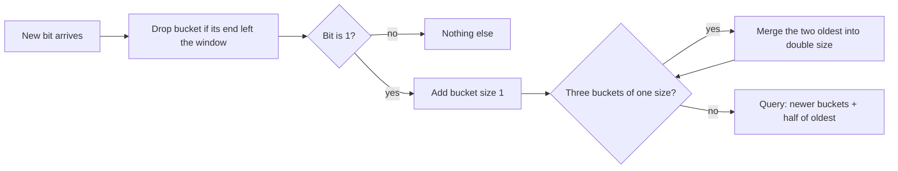
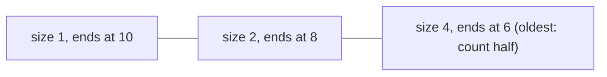

**In one line:** <mark>DGIM counts the 1s in the last N bits of a 0/1 stream using only about log N buckets of power-of-2 sizes, and its answer is within 50 percent of the true count</mark>. <Cite id="stream-counting-mmds-home" loc="§4.6" />

<Box kind="key">

**Key points to write (any DGIM question):**

- Problem: <mark>count the 1s in the last N bits of a stream</mark>; exact counting needs all N bits in memory.
- A <mark>bucket stores its size (number of 1s, a power of 2) and the timestamp of its right end</mark>.
- Rules: <mark>right end is a 1; one or two buckets of each size; sizes never decrease going back in time; a bucket leaving the window is dropped</mark>.
- Update: <mark>a new 1 makes a bucket of size 1; if three buckets have the same size, merge the two oldest into one of double size</mark>. A 0 only advances time.
- Query: <mark>add all buckets newer than the oldest bucket B, plus half of B</mark>.
- Error: <mark>at most 50 percent</mark>; memory: <mark>O(log² N) bits</mark>.

</Box>

## Core answer (5 marks, fits every question here)

<Box kind="definition">

The **DGIM algorithm** (Datar, Gionis, Indyk, Motwani, 2002) estimates the number of 1s in the last $N$ bits of a binary stream. It stores a small list of **buckets**; each bucket summarises a group of 1s by its **size** and the **timestamp of its most recent (right) end**. <Cite id="stream-counting-mmds-home" loc="§4.6" /> <Cite id="stream-counting-wiki-dsm" />

</Box>

**Why it is needed:** a stream cannot be stored. Exact counting of the last $N$ bits needs $N$ bits of memory; DGIM needs only about $\log^2 N$ bits.

**Rules (constraints) of the buckets:**

1. The right end of every bucket is a 1; every 1 is in exactly one bucket.
2. There are **one or two buckets of each size**.
3. Every size is a **power of 2**.
4. Sizes **never decrease** going back in time (older buckets are bigger or equal).
5. A bucket is dropped once its right end leaves the window.

**Update when a bit arrives at time $t$:**

1. Drop the oldest bucket if its timestamp is $\le t - N$.
2. A **0**: nothing more.
3. A **1**: create a bucket of size 1 with timestamp $t$.
4. If three buckets now have the same size, **merge the two oldest** of them into one of double size (keep the newer timestamp). Repeat for the next size.

**Query:** add the sizes of all buckets newer than the oldest bucket $B$ in the window, then add **half the size of $B$**.

<Cite id="stream-counting-cs246-slides" loc="diagram" />

**Conclusion:** <mark>DGIM replaces a window of N bits by about log N buckets and still answers the count within a known error</mark>.

## Extended answer (10 marks): add these

### 1. Worked example

<Sum>

<Given>

Stream (time 1 first): `1 0 1 1 0 1 1 1 0 1` (10 bits). Window $N = 8$. A bucket is written (size, timestamp).

</Given>

<Find>

the buckets after every 1 and the estimate of the number of 1s in the last 8 bits.

</Find>

<Steps>

1. Apply the update rules bit by bit (a 0 changes nothing, so only the 1s are shown):

   | $t$ | Bit | Buckets after (newest first) | Why |
   |---|---|---|---|
   | 1 | 1 | (1,1) | new bucket |
   | 3 | 1 | (1,3) (1,1) | two of size 1 is allowed |
   | 4 | 1 | (1,4) (2,3) | three of size 1, so (1,3) and (1,1) merge into (2,3) |
   | 6 | 1 | (1,6) (1,4) (2,3) | two of size 1 |
   | 7 | 1 | (1,7) (2,6) (2,3) | three of size 1, so (1,6) and (1,4) merge into (2,6) |
   | 8 | 1 | (1,8) (1,7) (2,6) (2,3) | allowed |
   | 10 | 1 | (1,10) (2,8) (4,6) | (1,8) and (1,7) merge into (2,8); then three of size 2, so (2,6) and (2,3) merge into (4,6) |

2. At $t = 10$ the window holds times 3 to 10, so nothing is dropped.
3. The oldest bucket in the window is $B = (4,6)$. The buckets newer than it hold $1 + 2 = 3$ ones.
4. Add half of $B$: $4 / 2 = 2$. Estimate $= 3 + 2 = 5$.

</Steps>

<Answer>

Final buckets (1,10) (2,8) (4,6). Estimated number of 1s in the last 8 bits $= 5$.

</Answer>

<Box kind="verify">

Count directly: times 3 to 10 are `1 1 0 1 1 1 0 1`, which has six 1s (at 3, 4, 6, 7, 8, 10). The estimate 5 is off by 1, within half of $B$ (2). The buckets hold all seven 1s of the stream: $1 + 2 + 4 = 7$.

</Box>

</Sum>

### 2. Why the error is at most 50 percent

Let the oldest bucket $B$ have size $2^r$. Some of its 1s may be outside the window, so we do not know how many are inside: between 1 and $2^r$. Guessing half, $2^{r-1}$, is wrong by at most $2^{r-1}$. The newer buckets contain at least one bucket of each smaller size, so at least $1 + 2 + \dots + 2^{r-1} = 2^r - 1$ ones, so the true count is at least $2^r$. Error $\le 2^{r-1} / 2^r = 50\%$. <Cite id="stream-counting-mmds-home" loc="§4.6" />

### 3. Memory and use

- There are $O(\log N)$ buckets, and each needs $O(\log N)$ bits for its timestamp, so the memory is $O(\log^2 N)$ bits.
- To count the last $k$ bits for any $k \le N$, use the same buckets with the same rule.
- The error can be made smaller by allowing more buckets of each size.

| Advantages | Disadvantages |
|---|---|
| Very small memory | Answer is approximate |
| Fast update | Plain DGIM works for 0/1 streams |
| Guaranteed error bound | Needs timestamp bookkeeping |

<Cite id="stream-counting-wiki-streaming" />

## Fit it to each question

- **"Explain DGIM algorithm."** (10 marks) <PYQ id="2023-12/q3b" /> <PYQ id="2024-05/q4b" />: core answer (problem, bucket, rules, update, query, flowchart) + section 2 (error) + section 3. A short example from section 1 helps even though it is not asked.
- **"Explain DGIM algorithm for counting ones in a stream with example."** (10 marks) <PYQ id="2023-12-ce/q4b" /> <PYQ id="2024-05-ce/q4b" /> <PYQ id="2025-05/q4b" />: core answer + the full worked example of section 1 with the bucket table and the final box diagram, then the error line.

## Exam tips

- **Always draw:** the final row of buckets (size, timestamp), newest on the left.
- Write the **merge rule** exactly: "three buckets of the same size, merge the two oldest".
- Common mistakes: forgetting to **halve the oldest bucket** in the query, or merging the two newest instead of the two oldest.
