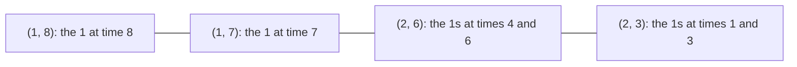
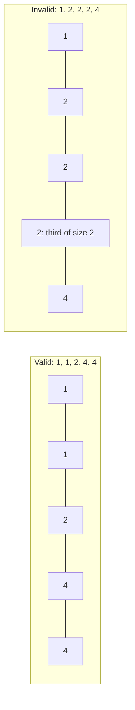

**Ek line mein:** <mark>DGIM mein stream ko buckets (size = 1s ki sankhya, right end ka timestamp) se represent karte hain, aur bucket list tabhi valid hai jab wo chhe constraints follow kare</mark>. <Cite id="stream-counting-mmds-home" loc="§4.6" />

<Box kind="key">

**Chhe constraints (chhe likho, har ek ek line mein):**

1. <mark>Bucket ka right end hamesha 1 hota hai.</mark>
2. <mark>Window ka har 1 kisi na kisi bucket mein hota hai.</mark>
3. <mark>Koi position ek se zyada bucket mein nahi hoti</mark> (buckets overlap nahi karte).
4. <mark>Har size ke ek ya do buckets hote hain</mark>, kisi maximum size tak.
5. <mark>Har bucket size power of 2 hota hai</mark> (1, 2, 4, 8, ...).
6. <mark>Peeche jaate hue bucket sizes kabhi kam nahi hote</mark> (purane buckets same size ya bade).

Jab bucket ka right end last $N$ bits ki window se bahar chala jaye to bucket drop ho jaata hai.

</Box>

## Core answer (5 marks, yahan ke har question ke liye)

<Box kind="definition">

The **DGIM algorithm** counts the 1s in the last $N$ bits of a stream. It keeps a few **buckets**. Each bucket is written (**size**, **timestamp of its right end**), where size is the number of 1s it covers. <Cite id="stream-counting-mmds-home" loc="§4.6" /> <Cite id="stream-counting-cs246-slides" />

</Box>

**Constraints, har ek ki wajah ke saath:**

| No. | Constraint | Kyun chahiye |
|---|---|---|
| 1 | Bucket ka right end 1 hai | Tab timestamp ek real 1 ko mark karta hai |
| 2 | Har 1 kisi bucket mein hai | Koi 1 bina gine nahi rehta |
| 3 | Koi position do buckets mein nahi | Koi 1 do baar nahi ginta |
| 4 | Har size ke ek ya do buckets | Buckets ki sankhya chhoti rehti hai |
| 5 | Sizes power of 2 | Sirf lagbhag $\log N$ alag sizes |
| 6 | Peeche jaate hue sizes kam nahi hote | Recent 1s exact pata hain; sirf purane rough hain |

**Example.** Stream (oldest pehle), time 1 se 8: `1 0 1 1 0 1 1 1`. 1s time 1, 3, 4, 6, 7 aur 8 pe hain. Buckets newest pehle, (size, right end) ki tarah: (1, 8), (1, 7), (2, 6), (2, 3).

<Cite id="stream-counting-cs246-slides" loc="diagram" />

| Constraint | Example pe check |
|---|---|
| 1 | Right ends 8, 7, 6 aur 3 sab 1 hain. |
| 2 aur 3 | Buckets 8; 7; 6 aur 4; 3 aur 1 ke 1s cover karte hain: chhe ke chhe 1s, har ek ek baar. |
| 4 | Size 1 ke do aur size 2 ke do buckets, kisi size ke teen kabhi nahi. |
| 5 | Sizes 1, 1, 2, 2 powers of 2 hain. |
| 6 | Newest se oldest 1, 1, 2, 2 kabhi kam nahi hote. |

Sizes ka jod $1 + 1 + 2 + 2 = 6$ hai, yaani 1s ki sankhya. <Cite id="stream-counting-wiki-streaming" />

**Conclusion:** <mark>ye constraints buckets ki sankhya log N ke paas rakhte hain, phir bhi window count 50 percent error ke andar aata hai</mark>.

## Extended answer (10 marks): ye add karo

### 1. Invalid lists (kaunsa rule tootta hai)

| Invalid list (sizes, newest first) | Kaunsa rule toota |
|---|---|
| 1, 2, 2, 2, 4 | Size 2 ke teen buckets (constraint 4) |
| 1, 3, 4 | 3 power of 2 nahi hai (constraint 5) |
| 2, 1, 1 | Purana bucket chhota hai (constraint 6) |
| 0 pe khatam hone wala bucket | Constraint 1 |
| Ek 1 share karne wale do buckets | Constraint 3 |

### 2. Update constraints ko true kaise rakhta hai

Jab 1 aata hai, bucket (1, $t$) jodte hain. Agar ab teen buckets ka size same ho, to unme se **do sabse purane** merge hoke double size ka ek bucket bante hain, newer timestamp ke saath, aur ye agle size ke liye repeat hota hai. Size $s$ ke do buckets merge karke $2s$ ka ek bucket milta hai, jo ab bhi power of 2 hai aur ab bhi 1 pe khatam hota hai. Purane buckets sirf bade hote hain aur sabse naye sabse chhote, isliye peeche jaate hue sizes ab bhi kam nahi hote.

### 3. Constraints se kya milta hai

- $\log_2 N$ sizes mein se har ek ke zyada se zyada 2 buckets, isliye $O(\log N)$ buckets aur $O(\log^2 N)$ bits.
- Query ka error sirf sabse purane bucket se aata hai, isliye zyada se zyada 50 percent. <Cite id="stream-counting-wiki-dsm" />

## Har question mein kaise fit karein

- **"List down all six constraints that must be satisfied for representing a stream by buckets using DGIM algorithm with examples."** (5 marks) <PYQ id="2023-12-ce/q1d" /> <PYQ id="2025-05-ce/q1d" />: chhe-point key box (har ek ki wajah table se), phir example stream, bucket list aur check table.
- **"List down any five constraints that must be satisfied for representing a stream by buckets using DGIM algorithm with examples."** (5 marks) <PYQ id="2024-12-ce/q1d" />: chhe mein se koi paanch likho (safest: constraints 1, 3, 4, 5, 6), aur phir bhi example aur section 1 ki ek invalid list dikhao.

## Exam tips

- **Hamesha example do:** ek chhoti bit stream, uske buckets (size, right-end time) ki tarah, aur har rule ka check.
- Exact phrases use karo: **"power of 2"**, **"one or two buckets of each size"**, **"sizes do not decrease going back in time"**, **"right end is a 1"**.
- Common galti: "exactly two buckets of each size" likhna. Sahi hai **one or two**; sirf kisi size ke teen hone par merge hota hai.

Exam mein English mein likho.
