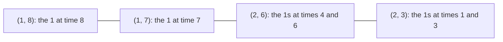
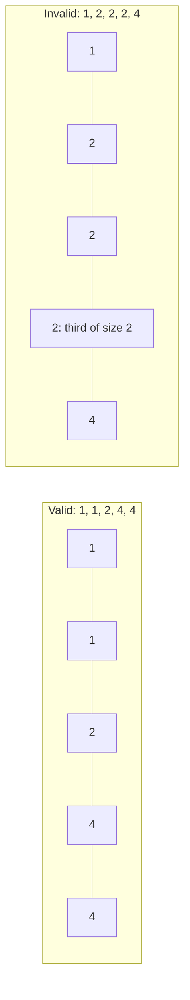

**In one line:** <mark>In DGIM a stream is represented by buckets (size = number of 1s, timestamp of the right end), and the list is valid only if it follows six constraints</mark>. <Cite id="stream-counting-mmds-home" loc="§4.6" />

<Box kind="key">

**The six constraints (write all six, one line each):**

1. <mark>The right end of a bucket is always a 1.</mark>
2. <mark>Every 1 in the window belongs to some bucket.</mark>
3. <mark>No position belongs to more than one bucket</mark> (buckets do not overlap).
4. <mark>There are one or two buckets of each size</mark>, up to some maximum size.
5. <mark>Every bucket size is a power of 2</mark> (1, 2, 4, 8, ...).
6. <mark>Bucket sizes never decrease going back in time</mark> (older buckets are the same size or bigger).

A bucket is also dropped when its right end leaves the window of the last $N$ bits.

</Box>

## Core answer (5 marks, fits every question here)

<Box kind="definition">

The **DGIM algorithm** counts the 1s in the last $N$ bits of a stream. It keeps a few **buckets**. Each bucket is written (**size**, **timestamp of its right end**), where size is the number of 1s it covers. <Cite id="stream-counting-mmds-home" loc="§4.6" /> <Cite id="stream-counting-cs246-slides" />

</Box>

**The constraints, with the reason for each:**

| No. | Constraint | Why it is needed |
|---|---|---|
| 1 | Right end of a bucket is a 1 | The timestamp then marks a real 1 |
| 2 | Every 1 is in some bucket | No 1 is left uncounted |
| 3 | No position in two buckets | No 1 is counted twice |
| 4 | One or two buckets of each size | Keeps the number of buckets small |
| 5 | Sizes are powers of 2 | Only about $\log N$ different sizes |
| 6 | Sizes never decrease going back in time | Recent 1s are known exactly; only old ones are rough |

**Example.** Stream (oldest first), times 1 to 8: `1 0 1 1 0 1 1 1`. The 1s are at times 1, 3, 4, 6, 7 and 8. Buckets newest first, as (size, right end): (1, 8), (1, 7), (2, 6), (2, 3).

<Cite id="stream-counting-cs246-slides" loc="diagram" />

| Constraint | Check on the example |
|---|---|
| 1 | Right ends 8, 7, 6 and 3 are all 1s. |
| 2 and 3 | The buckets cover the 1s at 8; 7; 6 and 4; 3 and 1: all six 1s, each once. |
| 4 | Two buckets of size 1 and two of size 2, never three of a size. |
| 5 | Sizes 1, 1, 2, 2 are powers of 2. |
| 6 | From newest to oldest 1, 1, 2, 2 never decrease. |

The sizes add up to $1 + 1 + 2 + 2 = 6$, the number of 1s. <Cite id="stream-counting-wiki-streaming" />

**Conclusion:** <mark>these constraints keep the number of buckets near log N while still allowing the window count within 50 percent error</mark>.

## Extended answer (10 marks): add these

### 1. Invalid lists (what breaks which rule)

| Invalid list (sizes, newest first) | Rule broken |
|---|---|
| 1, 2, 2, 2, 4 | Three buckets of size 2 (constraint 4) |
| 1, 3, 4 | 3 is not a power of 2 (constraint 5) |
| 2, 1, 1 | An older bucket is smaller (constraint 6) |
| A bucket ending in a 0 | Constraint 1 |
| Two buckets sharing a 1 | Constraint 3 |

### 2. How the update keeps the constraints true

When a 1 arrives, a bucket (1, $t$) is added. If now three buckets have the same size, the **two oldest** of them merge into one of double size with the newer timestamp, and this repeats for the next size. Merging two buckets of size $s$ gives one of size $2s$, still a power of 2 and still ending in a 1. Old buckets only grow and the newest are smallest, so sizes still never decrease going back.

### 3. What the constraints give

- At most 2 buckets of each of the $\log_2 N$ sizes, so $O(\log N)$ buckets and $O(\log^2 N)$ bits.
- The query error comes only from the oldest bucket, so it is at most 50 percent. <Cite id="stream-counting-wiki-dsm" />

## Fit it to each question

- **"List down all six constraints that must be satisfied for representing a stream by buckets using DGIM algorithm with examples."** (5 marks) <PYQ id="2023-12-ce/q1d" /> <PYQ id="2025-05-ce/q1d" />: the six-point key box (each with its reason from the table), then the example stream, the bucket list and the check table.
- **"List down any five constraints that must be satisfied for representing a stream by buckets using DGIM algorithm with examples."** (5 marks) <PYQ id="2024-12-ce/q1d" />: write any five of the six (safest: constraints 1, 3, 4, 5, 6), and still show the example and one invalid list from section 1.

## Exam tips

- **Always give an example:** a short bit stream, its buckets as (size, right-end time), and a check of each rule.
- Use the exact phrases: **"power of 2"**, **"one or two buckets of each size"**, **"sizes do not decrease going back in time"**, **"right end is a 1"**.
- Common mistake: writing "exactly two buckets of each size". It is **one or two**; only three of a size must be merged.
