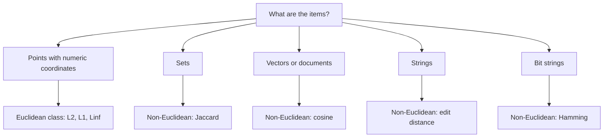

**Ek line mein:** <mark>Distance measure ek number deta hai ki do items kitne door hain (0 = identical); do major classes hain Euclidean distances (items coordinates wale points) aur non-Euclidean distances (items sets, strings, bit vectors ya documents)</mark>. <Cite id="distance-measures-mmds" loc="§3.5, §7.1" /> <Cite id="distance-measures-av" />

<Box kind="key">

**Har distance-measure question mein ye points likho:**

- Distance $d(x, y)$ ke rules: <mark>kabhi negative nahi, sirf x = y pe 0, symmetric, aur triangle inequality</mark> $d(x,z) \le d(x,y) + d(y,z)$.
- <mark>Euclidean class: space ke points, isliye average point hota hai</mark>; measures $L_2$, $L_1$, $L_\infty$; cluster centre <mark>centroid</mark> hai.
- <mark>Non-Euclidean class: coordinates nahi, average item nahi</mark>; measures Jaccard, cosine, edit, Hamming; cluster centre <mark>clustroid</mark> (ek existing item) hai.
- Data ke hisaab se measure: <mark>sets ke liye Jaccard, text vectors ke liye cosine, strings ke liye edit, bit strings ke liye Hamming, numeric points ke liye Euclidean ya Manhattan</mark>.
- Hamesha ek chhota numeric example do.

</Box>

## Core answer (5 marks, yahan ke har question ke liye)

<Box kind="definition">

A **distance measure** gives a number for how far apart two items are (0 means identical). Clustering, nearest-neighbour search, similar-document search and recommendations all need one. Which measure to use depends on what the items are: sets, points, vectors or strings. <Cite id="distance-measures-mmds" loc="§3.5" /> <Cite id="distance-measures-av" />

</Box>

Sachcha distance kabhi 0 se neeche nahi jaata, sirf identical items ke liye 0 hota hai, dono directions mein same hota hai, aur triangle inequality follow karta hai (seedha raasta kabhi ghoom ke jaane se lamba nahi hota). <Cite id="distance-measures-wiki-metric" />

| Measure | Kiske liye | Idea | Example |
|---|---|---|---|
| Jaccard | Sets | $1 - \dfrac{\lvert A \cap B \rvert}{\lvert A \cup B \rvert}$, shared items / saare items | $A = \{1,2,3,4\}$, $B = \{3,4,5\}$: $1 - 2/5 = 0.6$ |
| Euclidean ($L_2$) | Points | Seedhi line ka distance, $\sqrt{\sum (x_i - y_i)^2}$ | $(1,2)$ se $(4,6)$: 5 |
| Manhattan ($L_1$) | Points | Coordinate gaps ka jod, $\sum \lvert x_i - y_i \rvert$ | $(1,2)$ se $(4,6)$: 7 |
| Cosine | Vectors, documents | Vectors ke beech ka angle, $\cos\theta = \dfrac{x \cdot y}{\lVert x \rVert \lVert y \rVert}$ | $(1,2)$ aur $(2,1)$: $\cos\theta = 0.8$, angle $36.9^\circ$ |
| Edit | Strings | Ek ko doosri banane ke liye kam se kam insertions aur deletions | abcde se acfdeg: 3 |
| Hamming | Barabar length ki strings ya bits | Kitni positions alag hain | 10101 aur 11001: 2 |

**Conclusion:** <mark>sets ke liye Jaccard, text vectors ke liye cosine, numeric points ke liye Euclidean aur Manhattan, spelling ke liye edit aur fixed-length codes ke liye Hamming</mark>.

## Extended answer (10 marks): ye add karo

### 1. Do major classes

**Euclidean class.** Items numeric coordinates wale points hain, isliye hum hamesha ek **average** point le sakte hain (har coordinate ka average). Aam measures $L_2$ (seedhi line), $L_1$ (Manhattan) aur $L_\infty$ hain. Cluster centre **centroid** hota hai, jo naya point ho sakta hai. <Cite id="distance-measures-gfg-euclid" /> <Cite id="distance-measures-wiki-euclid" />

**Non-Euclidean class.** Items ke coordinates nahi hote, isliye items ko jod nahi sakte ya average item nahi nikal sakte. Examples: Jaccard (sets), cosine (vector directions), edit distance (strings) aur Hamming (bit vectors). Cluster centre ek existing item hona chahiye, yaani **clustroid**. <Cite id="distance-measures-gfg-jaccard" /> <Cite id="distance-measures-gfg-cosine" />

| Point | Euclidean | Non-Euclidean |
|---|---|---|
| Items hain | Coordinates wale points | Sets, strings, bit vectors, documents |
| Examples | $L_2$, $L_1$, $L_\infty$ | Jaccard, cosine, edit, Hamming |
| Average item | Hota hai | Nahi hota |
| Cluster centre | Centroid (naya point) | Clustroid (existing item) |
| Typical data | Coordinates, heights, sensor values | Documents, DNA, usernames |

### 2. Dono classes ka worked example

<Sum>

<Given>

Euclidean example: points $P(1, 2)$ aur $Q(4, 6)$. Non-Euclidean example: sets $A = \{a, b, c, d\}$ aur $B = \{c, d, e\}$ (Jaccard distance).

</Given>

<Find>

$L_2$, $L_1$ aur $L_\infty$ distances aur $P$, $Q$ ka average; $A$ aur $B$ ka Jaccard distance.

</Find>

<Steps>

1. Differences: $\Delta x = 4 - 1 = 3$, $\Delta y = 6 - 2 = 4$. *Reason: saare Euclidean measures coordinate differences use karte hain.*
2. $L_2 = \sqrt{3^2 + 4^2} = \sqrt{25} = 5$.
3. $L_1 = 3 + 4 = 7$ aur $L_\infty = \max(3, 4) = 4$.
4. Average point $= ((1+4)/2, (2+6)/2) = (2.5, 4)$. *Reason: Euclidean space mein average hamesha hota hai.*
5. Sets: intersection $A \cap B = \{c, d\}$, size 2. Union $= \{a, b, c, d, e\}$, size 5.
6. Jaccard similarity $= 2/5 = 0.4$, isliye Jaccard distance $= 1 - 0.4 = 0.6$.

</Steps>

<Answer>

$L_2 = 5$, $L_1 = 7$, $L_\infty = 4$, average point $(2.5, 4)$; Jaccard distance $= 0.6$.

</Answer>

<Box kind="verify">

3-4-5 triangle se $L_2 = 5$ aata hai ($9 + 16 = 25$). Ordering $L_\infty \le L_2 \le L_1$ sahi hai ($4 \le 5 \le 7$). Sets ke liye $|A| + |B| - |A \cap B| = 4 + 3 - 2 = 5$, union ka wahi size. $A$ aur $B$ ka koi aisa "average" nahi jo set ho, isliye is class ko clustroids chahiye.

</Box>

</Sum>

### 3. Baaki measures ek ek line mein

- **Cosine distance** $= 1 - \cos\theta$, ya khud angle; ye length ignore karke direction compare karta hai, isliye documents ke liye theek hai. <Cite id="distance-measures-gfg-cosine" />
- Strings $x$ aur $y$ ka **edit distance** $= |x| + |y| - 2\,|\text{LCS}|$ (sirf insertions aur deletions), jahan LCS longest common subsequence hai. <Cite id="distance-measures-gfg-edit" />
- **Hamming distance**: barabar length ke do vectors mein kitni positions alag hain. <Cite id="distance-measures-wiki-hamming" />

## Har question mein kaise fit karein

- **"Explain with example two major classes of distance measures."** (10 marks) <PYQ id="2023-12/q6a" />: core answer (rules, ek line) + section 1 (dono classes, comparison table, dono images) + section 2 (worked example).
- **"Distance measures for Big Data"** (5 marks) <PYQ id="2024-05/q1b" />: core answer: definition ki ek line, rules, chhe measures ki table aur conclusion.
- **"List and explain Distance measures for Big Data."** (5 marks) <PYQ id="2025-05/q1d" />: table ke saath core answer; dhyan rakho ki chhe measures mein se har ek ka idea aur chhota example ho.

## Exam tips

- **Hamesha draw ya tabulate karo:** chhe-measure wali table; zyadatar marks usi pe hain.
- Dono classes ke naam shabdon mein likho: **"Euclidean: points, average exists, centroid"** aur **"non-Euclidean: sets/strings/bits, no average, clustroid"**.
- Common galti: sets ya text ke liye Euclidean distance use karna. Measure ko data se match karo.

Exam mein English mein likho.
