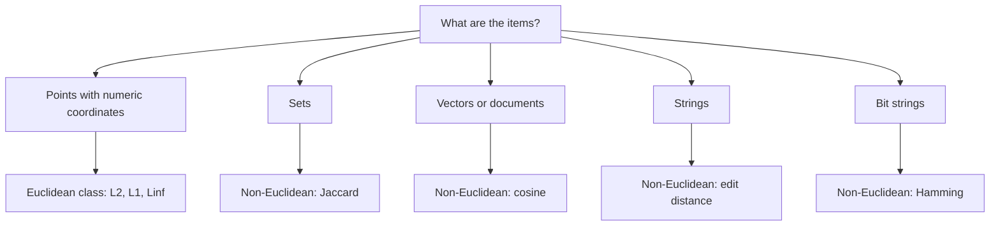

**In one line:** <mark>A distance measure gives one number for how far apart two items are (0 = identical); the two major classes are Euclidean distances (items are points with coordinates) and non-Euclidean distances (items are sets, strings, bit vectors or documents)</mark>. <Cite id="distance-measures-mmds" loc="§3.5, §7.1" /> <Cite id="distance-measures-av" />

<Box kind="key">

**Key points to write (any distance-measure question):**

- Rules of a distance $d(x, y)$: <mark>never negative, 0 only when x = y, symmetric, and the triangle inequality</mark> $d(x,z) \le d(x,y) + d(y,z)$.
- <mark>Euclidean class: points in a space, so an average point exists</mark>; measures $L_2$, $L_1$, $L_\infty$; the cluster centre is a <mark>centroid</mark>.
- <mark>Non-Euclidean class: no coordinates, no average item</mark>; measures Jaccard, cosine, edit, Hamming; the cluster centre is a <mark>clustroid</mark> (an existing item).
- Match measure to data: <mark>Jaccard for sets, cosine for text vectors, edit for strings, Hamming for bit strings, Euclidean or Manhattan for numeric points</mark>.
- Always give one small numeric example.

</Box>

## Core answer (5 marks, fits every question here)

<Box kind="definition">

A **distance measure** gives a number for how far apart two items are (0 means identical). Clustering, nearest-neighbour search, similar-document search and recommendations all need one. Which measure to use depends on what the items are: sets, points, vectors or strings. <Cite id="distance-measures-mmds" loc="§3.5" /> <Cite id="distance-measures-av" />

</Box>

A true distance never goes below 0, is 0 only for identical items, is the same in both directions, and obeys the triangle inequality (the direct route is never longer than a detour). <Cite id="distance-measures-wiki-metric" />

| Measure | Used for | Idea | Example |
|---|---|---|---|
| Jaccard | Sets | $1 - \dfrac{\lvert A \cap B \rvert}{\lvert A \cup B \rvert}$, shared items over all items | $A = \{1,2,3,4\}$, $B = \{3,4,5\}$: $1 - 2/5 = 0.6$ |
| Euclidean ($L_2$) | Points | Straight-line distance, $\sqrt{\sum (x_i - y_i)^2}$ | $(1,2)$ to $(4,6)$: 5 |
| Manhattan ($L_1$) | Points | Sum of coordinate gaps, $\sum \lvert x_i - y_i \rvert$ | $(1,2)$ to $(4,6)$: 7 |
| Cosine | Vectors, documents | Angle between the vectors, $\cos\theta = \dfrac{x \cdot y}{\lVert x \rVert \lVert y \rVert}$ | $(1,2)$ and $(2,1)$: $\cos\theta = 0.8$, angle $36.9^\circ$ |
| Edit | Strings | Fewest insertions and deletions to turn one into the other | abcde to acfdeg: 3 |
| Hamming | Equal-length strings or bits | Number of positions that differ | 10101 and 11001: 2 |

**Conclusion:** <mark>Jaccard for sets, cosine for text vectors, Euclidean and Manhattan for numeric points, edit for spelling and Hamming for fixed-length codes</mark>.

## Extended answer (10 marks): add these

### 1. The two major classes

**Euclidean class.** Items are points with numeric coordinates, so we can always take an **average** point (average each coordinate). The usual measures are $L_2$ (straight line), $L_1$ (Manhattan) and $L_\infty$. A cluster centre is a **centroid**, which can be a new point. <Cite id="distance-measures-gfg-euclid" /> <Cite id="distance-measures-wiki-euclid" />

**Non-Euclidean class.** Items have no coordinates, so we cannot add items or find an average item. Examples are Jaccard (sets), cosine (vector directions), edit distance (strings) and Hamming (bit vectors). A cluster centre must be an existing item, a **clustroid**. <Cite id="distance-measures-gfg-jaccard" /> <Cite id="distance-measures-gfg-cosine" />

| Point | Euclidean | Non-Euclidean |
|---|---|---|
| Items are | Points with coordinates | Sets, strings, bit vectors, documents |
| Examples | $L_2$, $L_1$, $L_\infty$ | Jaccard, cosine, edit, Hamming |
| Average item | Exists | Does not exist |
| Cluster centre | Centroid (a new point) | Clustroid (an existing item) |
| Typical data | Coordinates, heights, sensor values | Documents, DNA, usernames |

### 2. A worked example for both classes

<Sum>

<Given>

Euclidean example: points $P(1, 2)$ and $Q(4, 6)$. Non-Euclidean example: sets $A = \{a, b, c, d\}$ and $B = \{c, d, e\}$ (Jaccard distance).

</Given>

<Find>

the $L_2$, $L_1$ and $L_\infty$ distances and the average of $P$ and $Q$; the Jaccard distance of $A$ and $B$.

</Find>

<Steps>

1. Differences: $\Delta x = 4 - 1 = 3$, $\Delta y = 6 - 2 = 4$. *Reason: all Euclidean measures use coordinate differences.*
2. $L_2 = \sqrt{3^2 + 4^2} = \sqrt{25} = 5$.
3. $L_1 = 3 + 4 = 7$ and $L_\infty = \max(3, 4) = 4$.
4. Average point $= ((1+4)/2, (2+6)/2) = (2.5, 4)$. *Reason: a Euclidean space always has an average.*
5. Sets: intersection $A \cap B = \{c, d\}$, size 2. Union $= \{a, b, c, d, e\}$, size 5.
6. Jaccard similarity $= 2/5 = 0.4$, so Jaccard distance $= 1 - 0.4 = 0.6$.

</Steps>

<Answer>

$L_2 = 5$, $L_1 = 7$, $L_\infty = 4$, average point $(2.5, 4)$; Jaccard distance $= 0.6$.

</Answer>

<Box kind="verify">

The 3-4-5 triangle gives $L_2 = 5$ ($9 + 16 = 25$). The ordering $L_\infty \le L_2 \le L_1$ holds ($4 \le 5 \le 7$). For the sets, $|A| + |B| - |A \cap B| = 4 + 3 - 2 = 5$, the same union size. There is no "average" of $A$ and $B$ that is a set, which is why this class needs clustroids.

</Box>

</Sum>

### 3. Other measures in a line each

- **Cosine distance** $= 1 - \cos\theta$, or the angle itself; it ignores length and compares direction, so it suits documents. <Cite id="distance-measures-gfg-cosine" />
- **Edit distance** between strings $x$ and $y$ $= |x| + |y| - 2\,|\text{LCS}|$ (insertions and deletions only), where LCS is the longest common subsequence. <Cite id="distance-measures-gfg-edit" />
- **Hamming distance**: number of positions where two equal-length vectors differ. <Cite id="distance-measures-wiki-hamming" />

## Fit it to each question

- **"Explain with example two major classes of distance measures."** (10 marks) <PYQ id="2023-12/q6a" />: core answer (rules, one line) + section 1 (both classes, the comparison table, the two images) + section 2 (the worked example).
- **"Distance measures for Big Data"** (5 marks) <PYQ id="2024-05/q1b" />: core answer: one line of definition, the rules, the table of six measures and the conclusion.
- **"List and explain Distance measures for Big Data."** (5 marks) <PYQ id="2025-05/q1d" />: the core answer with the table; make sure each of the six measures has its idea and a small example.

## Exam tips

- **Always draw or tabulate:** the six-measure table; it carries most of the marks.
- Name the two classes in words: **"Euclidean: points, average exists, centroid"** and **"non-Euclidean: sets/strings/bits, no average, clustroid"**.
- Common mistake: using Euclidean distance for sets or text. Match the measure to the data.
