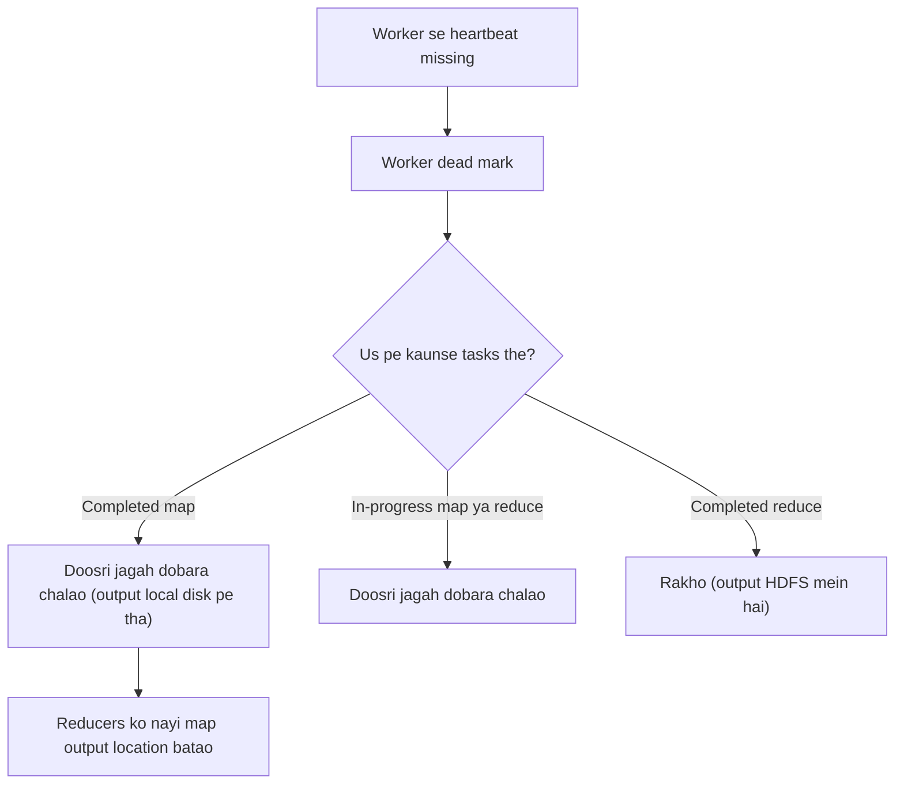

**Ek line mein:** <mark>Hadoop failure ko normal maanta hai: missing heartbeats se dead node pakadta hai, uske lost tasks doosre nodes pe dobara chalata hai, aur HDFS ke har block ki 3 copies se data safe rakhta hai</mark>. <Cite id="hadoop-ecosystem-mmds" loc="§2.2.6" /> <Cite id="hadoop-ecosystem-dean2004" loc="§3.3" />

<Box kind="key">

**Hadoop MapReduce mein failure handling ke question mein ye points likho:**

- <mark>Workers heartbeats bhejte hain; heartbeats ruke to master worker ko dead mark karta hai</mark>.
- <mark>Failed node ke saare map tasks (finished ya nahi) dobara chalte hain, kyunki map output uski local disk pe tha</mark>.
- <mark>Unfinished reduce tasks dobara chalte hain; finished reduce tasks nahi, kyunki output HDFS mein hai</mark>.
- <mark>Failed task dobara try hota hai (default 4 attempts) aur phir job fail hoti hai</mark>.
- <mark>Slow tasks ki backup copies chalti hain (speculative execution); jo pehle khatam kare woh jeette</mark>.
- <mark>Data safe hai kyunki HDFS har block ki 3 replicas rakhta hai</mark>.
- Master failure: **YARN ApplicationMaster ko restart karta hai**; ResourceManager aur NameNode ko highly available banaya ja sakta hai.

</Box>

## Core answer (5 marks, yahan ke har question ke liye)

<Box kind="definition">

With thousands of cheap machines, some machine is always failing, so the MapReduce framework detects failures and recovers from them automatically without the programmer writing any code. <Cite id="hadoop-ecosystem-mmds" loc="§2.2.6" />

</Box>

**Compute node (worker) fail ho jaye:** <Cite id="hadoop-ecosystem-dean2004" loc="§3.3" />

1. Master dekhta hai ki **heartbeats** (har kuch second mein chhota "I am alive" message) ruk gaye, aur worker ko dead mark karta hai.
2. Us node ke har **map task** ko, finished ho ya nahi, idle karke doosre nodes ko diya jata hai, kyunki uska output dead node ki local disk pe tha.
3. Uske **unfinished reduce tasks** dobara schedule hote hain. **Finished reduce tasks dobara nahi chalte** kyunki unka output HDFS mein hai.
4. Jin reducers ne lost map output abhi fetch nahi kiya tha unhe nayi location batayi jati hai.
5. Input data abhi bhi available hai kyunki **HDFS har block ki 3 copies** rakhta hai, isliye dobara chalne wala task doosri copy padhta hai. <Cite id="hadoop-ecosystem-apache-hdfs-design" />

<Cite id="mapreduce-gfg-mr" loc="diagram" />

**Conclusion:** <mark>Hadoop mein fault tolerance tasks dobara chalane aur data replicate karne se aati hai, isliye node failure job ko rokta nahi</mark>.

## Extended answer (10 marks): ye add karo

### 1. Failure ke doosre types

| Failure | Kaise pata chalta hai | Action |
|---|---|---|
| Task fail (code error, bad record, out of memory) | Exception ya exit code | Retry, aksar doosre node pe, 4 attempts tak, phir job fail |
| Task hang | 10 minute (default) tak progress nahi | Kill karke retry |
| Worker node dead | Heartbeats missing | Uske saare map tasks aur unfinished reduce tasks dobara chalte hain |
| Slow worker (straggler) | Progress doosron se bahut kam | Speculative backup copy; jo pehle khatam kare woh, doosra kill |
| Job master dead | YARN | Hadoop 2 aur baad mein ApplicationMaster restart (default 2 attempts) |

<Cite id="mapreduce-apache-mapred-default" /> <Cite id="hadoop-ecosystem-apache-yarn" />

### 2. HDFS ke pieces ki failure

| Failure | HDFS kya karta hai |
|---|---|
| DataNode ya disk dead | Heartbeats ruk jate hain; NameNode use dead mark karke uske blocks ki nayi copies doosre nodes pe banwata hai jab tak har block ki 3 replicas na ho jayein |
| Block corrupt | Client ka checksum match nahi karta, isliye woh doosri replica padhta hai aur bad copy ki jagah nayi copy aati hai |
| Poora rack fail | Doosre rack ki copy abhi bhi serve karti hai; missing replicas dobara banti hain |
| NameNode dead | Hadoop 1 mein single point of failure; HA mein Standby NameNode Active ban jata hai |

<Cite id="hdfs-apache-design" /> <Cite id="hdfs-apache-ha" />

### 3. Worked count: kitne tasks dobara chalenge?

Ek job mein 11 map aur 3 reduce tasks hain. Ek worker crash hota hai jisme 2 completed map tasks, 1 in-progress map task, 1 completed reduce task aur 1 in-progress reduce task the.

| Dead node pe task | Dobara chalega? | Kyun |
|---|---|---|
| 2 completed map | Haan (2) | Output dead local disk pe tha |
| 1 map in progress | Haan (1) | Kaam poora nahi hua |
| 1 reduce in progress | Haan (1) | Kaam poora nahi hua |
| 1 completed reduce | Nahi (0) | Output pehle se HDFS mein hai |

Total $2 + 1 + 1 + 0 = 4$ tasks dobara chalte hain. Check: node ne 5 tasks chalaye aur sirf HDFS mein saved wala bacha, $5 - 1 = 4$.

### 4. Speculative execution

Kharab disk wali machine task bahut dheere chala sakti hai aur poori job ko rok sakti hai. End ke paas master slow tasks ki **backup copies** doosre nodes pe start karta hai; jo copy pehle khatam ho wahi use hoti hai. Ye default mein on hai. <Cite id="hadoop-ecosystem-dean2004" loc="§3.6" />

## Har question mein kaise fit karein

- **"Explain how node failure is handled in Hadoop."** (5 marks) <PYQ id="2023-12-ce/q1c" />: core answer (heartbeat, re-run, replication) flow diagram ke saath; section 2 ki HDFS DataNode row add karo.
- **"Explain how failures are handled in Map Reduce job."** (5 marks) <PYQ id="2024-12/q1d" />: core answer, phir **section 1 table** (task, hang, node, straggler, master failure) aur speculative execution.

## Exam tips

- **Key fact yaad rakho**: completed *map* tasks dobara chalte hain, completed *reduce* tasks nahi (reason: unka output kahan rakha hai).
- **Teen cheezein** likho: heartbeat, re-execution, replication; extra marks ke liye speculative execution.
- **Chhota flow diagram** banao; isse answer organised lagta hai.
