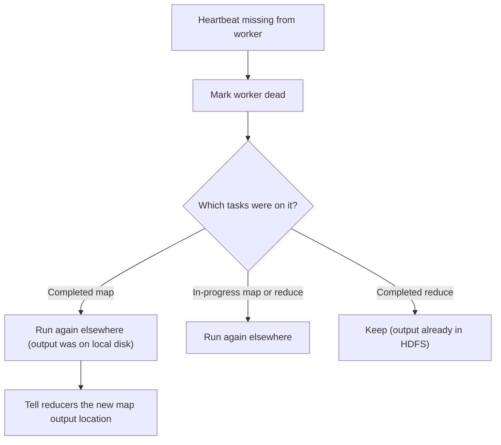

**In one line:** <mark>Hadoop treats failure as normal: it detects a dead node by missing heartbeats, re-runs its lost tasks on other nodes, and keeps the data safe with 3 copies of every HDFS block</mark>. <Cite id="hadoop-ecosystem-mmds" loc="§2.2.6" /> <Cite id="hadoop-ecosystem-dean2004" loc="§3.3" />

<Box kind="key">

**Key points to write (failure handling in Hadoop MapReduce):**

- <mark>Workers send heartbeats; the master marks a worker dead when they stop</mark>.
- <mark>All map tasks of a failed node (finished or not) are re-run, because map output is on its local disk</mark>.
- <mark>Unfinished reduce tasks are re-run; finished reduce tasks are not, as the output is in HDFS</mark>.
- <mark>A failed task is retried (4 attempts by default) and then the job fails</mark>.
- <mark>Slow tasks get backup copies (speculative execution); the first to finish wins</mark>.
- <mark>Data is safe because HDFS keeps 3 replicas of each block</mark>.
- Master failure: **ApplicationMaster is restarted by YARN**; ResourceManager and NameNode can be made highly available.

</Box>

## Core answer (5 marks, fits every question here)

<Box kind="definition">

With thousands of cheap machines, some machine is always failing, so the MapReduce framework detects failures and recovers from them automatically without the programmer writing any code. <Cite id="hadoop-ecosystem-mmds" loc="§2.2.6" />

</Box>

**Compute node (worker) fails:** <Cite id="hadoop-ecosystem-dean2004" loc="§3.3" />

1. The master notices that **heartbeats** (a small "I am alive" message every few seconds) have stopped, and marks the worker dead.
2. Every **map task** of that node, finished or not, is made idle and given to other nodes, because its output was on the dead node's local disk.
3. Its **unfinished reduce tasks** are rescheduled. **Finished reduce tasks are not repeated** because their output is in HDFS.
4. Reducers that had not yet fetched a lost map output are told the new location.
5. The input data is still available because **HDFS keeps 3 copies** of every block, so the re-run task reads another copy. <Cite id="hadoop-ecosystem-apache-hdfs-design" />

<Cite id="mapreduce-gfg-mr" loc="diagram" />

**Conclusion:** <mark>fault tolerance in Hadoop comes from re-running tasks and replicating data, so a node failure does not stop the job</mark>.

## Extended answer (10 marks): add these

### 1. Other kinds of failure

| Failure | Detected by | Action |
|---|---|---|
| Task fails (code error, bad record, out of memory) | Exception or exit code | Retry, usually on another node, up to 4 attempts, then the job fails |
| Task hangs | No progress for 10 minutes (default) | Kill and retry |
| Worker node dies | Missing heartbeats | Re-run all its map tasks and its unfinished reduce tasks |
| Slow worker (straggler) | Progress much slower than others | Speculative backup copy; the first to finish wins, the other is killed |
| Job master dies | YARN | Restart the ApplicationMaster (2 attempts by default) in Hadoop 2 and later |

<Cite id="mapreduce-apache-mapred-default" /> <Cite id="hadoop-ecosystem-apache-yarn" />

### 2. Failure of HDFS pieces

| Failure | What HDFS does |
|---|---|
| DataNode or disk dies | Heartbeats stop; NameNode marks it dead and makes new copies of its blocks on other nodes until each block again has 3 replicas |
| A block is corrupt | The client's checksum does not match, so it reads another replica and a fresh copy replaces the bad one |
| A whole rack fails | The copy kept in another rack still serves; missing replicas are rebuilt |
| NameNode dies | Single point of failure in Hadoop 1; with HA the Standby NameNode becomes Active |

<Cite id="hdfs-apache-design" /> <Cite id="hdfs-apache-ha" />

### 3. Worked count: how many tasks run again?

A job has 11 map and 3 reduce tasks. One worker crashes, holding 2 completed map tasks, 1 map task in progress, 1 completed reduce task and 1 reduce task in progress.

| Task on the dead node | Re-run? | Why |
|---|---|---|
| 2 completed map | Yes (2) | Output was on the dead local disk |
| 1 map in progress | Yes (1) | Work not finished |
| 1 reduce in progress | Yes (1) | Work not finished |
| 1 completed reduce | No (0) | Output is already in HDFS |

Total $2 + 1 + 1 + 0 = 4$ tasks run again. Check: the node ran 5 tasks and only the one saved in HDFS is kept, $5 - 1 = 4$.

### 4. Speculative execution

A machine with a bad disk may run a task very slowly and delay the whole job. Near the end the master starts **backup copies** of the slow tasks on other nodes; whichever copy finishes first is used. It is on by default. <Cite id="hadoop-ecosystem-dean2004" loc="§3.6" />

## Fit it to each question

- **"Explain how node failure is handled in Hadoop."** (5 marks) <PYQ id="2023-12-ce/q1c" />: core answer (heartbeat, re-run, replication) with the flow diagram; add the HDFS DataNode row from section 2.
- **"Explain how failures are handled in Map Reduce job."** (5 marks) <PYQ id="2024-12/q1d" />: core answer, then the **section 1 table** (task, hang, node, straggler, master failure) and speculative execution.

## Exam tips

- **Remember the key fact**: completed *map* tasks are re-run, completed *reduce* tasks are not (the reason is where their output lives).
- Name the **three pieces**: heartbeat, re-execution, replication; add speculative execution for extra marks.
- Draw the **small flow diagram**; it organises the answer.
