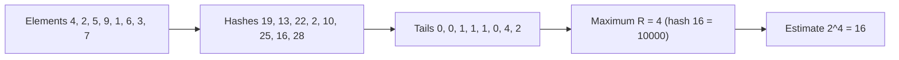

**Ek line mein:** <mark>Flajolet-Martin har element ko hash karta hai, hash ke trailing zeros ginta hai, sabse bada count R rakhta hai, aur distinct elements ka estimate 2^R lagata hai</mark>. <Cite id="stream-counting-fm1985" /> <Cite id="stream-counting-mmds-home" loc="§4.4" />

<Box kind="key">

**Har Flajolet-Martin sum mein ye points likho:**

- <mark>Har element ko diye gaye h(x) se hash karo aur result ko binary mein likho</mark>, jitne bits bole hain utne.
- <mark>Trailing zeros = binary number ke right end ke zeros</mark>. Example: 10100 mein 2.
- <mark>R = saare elements mein trailing zeros ka maximum</mark>.
- <mark>Estimate = 2^R</mark>.
- Agar hash value 0 (saare zeros) ho to uski tail define nahi hoti; aam practice mein use ignore karte hain, aur ye likh do.
- <mark>Repeated elements ka hash same aata hai, isliye R nahi badalta</mark>.
- Ek hash function rough hota hai; real use mein kayi hash functions, groups ke andar average, phir groups ka median lete hain.

</Box>

## Core answer (5 marks, yahan ke har question ke liye): method

<Box kind="definition">

The **Flajolet-Martin (FM) algorithm** estimates the number of **distinct** elements in a stream using very little memory (one number). Hash each element to a binary number, count its **trailing zeros** (the **tail length**), remember the largest tail $R$, and estimate $2^R$. <Cite id="stream-counting-fm1985" /> <Cite id="stream-counting-wiki-fm" />

</Box>

**Ye kyun kaam karta hai:** hash value kam se kam $r$ zeros pe khatam hone ki chance lagbhag $2^r$ mein $1$ element ki hoti hai. Agar dekhi gayi sabse lambi tail $R$ hai, to lagbhag $2^R$ alag elements hash hue honge. Repeats ka value same aata hai, isliye sirf distinct elements gine jaate hain. <Cite id="stream-counting-mmds-home" loc="§4.4" />

**Sum ke steps:**

1. Har element ka $h(x)$ nikalo, diye gaye modulus ke saath.
2. Har $h(x)$ ko binary mein likho, bataye gaye bits mein (aage leading zeros lagao).
3. Har ek ke trailing zeros gino.
4. $R$ = sabse bada count.
5. Estimate $= 2^R$.

<Cite id="stream-counting-gfg-fm" loc="diagram" />

| Sabse badi tail $R$ | 0 | 1 | 2 | 3 | 4 | 5 |
|---|---|---|---|---|---|---|
| Estimate $2^R$ | 1 | 2 | 4 | 8 | 16 | 32 |

**Conclusion:** <mark>FM sirf R store karta hai, phir bhi distinct count estimate karta hai</mark>, isliye un streams ke liye theek hai jo store karne ke liye bahut bade hain.

## Extended answer (10 marks): ye add karo

### 1. Ek poora worked sum

<Sum>

<Given>

Stream $S = \{4, 2, 5, 9, 1, 6, 3, 7\}$. Hash $h(x) = (3x + 7) \bmod 32$, result 5-bit binary integer maana gaya.

</Given>

<Find>

distinct elements ka Flajolet-Martin estimate.

</Find>

<Steps>

1. **Har element hash karo aur 5 bits mein likho.** *Reason: algorithm hash pe chalta hai, raw item pe nahi.*

   | $x$ | $3x + 7$ | $\bmod 32$ | 5-bit binary | Trailing zeros |
   |---|---|---|---|---|
   | 4 | 19 | 19 | 10011 | 0 |
   | 2 | 13 | 13 | 01101 | 0 |
   | 5 | 22 | 22 | 10110 | 1 |
   | 9 | 34 | 2 | 00010 | 1 |
   | 1 | 10 | 10 | 01010 | 1 |
   | 6 | 25 | 25 | 11001 | 0 |
   | 3 | 16 | 16 | 10000 | 4 |
   | 7 | 28 | 28 | 11100 | 2 |

2. Sabse zyada trailing zeros $R = 4$ hain ($x = 3$ se, hash 10000).
3. Estimate $= 2^R = 2^4 = 16$.

</Steps>

<Answer>

estimated number of distinct elements $= 2^4 = 16$.

</Answer>

<Box kind="verify">

Binary check: $19 = 16 + 2 + 1 = 10011$, $22 = 16 + 4 + 2 = 10110$, $16 = 10000$, $28 = 16 + 8 + 4 = 11100$. Stream mein 8 alag elements hain, to ek hash function 2 guna overestimate karta hai. Ye normal hai: ek hash ke saath FM rough hota hai.

</Box>

</Sum>

### 2. Estimate behtar kaise karein

- **Kayi hash functions** use karo, estimates ko groups mein baanto, **har group ke andar average** lo aur **group averages ka median** lo. Sirf average ek rare bade $2^R$ se kharab ho jaata hai; median use ignore kar deta hai. <Cite id="stream-counting-wiki-fm" />
- Modern improvement **HyperLogLog** hai, jo wahi idea use karta hai par error bahut kam hai. <Cite id="stream-counting-hll2007" />

### 3. Sum mein ye cases mention karo

| Case | Kya likhna hai |
|---|---|
| Hash hamesha odd, jaise $2x + 1$ ya $4x + 1$ | Last bit hamesha 1 hai, isliye $R = 0$ aur estimate 1. Ye poor hash hai, par answer waisa hi likho jaisa pucha hai. |
| Hash value 0 | Tail define nahi hoti; ignore karo aur likh do. (Use poori length ki tail maanoge to $2^{\text{bits}}$ aayega.) |
| Bahut chhoti stream | Estimate sach se door ho sakta hai; true distinct count likh do. |

## Har question mein kaise fit karein

Saare saat ek hi method hain; sirf numbers badalte hain. Table likho, phir $R$, phir $2^R$. <Cite id="stream-counting-fm1985" />

- **"Stream 1, 3, 2, 1, 2, 3, 4, 3, 1, 2, 3, 1 with h(x) = 6x + 1 mod 5: show how FM estimates the distinct elements"** (10 marks) <PYQ id="2022-12-ce/q3a" />: hashes 2, 4, 3, 0 (x = 4 ke liye). Hash 0 ki tail nahi hoti, ignore karo: $R = 2$ (hash 4 = 100 se), estimate $4$. True count 4 hai.
- **"Stream S = \{2, 1, 6, 1, 5, 9, 2, 3, 5\}, h(x) = 4x + 1 mod 16, 4-bit binary"** (10 marks) <PYQ id="2023-05-ce/q3a" />: har hash odd hai, isliye $R = 0$ aur estimate $2^0 = 1$ (true count 6; likho ki hash poor hai).
- **"Stream S = \{4, 2, 5, 9, 1, 6, 3, 7\}, h(x) = x + 6 mod 32, 5-bit binary"** (10 marks) <PYQ id="2023-12-ce/q3a" />: hashes 10, 8, 11, 15, 7, 12, 9, 13; hash 8 = 01000 ke 3 trailing zeros hain, isliye $R = 3$ aur estimate $8$.
- **"Stream S = \{4, 2, 5, 9, 1, 6, 3, 7\}, h(x) = 3x + 7 mod 32, 5-bit binary"** (10 marks) <PYQ id="2024-05-ce/q3a" />: upar wala worked sum. $R = 4$, estimate $16$.
- **"Stream 9, 8, 7, 6, 5, 4, 3, 2 with h(x) = (2x + 1) mod 32, 5-bit binary"** (10 marks) <PYQ id="2024-12-ce/q4a" />: $2x + 1$ hamesha odd hai, isliye $R = 0$ aur estimate $1$ (true count 8).
- **"Stream S = \{10, 12, 8, 15, 6, 9, 14, 7\}, h(x) = 5x + 11 mod 32, 5-bit binary"** (10 marks) <PYQ id="2025-05-ce/q3a" />: hashes 29, 7, 19, 22, 9, 24, 17, 14; 24 = 11000 ke 3 trailing zeros hain, isliye $R = 3$ aur estimate $8$.
- **"Stream 3, 1, 4, 1, 5, 9, 2, 6, 5 with h(x) = 3x + 7 mod 8, treat the result as a 5-bit binary integer"** (10 marks) <PYQ id="2025-12-ce/q5a" />: hashes 0, 2, 3, 2, 6, 2, 5, 1, 6. Hash 0 = 00000 ke paanch trailing zeros hain, isliye $R = 5$ aur estimate $32$. Agar hash 0 skip karo to $R = 1$ aur estimate $2$. Likho ki kaunsa rule use kiya; true count 7 hai.

## Exam tips

- **Hamesha draw karo:** columns $x$, $h(x)$, binary, trailing zeros wali table. Marks isi table pe milte hain.
- Question ka **bit width** (4 bits ya 5 bits) likho aur leading zeros rakho: 5 bits mein 2 = 00010.
- Common galti: **leading** zeros ginna ya 1s ginna. Sirf **right end** ke zeros gine jaate hain.
- Ek line se khatam karo: "Estimated distinct elements $= 2^R = \ldots$", aur true count bhi likh do taaki dikhe ki check kiya.

Exam mein English mein likho.
