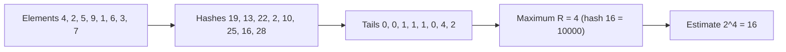

**In one line:** <mark>Flajolet-Martin hashes every element, counts the trailing zeros of the hash, keeps the largest count R, and estimates the number of distinct elements as 2^R</mark>. <Cite id="stream-counting-fm1985" /> <Cite id="stream-counting-mmds-home" loc="§4.4" />

<Box kind="key">

**Key points to write (any Flajolet-Martin sum):**

- <mark>Hash each element with the given h(x) and write the result in binary</mark> with the stated number of bits.
- <mark>Trailing zeros = zeros at the right end</mark> of the binary number. Example: 10100 has 2.
- <mark>R = the maximum number of trailing zeros over all elements</mark>.
- <mark>Estimate = 2^R</mark>.
- A hash value that is 0 (all zeros) has no defined tail; the usual practice is to ignore it, and say so.
- <mark>Repeated elements give the same hash, so they never change R</mark>.
- One hash function is rough; real use takes many hash functions, averages inside groups and then the median of the groups.

</Box>

## Core answer (5 marks, fits every question here): the method

<Box kind="definition">

The **Flajolet-Martin (FM) algorithm** estimates the number of **distinct** elements in a stream using very little memory (one number). Hash each element to a binary number, count its **trailing zeros** (the **tail length**), remember the largest tail $R$, and estimate $2^R$. <Cite id="stream-counting-fm1985" /> <Cite id="stream-counting-wiki-fm" />

</Box>

**Why it works:** a hash value ends in at least $r$ zeros for about $1$ element in $2^r$. If the longest tail seen is $R$, then about $2^R$ different elements were probably hashed. Repeats give the same value, so only distinct elements count. <Cite id="stream-counting-mmds-home" loc="§4.4" />

**Steps for a sum:**

1. Compute $h(x)$ for every element, with the modulus given.
2. Write each $h(x)$ in binary using the stated number of bits (add leading zeros).
3. Count the trailing zeros of each.
4. $R$ = the largest count.
5. Estimate $= 2^R$.

<Cite id="stream-counting-gfg-fm" loc="diagram" />

| Largest tail $R$ | 0 | 1 | 2 | 3 | 4 | 5 |
|---|---|---|---|---|---|---|
| Estimate $2^R$ | 1 | 2 | 4 | 8 | 16 | 32 |

**Conclusion:** <mark>FM stores only R, yet estimates the distinct count</mark>, which suits streams too big to store.

## Extended answer (10 marks): add these

### 1. A full worked sum

<Sum>

<Given>

Stream $S = \{4, 2, 5, 9, 1, 6, 3, 7\}$. Hash $h(x) = (3x + 7) \bmod 32$, result treated as a 5-bit binary integer.

</Given>

<Find>

the Flajolet-Martin estimate of the number of distinct elements.

</Find>

<Steps>

1. **Hash each element and write it in 5 bits.** *Reason: the algorithm works on the hash, not on the raw item.*

   | $x$ | $3x + 7$ | $\bmod 32$ | 5-bit binary | Trailing zeros |
   |---|---|---|---|---|
   | 4 | 19 | 19 | 10011 | 0 |
   | 2 | 13 | 13 | 01101 | 0 |
   | 5 | 22 | 22 | 10110 | 1 |
   | 9 | 34 | 2 | 00010 | 1 |
   | 1 | 10 | 10 | 01010 | 1 |
   | 6 | 25 | 25 | 11001 | 0 |
   | 3 | 16 | 16 | 10000 | 4 |
   | 7 | 28 | 28 | 11100 | 2 |

2. The largest number of trailing zeros is $R = 4$ (from $x = 3$, hash 10000).
3. Estimate $= 2^R = 2^4 = 16$.

</Steps>

<Answer>

estimated number of distinct elements $= 2^4 = 16$.

</Answer>

<Box kind="verify">

Binary check: $19 = 16 + 2 + 1 = 10011$, $22 = 16 + 4 + 2 = 10110$, $16 = 10000$, $28 = 16 + 8 + 4 = 11100$. The stream has 8 different elements, so one hash function overestimates by a factor of 2. This is normal: FM with one hash is rough.

</Box>

</Sum>

### 2. How to improve the estimate

- Use **many hash functions**, split the estimates into groups, **average inside each group** and take the **median of the group averages**. Averaging alone is spoiled by a rare large $2^R$; the median ignores it. <Cite id="stream-counting-wiki-fm" />
- The modern improvement is **HyperLogLog**, which uses the same idea with much less error. <Cite id="stream-counting-hll2007" />

### 3. Cases to mention in a sum

| Case | What to write |
|---|---|
| Hash always odd, like $2x + 1$ or $4x + 1$ | The last bit is always 1, so $R = 0$ and the estimate is 1. This is a poor hash, but write the answer as asked. |
| Hash value 0 | No tail is defined; ignore it and say so. (Counting it as a full-length tail would give $2^{\text{bits}}$.) |
| Very small stream | The estimate can be far from the truth; mention the true distinct count. |

## Fit it to each question

All seven are the same method; only the numbers change. Write the table, then $R$, then $2^R$. <Cite id="stream-counting-fm1985" />

- **"Stream 1, 3, 2, 1, 2, 3, 4, 3, 1, 2, 3, 1 with h(x) = 6x + 1 mod 5: show how FM estimates the distinct elements"** (10 marks) <PYQ id="2022-12-ce/q3a" />: hashes are 2, 4, 3, 0 (for x = 4). The hash 0 has no tail, so ignore it: $R = 2$ (from hash 4 = 100), estimate $4$. True count is 4.
- **"Stream S = \{2, 1, 6, 1, 5, 9, 2, 3, 5\}, h(x) = 4x + 1 mod 16, 4-bit binary"** (10 marks) <PYQ id="2023-05-ce/q3a" />: every hash is odd, so $R = 0$ and the estimate is $2^0 = 1$ (true count 6; say the hash is poor).
- **"Stream S = \{4, 2, 5, 9, 1, 6, 3, 7\}, h(x) = x + 6 mod 32, 5-bit binary"** (10 marks) <PYQ id="2023-12-ce/q3a" />: hashes 10, 8, 11, 15, 7, 12, 9, 13; the hash 8 = 01000 has 3 trailing zeros, so $R = 3$ and the estimate is $8$.
- **"Stream S = \{4, 2, 5, 9, 1, 6, 3, 7\}, h(x) = 3x + 7 mod 32, 5-bit binary"** (10 marks) <PYQ id="2024-05-ce/q3a" />: the worked sum above. $R = 4$, estimate $16$.
- **"Stream 9, 8, 7, 6, 5, 4, 3, 2 with h(x) = (2x + 1) mod 32, 5-bit binary"** (10 marks) <PYQ id="2024-12-ce/q4a" />: $2x + 1$ is always odd, so $R = 0$ and the estimate is $1$ (true count 8).
- **"Stream S = \{10, 12, 8, 15, 6, 9, 14, 7\}, h(x) = 5x + 11 mod 32, 5-bit binary"** (10 marks) <PYQ id="2025-05-ce/q3a" />: hashes 29, 7, 19, 22, 9, 24, 17, 14; 24 = 11000 has 3 trailing zeros, so $R = 3$ and the estimate is $8$.
- **"Stream 3, 1, 4, 1, 5, 9, 2, 6, 5 with h(x) = 3x + 7 mod 8, treat the result as a 5-bit binary integer"** (10 marks) <PYQ id="2025-12-ce/q5a" />: hashes 0, 2, 3, 2, 6, 2, 5, 1, 6. The hash 0 = 00000 has five trailing zeros, so $R = 5$ and the estimate is $32$. If you skip the hash 0, $R = 1$ and the estimate is $2$. State which rule you use; the true count is 7.

## Exam tips

- **Always draw:** the table with columns $x$, $h(x)$, binary, trailing zeros. Marks go to this table.
- Write the **bit width** from the question (4 bits or 5 bits) and keep the leading zeros: 2 in 5 bits is 00010.
- Common mistake: counting **leading** zeros, or counting the 1s. Only the zeros at the **right end** count.
- Finish with one line: "Estimated distinct elements $= 2^R = \ldots$", and add the true count to show you checked.
