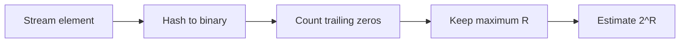

**Ek line mein:** <mark>Flajolet-Martin algorithm lambi stream mein distinct elements ki sankhya bahut kam memory se estimate karta hai</mark>; do real uses hain <mark>website ke unique visitors ginna aur distinct search queries ginna</mark>. <Cite id="stream-counting-fm1985" /> <Cite id="stream-counting-mmds-home" loc="§4.4" />

<Box kind="key">

**Ye points likho:**

- Problem: <mark>stream mein distinct elements ginna</mark>; har element store karne ke liye distinct elements jitni memory chahiye.
- Algorithm: <mark>Flajolet-Martin (aur uska modern form, HyperLogLog)</mark>.
- Method: <mark>har element hash karo, trailing zeros gino, maximum R rakho, estimate 2^R</mark>.
- Ye <mark>har hash function ke liye sirf ek chhota number</mark> rakhta hai, aur repeats se wo nahi badalta.
- Application 1: <mark>website ya app ke unique visitors (users ya IP addresses)</mark>.
- Application 2: <mark>distinct search queries, distinct products viewed, network traffic mein distinct IPs</mark>.
- Answer <mark>approximate</mark> hai; error kam karne ke liye kayi hash functions milaate hain.

</Box>

## Core answer (5 marks, yahan ke har question ke liye)

<Box kind="definition">

The **Flajolet-Martin (FM) algorithm** estimates the number of **distinct** elements in a stream using memory of only a few numbers. It hashes each element, counts the trailing zeros of the hash, and estimates $2^R$ where $R$ is the longest tail seen. <Cite id="stream-counting-fm1985" /> <Cite id="stream-counting-wiki-countdistinct" />

</Box>

**Kyun chahiye:** dekhe gaye har element ko rakhne ke liye distinct elements jitni memory chahiye, jo arabon items ke liye bahut zyada hai. FM ek number se approximate answer deta hai. <Cite id="stream-counting-mmds-home" loc="§4.4" />

**Kaise kaam karta hai:**

1. Har element ko binary number mein hash karo.
2. Hash ke **trailing zeros** gino aur sirf sabse bada count $R$ rakho.
3. Distinct count ka estimate $2^R$. $r$ zeros pe khatam hone wale hash ki chance $1/2^r$ hai, isliye $R$ zeros dikhna lagbhag $2^R$ alag elements ka sanket hai. Repeats ka hash same aata hai, isliye $R$ nahi badalta.

<Cite id="stream-counting-gfg-fm" loc="diagram" />

**Do real-life applications:**

1. **Website ya app ke unique visitors.** Aaj kitne alag users ya IP addresses aaye, sabko store kiye bina ginna. HyperLogLog Redis mein ye karta hai (`PFCOUNT`). <Cite id="stream-counting-redis-hll" />
2. **Distinct search queries.** Search engine bina har query rakhe ginta hai ki is mahine kitni alag queries aayi. <Cite id="stream-counting-mmds-home" loc="§4.4" />

**Conclusion:** <mark>FM ek chhote number se stream ke distinct elements estimate karta hai, price ye ki answer approximate hota hai</mark>.

## Extended answer (10 marks): ye add karo

### 1. Ek chhota example

Hashes 2, 4, 3 (binary 010, 100, 011) ke liye tails 1, 2, 0 hain, isliye $R = 2$ aur estimate $2^2 = 4$ distinct elements.

| Hash | Binary | Trailing zeros |
|---|---|---|
| 2 | 010 | 1 |
| 4 | 100 | 2 |
| 3 | 011 | 0 |

### 2. Estimate behtar karna

- Ek hash rough answer deta hai (estimate hamesha power of 2 hota hai). Isliye **kayi hash functions** lo, groups ke andar estimates ka average lo, aur group averages ka **median** lo. <Cite id="stream-counting-wiki-countdistinct" />
- **HyperLogLog** (2007) modern improvement hai. Ye hash ke pehle bits se stream ko kayi chhote groups mein baantta hai, har group ka $R$ rakhta hai aur sabko milata hai, aur sirf kilobytes ki memory se lagbhag 1 percent error deta hai. <Cite id="stream-counting-hll2007" />

### 3. Aur applications

| Application | Kya ginte hain |
|---|---|
| Web analytics | Unique visitors, roz ke unique users (Redis HyperLogLog) |
| Search engines | Distinct queries |
| Network monitoring | Traffic mein distinct IP addresses ya flows |
| Data warehouses | Fast approximate distinct counts, jaise Spark ka `approx_count_distinct` aur BigQuery ka HyperLogLog++ |

<Cite id="stream-counting-spark-approx" /> <Cite id="stream-counting-bq-hll" />

### 4. Advantages aur disadvantages

| Advantages | Disadvantages |
|---|---|
| Bahut kam memory | Sirf estimate, exact nahi |
| Ek pass, har element ke liye constant time | Ek hash rough hai; kayi hashes chahiye |
| Repeated elements apne aap ignore ho jaate hain | Estimates powers of 2 hote hain |

## Har question mein kaise fit karein

- **"Which algorithm can be used for finding distinct elements in a long data stream? Give two real life applications for the same."** (5 marks) <PYQ id="2025-12-ce/q1b" />: **Flajolet-Martin** (aur HyperLogLog) ka naam likho, core answer (kaise kaam karta hai, flowchart) aur do applications likho. Time ho to section 2 (kayi hashes) ek line mein jodo.

## Exam tips

- **Pehle algorithm ka naam likho:** "Flajolet-Martin algorithm", phir "HyperLogLog uska improved version hai".
- **Do applications** do, aur kya ginte hain wo bhi likho: "unique visitors of a website", "distinct search queries".
- Formula likho: estimate $= 2^R$, $R$ = maximum trailing zeros.

Exam mein English mein likho.
