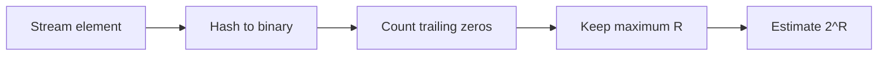

**In one line:** <mark>The Flajolet-Martin algorithm estimates the number of distinct elements in a long stream using very little memory</mark>; two real uses are <mark>counting unique visitors of a website and counting distinct search queries</mark>. <Cite id="stream-counting-fm1985" /> <Cite id="stream-counting-mmds-home" loc="§4.4" />

<Box kind="key">

**Key points to write:**

- Problem: <mark>count distinct elements in a stream</mark>; storing every element needs memory as big as the number of distinct elements.
- Algorithm: <mark>Flajolet-Martin (and its modern form, HyperLogLog)</mark>.
- Method: <mark>hash each element, count trailing zeros, keep the maximum R, estimate 2^R</mark>.
- It keeps <mark>only one small number</mark> per hash function, and repeats do not change it.
- Application 1: <mark>unique visitors (users or IP addresses) of a website or app</mark>.
- Application 2: <mark>distinct search queries, distinct products viewed, distinct IPs in network traffic</mark>.
- Answer is <mark>approximate</mark>; many hash functions are combined to reduce the error.

</Box>

## Core answer (5 marks, fits every question here)

<Box kind="definition">

The **Flajolet-Martin (FM) algorithm** estimates the number of **distinct** elements in a stream using memory of only a few numbers. It hashes each element, counts the trailing zeros of the hash, and estimates $2^R$ where $R$ is the longest tail seen. <Cite id="stream-counting-fm1985" /> <Cite id="stream-counting-wiki-countdistinct" />

</Box>

**Why it is needed:** keeping every element seen would need memory as large as the number of distinct elements, which is too much for billions of items. FM gives an approximate answer from one number. <Cite id="stream-counting-mmds-home" loc="§4.4" />

**How it works:**

1. Hash every element to a binary number.
2. Count the **trailing zeros** of the hash and keep only the largest count $R$.
3. Estimate the distinct count as $2^R$. A hash ending in $r$ zeros has chance $1/2^r$, so seeing $R$ zeros suggests about $2^R$ different elements. Repeats give the same hash, so they never change $R$.

<Cite id="stream-counting-gfg-fm" loc="diagram" />

**Two real-life applications:**

1. **Unique visitors of a website or app.** Count how many different users or IP addresses visited today without storing all of them. HyperLogLog does this in Redis (`PFCOUNT`). <Cite id="stream-counting-redis-hll" />
2. **Distinct search queries.** A search engine can count how many different queries it received this month without keeping every query. <Cite id="stream-counting-mmds-home" loc="§4.4" />

**Conclusion:** <mark>FM estimates distinct elements in a stream from one small number, at the cost of an approximate answer</mark>.

## Extended answer (10 marks): add these

### 1. A tiny example

For the hashes 2, 4, 3 (binary 010, 100, 011) the tails are 1, 2, 0, so $R = 2$ and the estimate is $2^2 = 4$ distinct elements.

| Hash | Binary | Trailing zeros |
|---|---|---|
| 2 | 010 | 1 |
| 4 | 100 | 2 |
| 3 | 011 | 0 |

### 2. Improving the estimate

- One hash gives a rough answer (the estimate is always a power of 2). So use **many hash functions**, average the estimates inside groups, and take the **median** of the group averages. <Cite id="stream-counting-wiki-countdistinct" />
- **HyperLogLog** (2007) is the modern improvement. It splits the stream into many small groups by the first bits of the hash, keeps $R$ for each group and combines them, giving an error of about 1 percent with only kilobytes of memory. <Cite id="stream-counting-hll2007" />

### 3. More applications

| Application | What is counted |
|---|---|
| Web analytics | Unique visitors, unique users per day (Redis HyperLogLog) |
| Search engines | Distinct queries |
| Network monitoring | Distinct IP addresses or flows in traffic |
| Data warehouses | Fast approximate distinct counts, for example Spark's `approx_count_distinct` and BigQuery's HyperLogLog++ |

<Cite id="stream-counting-spark-approx" /> <Cite id="stream-counting-bq-hll" />

### 4. Advantages and disadvantages

| Advantages | Disadvantages |
|---|---|
| Very small memory | Only an estimate, not exact |
| One pass, constant time per element | A single hash is rough; needs many hashes |
| Repeated elements are ignored automatically | Estimates are powers of 2 |

## Fit it to each question

- **"Which algorithm can be used for finding distinct elements in a long data stream? Give two real life applications for the same."** (5 marks) <PYQ id="2025-12-ce/q1b" />: name **Flajolet-Martin** (and HyperLogLog), write the core answer (how it works, flowchart) and the two applications. Add section 2 (many hashes) in one line if you have time.

## Exam tips

- **Always name the algorithm first:** "Flajolet-Martin algorithm", then add "HyperLogLog is its improved version".
- Give **two applications** with the thing counted: "unique visitors of a website", "distinct search queries".
- Write the formula: estimate $= 2^R$, $R$ = maximum trailing zeros.
