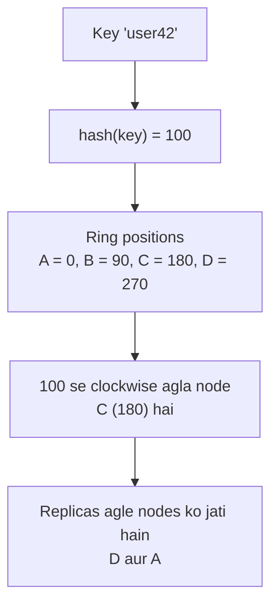
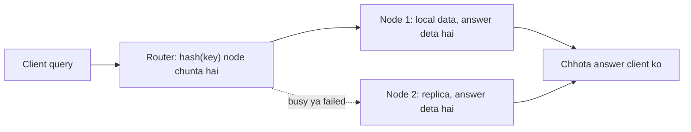

**Ek line mein:** <mark>NoSQL systems big data problems ko chaar tarah se handle karte hain: query ko data ke paas le jao, hash rings se data barabar baanto, reads scale karne ke liye replication use karo, aur database queries ko data nodes pe barabar baante</mark>. <Cite id="big-data-intro-nosql" />

<Box kind="key">

**NoSQL ke four ways ke question mein ye points likho:**

- <mark>1. Query ko data ke paas le jao, data ko query ke paas nahi</mark> (chhoti query har node ko bhejo, chhote answers wapas).
- <mark>2. Cluster mein data barabar baantne ke liye consistent hashing (hash rings) use karo</mark>.
- <mark>3. Reads scale karne ke liye replication use karo</mark> (bahut copies, koi bhi copy answer de sakti hai, failure se bhi bachata hai).
- <mark>4. Database queries ko data nodes pe barabar baante</mark> (koi hot spot nahi).
- **Hash ring** pe key clockwise agle node ke paas jati hai, isliye node add karne pe sirf kuch keys move hoti hain.
- Bada picture: cheap nodes ke **shared-nothing** clusters.

</Box>

## Core answer (5 marks, yahan ke har question ke liye)

<Box kind="definition">

Big data is too large for one server, so NoSQL systems run on a cluster of cheap machines and use four main techniques to spread data and work evenly. These four ways are described by McCreary and Kelly. <Cite id="big-data-intro-nosql" />

</Box>

1. **Query ko data ke paas le jao, data ko query ke paas nahi.** Terabytes network pe bhejna slow hai. Chhoti query har node ko bhejo, woh apne local data mein search kare aur sirf chhote answers wapas kare. MapReduce aise hi kaam karta hai. <Cite id="big-data-intro-mapreduce" /> <Cite id="nosql-intro-wiki-sharding" />
2. **Cluster mein data barabar baantne ke liye hash rings use karo.** Hash function key ko number banata hai; numbers ek circle (ring) pe rakhe jate hain aur har node ring ka ek hissa sambhalta hai. Key ring pe ghoomte hue pehle mile node pe store hoti hai. Nodes aate-jaate hain to data ka sirf chhota hissa move hota hai. <Cite id="nosql-intro-dynamo" /> <Cite id="web-bda-1-wiki-consistent-hashing" />
3. **Reads scale karne ke liye replication use karo.** Data ke har piece ki kai copies alag nodes pe rakho. Reads kisi bhi copy pe ja sakte hain, isliye zyada copies matlab zyada reads per second, aur copies node failure se bhi bachati hain. <Cite id="nosql-intro-mongo-repl" />
4. **Database queries ko data nodes pe barabar baante.** Router ya nodes khud har request ko aise node ko bhejte hain jiske paas data hai aur jo busy nahi, isliye koi node hot spot nahi banta. <Cite id="nosql-intro-mongo-shard" />

<Cite id="nosql-intro-dynamo" loc="diagram" /> <Cite id="nosql-intro-cassandra-dynamo" loc="diagram" />

**Conclusion:** <mark>ye chaar tarike NoSQL ko cheap nodes pe scale out karne dete hain, kaam aur data barabar baante hue</mark>.

## Extended answer (10 marks): ye add karo

### 1. Hash ring kyun, hash mod N kyun nahi

`hash mod N` mein nodes ki sankhya $N$ badalne se lagbhag har key ka ghar badal jata hai. Ring mein sirf kuch hi move hoti hain. <Cite id="web-bda-1-wiki-consistent-hashing" />

<Sum>

<Given>

Case 1: eight keys with hash values $4, 5, 6, 7, 8, 9, 10, 11$ placed by `hash mod N`; the cluster grows from $N = 3$ to $N = 4$.

Case 2: a ring with nodes A $= 0$, B $= 90$, C $= 180$, D $= 270$; a key goes to the first node at or after its hash going clockwise (after 270 it wraps to A). Keys: k1 $= 50$, k2 $= 100$, k3 $= 200$, k4 $= 300$, k5 $= 130$. A new node E is added at $150$.

</Given>

<Find>

how many keys change node in each case.

</Find>

<Steps>

1. Case 1, $N = 3$: remainders of $4, 5, \dots, 11$ divided by 3 are $1, 2, 0, 1, 2, 0, 1, 2$.
2. Case 1, $N = 4$: remainders divided by 4 are $0, 1, 2, 3, 0, 1, 2, 3$.
3. Compare each pair: all 8 differ, so all 8 keys move.
4. Case 2, before E: k1 $\to$ B, k2 $\to$ C, k3 $\to$ D, k4 $\to$ A (wraps), k5 $\to$ C.
5. Case 2, after E at 150: k2 $= 100 \to$ E and k5 $= 130 \to$ E; the others are unchanged. *Reason: E is now the first node at or after 100 and 130.*
6. Only k2 and k5 changed, 2 of 5.

</Steps>

<Answer>

`hash mod N`: 8 of 8 keys move. Hash ring: 2 of 5 keys move.

</Answer>

<Box kind="verify">

A new node E at 150 can only take keys with hash in $(90, 150]$, the stretch between B and E that used to belong to C. Of our keys only 100 and 130 lie in that range, which matches.

</Box>

</Sum>

### 2. Replication aur distribution models

| Point | Master-slave | Peer-to-peer |
|---|---|---|
| Idea | Ek master saari writes leta hai aur slaves ko copy karta hai | Saare nodes barabar hain aur reads aur writes lete hain |
| Reads | Slaves serve karte hain (reads scale) | Koi bhi node serve karta hai |
| Writes | Sirf master ke through | Koi bhi node, isliye writes bhi scale |
| Failure | Master writes ke liye single point of failure | Koi single point of failure nahi |
| Consistency | Aasaan, ek jagah order tay hota hai | Mushkil, conflicting writes resolve karni padti hain |
| Examples | MongoDB replica set, HBase | Cassandra, Amazon Dynamo |

<Cite id="nosql-intro-mongo-repl" /> <Cite id="nosql-intro-cassandra-dynamo" /> <Cite id="big-data-intro-cassandra" />

### 3. Chaaron tarike saath mein

## Har question mein kaise fit karein

- **"Describe the four ways by which big data problems are handled by NoSQL."** (10 marks) <PYQ id="2023-12-ce/q2a" />: core answer (chaaron tarike ring diagram ke saath), phir **section 1** (sum), section 2 aur shared-nothing pe ek line.
- **"Four ways that NoSQL systems handle big data problems."** (10 marks) <PYQ id="2025-05/q6d" />: wahi; extended part ke liye replication diagram aur master-slave versus peer-to-peer table add karo.

## Exam tips

- **Chaaron tarike number karo** upar wale exact order mein aur har ka pehla phrase bold karo.
- **Hash ring draw karo** 4 nodes aur ek key ke saath; examiner yahi picture chahta hai.
- Ring ka **reason** yaad rakho: node add ya remove karne pe sirf kuch keys move hoti hain.
