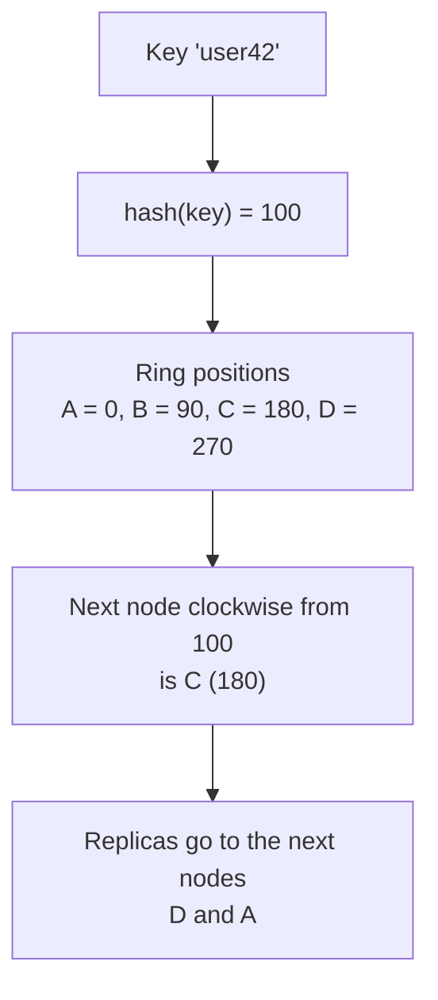

**In one line:** <mark>NoSQL systems handle big data problems in four ways: move the query to the data, distribute data evenly with hash rings, use replication to scale reads, and let the database distribute queries evenly across data nodes</mark>. <Cite id="big-data-intro-nosql" />

<Box kind="key">

**Key points to write (four ways NoSQL handles big data):**

- <mark>1. Move the query to the data, not the data to the query</mark> (send the small query to each node, return small answers).
- <mark>2. Use consistent hashing (hash rings) to distribute data evenly across the cluster</mark>.
- <mark>3. Use replication to scale reads</mark> (many copies, any copy can answer, also protects against failure).
- <mark>4. Let the database distribute queries evenly to the data nodes</mark> (no hot spot).
- On a **hash ring** a key goes to the next node clockwise, so adding a node moves only a few keys.
- The big picture: **shared-nothing** clusters of cheap nodes.

</Box>

## Core answer (5 marks, fits every question here)

<Box kind="definition">

Big data is too large for one server, so NoSQL systems run on a cluster of cheap machines and use four main techniques to spread data and work evenly. These four ways are described by McCreary and Kelly. <Cite id="big-data-intro-nosql" />

</Box>

1. **Move the query to the data, not the data to the query.** Sending terabytes over the network is slow. Send the small query to each node, let it search its own local data and return only small answers. MapReduce works like this. <Cite id="big-data-intro-mapreduce" /> <Cite id="nosql-intro-wiki-sharding" />
2. **Use hash rings to distribute data evenly across a cluster.** A hash function turns a key into a number; the numbers are arranged on a circle and each node owns a part of the ring. A key is stored on the first node found going round. Nodes can join or leave and only a small part of the data moves. <Cite id="nosql-intro-dynamo" /> <Cite id="web-bda-1-wiki-consistent-hashing" />
3. **Use replication to scale reads.** Keep several copies of each piece of data on different nodes. Reads can go to any copy, so more copies mean more reads per second, and copies also protect against node failure. <Cite id="nosql-intro-mongo-repl" />
4. **Let the database distribute queries evenly to the data nodes.** A router or the nodes themselves send each request to a node that holds the data and is not busy, so no node becomes a hot spot. <Cite id="nosql-intro-mongo-shard" />

<Cite id="nosql-intro-dynamo" loc="diagram" /> <Cite id="nosql-intro-cassandra-dynamo" loc="diagram" />

**Conclusion:** <mark>these four ways let NoSQL scale out on cheap nodes, with the work and the data spread evenly</mark>.

## Extended answer (10 marks): add these

### 1. Why a hash ring and not hash mod N

With `hash mod N`, changing the number of nodes $N$ changes the home of almost every key. A ring moves only a few. <Cite id="web-bda-1-wiki-consistent-hashing" />

<Sum>

<Given>

Case 1: eight keys with hash values $4, 5, 6, 7, 8, 9, 10, 11$ placed by `hash mod N`; the cluster grows from $N = 3$ to $N = 4$.

Case 2: a ring with nodes A $= 0$, B $= 90$, C $= 180$, D $= 270$; a key goes to the first node at or after its hash going clockwise (after 270 it wraps to A). Keys: k1 $= 50$, k2 $= 100$, k3 $= 200$, k4 $= 300$, k5 $= 130$. A new node E is added at $150$.

</Given>

<Find>

how many keys change node in each case.

</Find>

<Steps>

1. Case 1, $N = 3$: remainders of $4, 5, \dots, 11$ divided by 3 are $1, 2, 0, 1, 2, 0, 1, 2$.
2. Case 1, $N = 4$: remainders divided by 4 are $0, 1, 2, 3, 0, 1, 2, 3$.
3. Compare each pair: all 8 differ, so all 8 keys move.
4. Case 2, before E: k1 $\to$ B, k2 $\to$ C, k3 $\to$ D, k4 $\to$ A (wraps), k5 $\to$ C.
5. Case 2, after E at 150: k2 $= 100 \to$ E and k5 $= 130 \to$ E; the others are unchanged. *Reason: E is now the first node at or after 100 and 130.*
6. Only k2 and k5 changed, 2 of 5.

</Steps>

<Answer>

`hash mod N`: 8 of 8 keys move. Hash ring: 2 of 5 keys move.

</Answer>

<Box kind="verify">

A new node E at 150 can only take keys with hash in $(90, 150]$, the stretch between B and E that used to belong to C. Of our keys only 100 and 130 lie in that range, which matches.

</Box>

</Sum>

### 2. Replication and distribution models

| Point | Master-slave | Peer-to-peer |
|---|---|---|
| Idea | One master takes all writes, copies them to slaves | All nodes are equal and take reads and writes |
| Reads | Served by slaves (scales reads) | Served by any node |
| Writes | Only through the master | Any node, so writes scale too |
| Failure | Master is a single point of failure for writes | No single point of failure |
| Consistency | Easy, one place decides the order | Harder, conflicting writes must be resolved |
| Examples | MongoDB replica set, HBase | Cassandra, Amazon Dynamo |

<Cite id="nosql-intro-mongo-repl" /> <Cite id="nosql-intro-cassandra-dynamo" /> <Cite id="big-data-intro-cassandra" />

### 3. Putting the four ways together

## Fit it to each question

- **"Describe the four ways by which big data problems are handled by NoSQL."** (10 marks) <PYQ id="2023-12-ce/q2a" />: core answer (all four ways with the ring diagram), then **section 1** (the sum), section 2 and one line on shared-nothing.
- **"Four ways that NoSQL systems handle big data problems."** (10 marks) <PYQ id="2025-05/q6d" />: the same; for the extended part add the replication diagram and the master-slave versus peer-to-peer table.

## Exam tips

- **Number the four ways** in the exact order above and bold the first phrase of each.
- **Draw the hash ring** with 4 nodes and one key; it is the picture the examiner expects.
- Remember the **reason** for the ring: adding or removing a node moves only a few keys.
