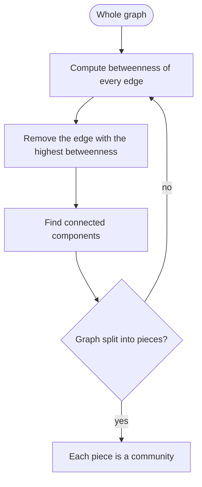
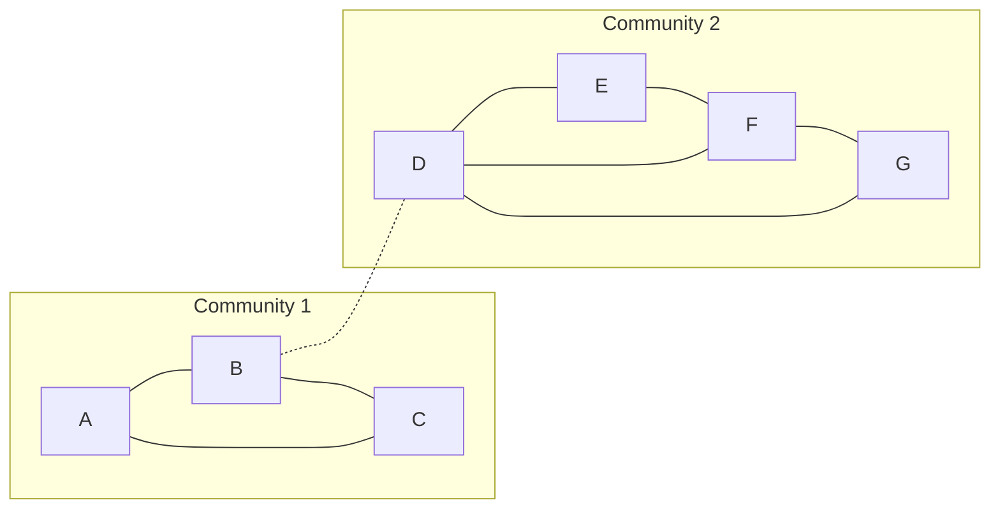

**Ek line mein:** <mark>Girvan-Newman algorithm communities dhoondhta hai: sabse high betweenness (usse guzarne wale shortest paths ki sankhya) wale edge ko baar baar hatata hai jab tak graph tukdon mein na toot jaye</mark>. <Cite id="social-network-graphs-girvan-newman2002" /> <Cite id="social-network-graphs-mmds-book" loc="§10.2" />

<Box kind="key">

**Har Girvan-Newman sum mein ye points likho:**

- <mark>Edge betweenness = saare node pairs ke beech ke wo shortest paths jo us edge se guzarte hain</mark>; agar ek pair ke kayi shortest paths hon to wo ek unit ka credit barabar baant lete hain.
- <mark>Communities ke beech ke bridge edges pe bahut shortest paths hote hain, isliye unki betweenness sabse high hoti hai.</mark>
- Steps: <mark>har edge ki betweenness nikalo, sabse high hatao, dobara nikalo, graph tootne tak repeat</mark>. Connected pieces communities hain.
- <mark>Har removal ke baad dobara compute karo</mark>, kyunki shortest paths badal jaate hain.
- Ties: tied edges mein se koi ek hatao aur likh do; final communities aam taur pe wahi aati hain.
- Check: betweenness values ka jod saare shortest-path lengths ke jod ke barabar; split ki modularity positive.

</Box>

## Core answer (5 marks, yahan ke har question ke liye): method

<Box kind="definition">

**Girvan-Newman** is a community-detection algorithm for graphs. The **edge betweenness** of an edge is the number of shortest paths between all pairs of nodes that run through it. Edges joining two communities lie on many shortest paths, so removing the highest-betweenness edges, step by step, separates the communities. <Cite id="social-network-graphs-girvan-newman2002" /> <Cite id="social-network-graphs-wiki-girvan-newman" />

</Box>

**Steps:** <Cite id="social-network-graphs-gfg-girvan-newman" />

1. Har node pair ke shortest path(s) nikalo; agar kayi hon to ek unit ka credit unme barabar baanto.
2. Edge ki **betweenness** wo total credit hai jo use milta hai.
3. Sabse high betweenness wala edge **hatao**.
4. Bache edges ki betweenness **dobara compute** karo aur repeat.
5. Jab graph alag connected pieces mein toot jaye to har piece ek **community** hai. Chhoti communities chahiye to aage badho; sabse achhi **modularity** wala split rakho.

<Cite id="social-network-graphs-gfg-girvan-newman" loc="diagram" />

**Conclusion:** <mark>sabse high betweenness wala edge bridge hota hai, aur use hatane se communities saamne aa jaati hain</mark>.

## Extended answer (10 marks): ye add karo

### 1. Ek poora worked sum

<Sum>

<Given>

7 nodes aur 9 edges wala undirected graph: A-B, A-C, B-C, B-D, D-E, D-F, D-G, E-F, F-G.

</Given>

<Find>

Girvan-Newman algorithm se communities.

</Find>

<Steps>

1. $\binom{7}{2} = 21$ node pairs hain. Har edge ke liye wo pairs gino jinka shortest path use use karta hai. *Reason: betweenness ki definition yehi hai.*

   | Edge | Use karne wale pairs (credit) | Betweenness |
   |---|---|---|
   | B-D | A, B, C mein se har ek D, E, F, G mein se har ek ke saath: $3 \times 4$ | 12 |
   | A-B | A-B, aur A ke D, E, F, G ke saath | 5 |
   | B-C | B-C, aur C ke D, E, F, G ke saath | 5 |
   | A-C | sirf A-C (A-B-C lamba hai) | 1 |
   | D-E | D-E 1, E ke A, B, C ke saath 3, E-G 0.5 (E-D-G ya E-F-G) | 4.5 |
   | D-G | D-G 1, G ke A, B, C ke saath 3, E-G 0.5 | 4.5 |
   | D-F | D-F 1, F ke A, B, C ke saath 3 | 4 |
   | E-F | E-F 1, E-G 0.5 | 1.5 |
   | F-G | F-G 1, E-G 0.5 | 1.5 |

2. Sabse high **B-D = 12** hai. Use hatao. *Reason: do groups ke beech wahi ek link hai.*
3. Graph ab do components mein toot gaya: \{A, B, C\} aur \{D, E, F, G\}. *Reason: unke beech koi edge nahi bacha.*
4. Pieces ke andar dobara compute karo (optional, aur todne ke liye): triangle ke edges A-B, A-C, B-C sab 1 hain (sab barabar, kuch nahi katne layak), aur \{D, E, F, G\} mein D-E 1.5, D-G 1.5, E-F 1.5, F-G 1.5, D-F 1. Koi edge alag nahi dikhta, isliye yahin ruk jaate hain.

</Steps>

<Answer>

do communities: \{A, B, C\} aur \{D, E, F, G\}, edge B-D hatane se alag.

</Answer>

<Box kind="verify">

Check 1: nau betweenness values ka jod $12 + 5 + 5 + 1 + 4.5 + 4.5 + 4 + 1.5 + 1.5 = 39$ hai, jo saare 21 shortest-path lengths ke jod ke barabar hai: A: $1+1+2+3+3+3 = 13$, B: $1+1+2+2+2 = 8$, C: $2+3+3+3 = 11$, phir D-E, D-F, D-G $= 3$ aur E-F 1, E-G 2, F-G 1 $= 4$; total $13 + 8 + 11 + 3 + 4 = 39$.

Check 2 (modularity, $m = 9$): \{A, B, C\} mein 3 edges aur degree total 7; \{D, E, F, G\} mein 5 edges aur degree total 11. $Q = (3/9 - (7/18)^2) + (5/9 - (11/18)^2) \approx 0.36$, saaf positive, isliye split sach mein community structure hai. <Cite id="social-network-graphs-wiki-modularity" />

</Box>

</Sum>

### 2. Ties hon to, aur papers ke doosre graphs

- **Ties.** Agar kayi edges ki sabse high value same ho, to koi ek hatao, likho kaunsa, aur dobara compute karo. Neeche ke graphs mein final communities choice pe depend nahi karti. <Cite id="social-network-graphs-networkx-girvan-newman" />
- **Do triangles ek edge se jude** (A-B, A-C, B-C, C-D, D-E, D-F, E-F): C-D ki betweenness 9 ($3 \times 3$ cross pairs), baaki 4 ya 1. C-D hatao: \{A, B, C\} aur \{D, E, F\}.
- **B-E edge share karte do squares** (A-B, B-C, A-D, B-E, C-F, D-E, E-F): A-B, B-C, D-E aur E-F 4 pe tie hain. B-C hatao; dobara compute: ab E-F 8 hai, sabse high. Use hatao: \{A, B, D, E\} aur \{C, F\}.
- **Paanch nodes** (A-B, A-C, B-D, C-D, B-E, D-E): A-B aur C-D 3 pe tie. A-B hatao; dobara compute: ab C-D 6 hai. Use hatao: \{A, C\} aur \{B, D, E\}.

### 3. Limitations

Slow hai, kyunki har removal ke baad har node se shortest paths dobara nikalne padte hain; ties order pe depend karti hain; har node exactly ek community mein jaata hai (overlapping communities ke liye clique percolation method jaise methods chahiye). <Cite id="social-network-graphs-mmds-book" loc="§10.2" />

## Har question mein kaise fit karein

Chhe ke chhe alag graph pe wahi method maangte hain. Method (core answer) likho, phir betweenness ki table, recomputation ke saath removals, aur communities. <Cite id="social-network-graphs-girvan-newman2002" />

- **"Determine communities for the given social network graph using Girvan-Newman algorithm."** (10 marks) <PYQ id="2022-12-ce/q5a" /> <PYQ id="2023-05-ce/q5a" /> <PYQ id="2023-12-ce/q5a" /> <PYQ id="2024-05-ce/q5a" /> <PYQ id="2025-05-ce/q5a" />: figure se edges padho aur section 2 se match karo. 2022-12 aur 2023-12 saat-node graph hain (upar worked: B-D = 12, communities \{A, B, C\} aur \{D, E, F, G\}). 2023-05 do triangles hain (C-D = 9). 2024-05 do squares hain (B-C hatao, phir E-F). 2025-05 paanch-node graph hai (A-B hatao, phir C-D).
- **"Demonstrate the different communities using Girwan-Newman algorithm for the following graph"** (10 marks) <PYQ id="2025-12-ce/q6a" />: wahi paanch-node graph (A-B, A-C, B-D, B-E, C-D, D-E): A-B hatao (C-D ke saath 3 pe tie), dobara compute (C-D = 6), C-D hatao: communities \{A, C\} aur \{B, D, E\}.

## Exam tips

- **Hamesha draw karo:** har edge pe betweenness likha graph, aur har removal ke baad use dobara banao.
- Kuch paths kaise gine wo dikhao (jaise "B-D $3 \times 4 = 12$ paths carry karta hai") aur **check** ki betweenness values ka jod path lengths ke jod ke barabar hai.
- Common galtiyan: removal ke baad **dobara compute** karna bhoolna, aur do shortest paths hone pe credit na baantna (har ek ko 1/2).

Exam mein English mein likho.
