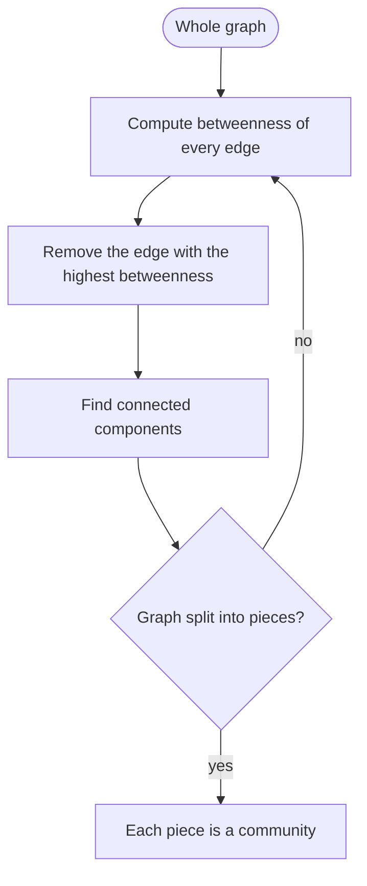
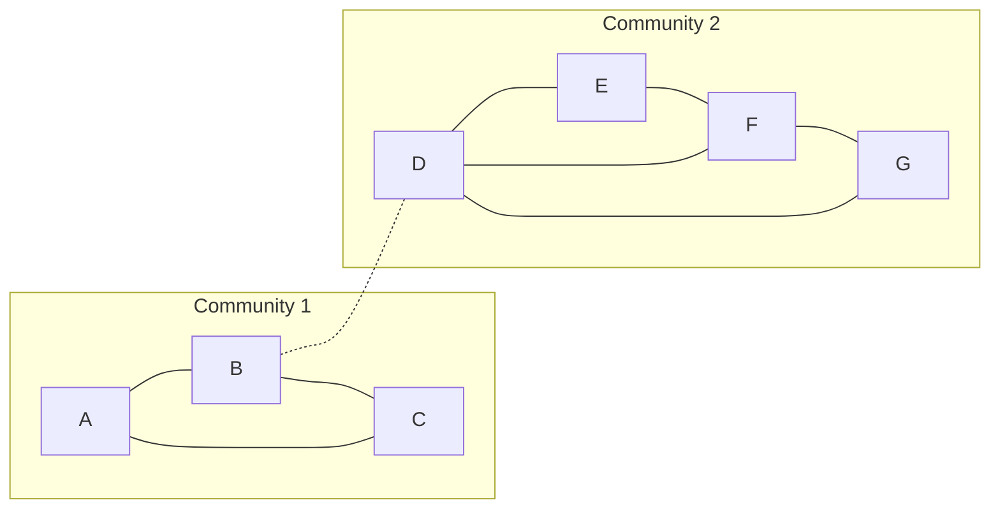

**In one line:** <mark>The Girvan-Newman algorithm finds communities by repeatedly removing the edge with the highest betweenness (the number of shortest paths through it) until the graph splits into pieces</mark>. <Cite id="social-network-graphs-girvan-newman2002" /> <Cite id="social-network-graphs-mmds-book" loc="§10.2" />

<Box kind="key">

**Key points to write (any Girvan-Newman sum):**

- <mark>Edge betweenness = number of shortest paths between all node pairs that pass through the edge</mark>; if a pair has several shortest paths, they share one unit of credit equally.
- <mark>Bridge edges between communities carry many shortest paths, so they have the highest betweenness.</mark>
- Steps: <mark>compute betweenness of every edge, remove the highest, recompute, repeat until the graph splits</mark>. Connected pieces are the communities.
- <mark>Recompute after every removal</mark>, because shortest paths change.
- Ties: remove any one of the tied edges and say so; the final communities are usually the same.
- Check: the betweenness values add up to the sum of all shortest-path lengths; modularity of the split is positive.

</Box>

## Core answer (5 marks, fits every question here): the method

<Box kind="definition">

**Girvan-Newman** is a community-detection algorithm for graphs. The **edge betweenness** of an edge is the number of shortest paths between all pairs of nodes that run through it. Edges joining two communities lie on many shortest paths, so removing the highest-betweenness edges, step by step, separates the communities. <Cite id="social-network-graphs-girvan-newman2002" /> <Cite id="social-network-graphs-wiki-girvan-newman" />

</Box>

**Steps:** <Cite id="social-network-graphs-gfg-girvan-newman" />

1. For every pair of nodes find the shortest path(s); if there are several, share one unit of credit equally among them.
2. The **betweenness** of an edge is the total credit it receives.
3. **Remove** the edge with the highest betweenness.
4. **Recompute** the betweenness of the remaining edges and repeat.
5. When the graph falls into separate connected pieces, each piece is a **community**. Continue if smaller communities are wanted; keep the split with the best **modularity**.

<Cite id="social-network-graphs-gfg-girvan-newman" loc="diagram" />

**Conclusion:** <mark>the highest-betweenness edge is the bridge, and removing it reveals the communities</mark>.

## Extended answer (10 marks): add these

### 1. A full worked sum

<Sum>

<Given>

Undirected graph with 7 nodes and 9 edges: A-B, A-C, B-C, B-D, D-E, D-F, D-G, E-F, F-G.

</Given>

<Find>

the communities by the Girvan-Newman algorithm.

</Find>

<Steps>

1. There are $\binom{7}{2} = 21$ node pairs. Count, for each edge, the pairs whose shortest path uses it. *Reason: this is the definition of betweenness.*

   | Edge | Pairs using it (credit) | Betweenness |
   |---|---|---|
   | B-D | each of A, B, C with each of D, E, F, G: $3 \times 4$ | 12 |
   | A-B | A-B, and A with D, E, F, G | 5 |
   | B-C | B-C, and C with D, E, F, G | 5 |
   | A-C | A-C only (A-B-C is longer) | 1 |
   | D-E | D-E 1, E with A, B, C 3, E-G 0.5 (E-D-G or E-F-G) | 4.5 |
   | D-G | D-G 1, G with A, B, C 3, E-G 0.5 | 4.5 |
   | D-F | D-F 1, F with A, B, C 3 | 4 |
   | E-F | E-F 1, E-G 0.5 | 1.5 |
   | F-G | F-G 1, E-G 0.5 | 1.5 |

2. The highest is **B-D = 12**. Remove it. *Reason: it is the only link between the two groups.*
3. The graph now splits into two components: \{A, B, C\} and \{D, E, F, G\}. *Reason: no edge is left between them.*
4. Recompute inside the pieces (optional, to split further): the triangle edges A-B, A-C, B-C have 1 each (all equal, nothing to cut), and in \{D, E, F, G\} the values are D-E 1.5, D-G 1.5, E-F 1.5, F-G 1.5, D-F 1. No edge stands out, so we stop here.

</Steps>

<Answer>

two communities: \{A, B, C\} and \{D, E, F, G\}, separated by removing the edge B-D.

</Answer>

<Box kind="verify">

Check 1: the nine betweenness values add to $12 + 5 + 5 + 1 + 4.5 + 4.5 + 4 + 1.5 + 1.5 = 39$, which equals the sum of all 21 shortest-path lengths: A: $1+1+2+3+3+3 = 13$, B: $1+1+2+2+2 = 8$, C: $2+3+3+3 = 11$, then D-E, D-F, D-G $= 3$ and E-F 1, E-G 2, F-G 1 $= 4$; total $13 + 8 + 11 + 3 + 4 = 39$.

Check 2 (modularity, $m = 9$): \{A, B, C\} has 3 edges and degree total 7; \{D, E, F, G\} has 5 edges and degree total 11. $Q = (3/9 - (7/18)^2) + (5/9 - (11/18)^2) \approx 0.36$, clearly positive, so the split is a real community structure. <Cite id="social-network-graphs-wiki-modularity" />

</Box>

</Sum>

### 2. When there are ties, and other graphs from the papers

- **Ties.** If several edges have the same highest value, remove any one, say which, and recompute. In the graphs below the final communities do not depend on the choice. <Cite id="social-network-graphs-networkx-girvan-newman" />
- **Two triangles joined by one edge** (A-B, A-C, B-C, C-D, D-E, D-F, E-F): C-D has betweenness 9 (all $3 \times 3$ cross pairs), the others are 4 or 1. Remove C-D: \{A, B, C\} and \{D, E, F\}.
- **Two squares sharing the edge B-E** (A-B, B-C, A-D, B-E, C-F, D-E, E-F): A-B, B-C, D-E and E-F tie at 4. Remove B-C; recompute: E-F is now 8, the highest. Remove it: \{A, B, D, E\} and \{C, F\}.
- **Five nodes** (A-B, A-C, B-D, C-D, B-E, D-E): A-B and C-D tie at 3. Remove A-B; recompute: C-D is now 6. Remove it: \{A, C\} and \{B, D, E\}.

### 3. Limitations

Slow, because shortest paths from every node are recomputed after every removal; ties depend on the order; each node lands in exactly one community (overlapping communities need methods like the clique percolation method). <Cite id="social-network-graphs-mmds-book" loc="§10.2" />

## Fit it to each question

All six ask for the same method on a different graph. Write the method (core answer), then the table of betweenness, the removals with recomputation, and the communities. <Cite id="social-network-graphs-girvan-newman2002" />

- **"Determine communities for the given social network graph using Girvan-Newman algorithm."** (10 marks) <PYQ id="2022-12-ce/q5a" /> <PYQ id="2023-05-ce/q5a" /> <PYQ id="2023-12-ce/q5a" /> <PYQ id="2024-05-ce/q5a" /> <PYQ id="2025-05-ce/q5a" />: read the edges from the figure and match them with section 2. 2022-12 and 2023-12 are the seven-node graph (worked above: B-D = 12, communities \{A, B, C\} and \{D, E, F, G\}). 2023-05 is the two triangles (C-D = 9). 2024-05 is the two squares (remove B-C, then E-F). 2025-05 is the five-node graph (remove A-B, then C-D).
- **"Demonstrate the different communities using Girwan-Newman algorithm for the following graph"** (10 marks) <PYQ id="2025-12-ce/q6a" />: the same five-node graph (A-B, A-C, B-D, B-E, C-D, D-E): remove A-B (tie with C-D at 3), recompute (C-D = 6), remove C-D: communities \{A, C\} and \{B, D, E\}.

## Exam tips

- **Always draw:** the graph with the betweenness written on each edge, and redraw it after each removal.
- Show how you count a few of the paths (for example "B-D carries $3 \times 4 = 12$ paths") and the **check** that the betweenness values add to the sum of path lengths.
- Common mistakes: forgetting to **recompute** after a removal, and not sharing credit when there are two shortest paths (each gets 1/2).
