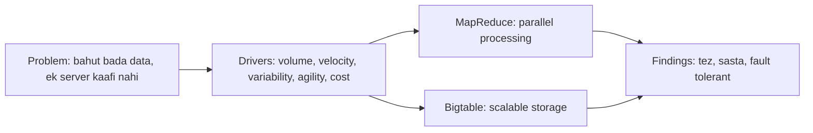
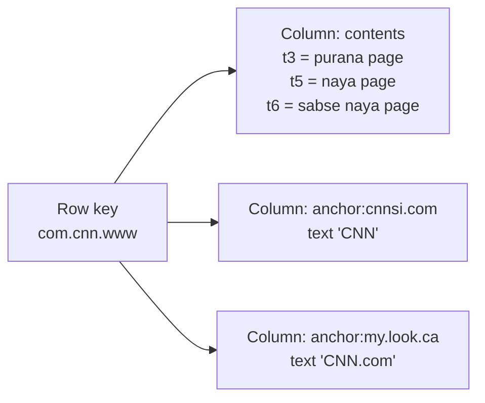

**Ek line mein:** <mark>Google ne apni business problems ko MapReduce (commodity clusters pe simple parallel processing) aur Bigtable (structured data ke liye scalable sparse sorted-map store) se tez, sasta aur zyada effective tarike se solve kiya</mark>. <Cite id="big-data-intro-mapreduce" /> <Cite id="nosql-intro-bigtable" />

<Box kind="key">

**Google MapReduce ya Bigtable case study ke question mein ye points likho:**

- Chaar parts mein likho: <mark>business problem, business drivers, solution, findings</mark>.
- <mark>Drivers: volume, velocity, variability, agility (aur low cost)</mark>.
- <mark>MapReduce: programmer sirf map aur reduce likhta hai; library splitting, scheduling aur failures commodity machines pe sambhalti hai</mark>.
- <mark>Bigtable: (row key, column key, timestamp) se indexed distributed, sparse, sorted map, GFS pe stored, hazaron machines tak scale</mark>.
- <mark>Findings: tez, sasta, simple code, fault tolerance, aur machines add karke capacity badhti hai</mark>.
- Bigtable ne **HBase aur Cassandra** ko inspire kiya; MapReduce ne **Hadoop** ko.

</Box>

## Core answer (5 marks, yahan ke har question ke liye)

<Box kind="definition">

A **business driver** is a business need that pushes a company to change its technology. The NoSQL movement had four: **volume** (data grows to terabytes and petabytes), **velocity** (very fast reads and writes), **variability** (data of many shapes) and **agility** (quick changes). Google's MapReduce and Bigtable show how these drivers were met. <Cite id="big-data-intro-nosql" />

</Box>

| | Google MapReduce | Google Bigtable |
|---|---|---|
| **Problem** | 20 TB ya zyada crawled web data process karna; har programmer ko distribution aur failures haath se sambhalne padte the | Bahut alag size aur use ka structured data (web index, Google Earth, Finance) petabyte scale pe store karna; RDBMS scale nahi kar pata tha |
| **Drivers** | Volume, velocity, low cost (cheap machines) | Volume, velocity, variability, agility |
| **Solution** | Sirf **map** aur **reduce** function likho; library input split karti hai, tasks bahut machines pe chalati hai, key se group karti hai, failures handle karti hai | Hazaron commodity servers pe distributed store, (row, column, timestamp) se value ka sparse sorted map, GFS pe |
| **Findings** | Tez, simple, sasta, fault tolerant | 60+ Google projects mein use, machines add karke scale, high availability |

<Cite id="big-data-intro-mapreduce" /> <Cite id="nosql-intro-bigtable" />

**Conclusion:** <mark>dono systems ne special mehnge hardware ki jagah bahut saari commodity machines pe simple software use kiya</mark>, aur unhone Hadoop, HBase aur Cassandra ko inspire kiya.

## Extended answer (10 marks): ye add karo

### 1. Google ka MapReduce detail mein

- **Problem.** Web index ke raw documents 20 TB se zyada the. Purana code parallel kaam ad-hoc tarike se karta tha aur har programmer failures aur data distribution khud sambhalta tha. <Cite id="big-data-intro-mapreduce" />
- **Solution.** Programmer `map` (record se key-value pairs) aur `reduce` (key aur values se result) likhta hai. Library input split karti hai, map tasks data ke paas chalati hai, key se group karti hai, reduce tasks chalati hai, aur failures chhupa leti hai. Ye commodity PCs ke bade clusters pe chalta hai aur storage ke liye GFS use karta hai. <Cite id="big-data-intro-gfs" />
- **Findings (paper se).**
  - Tez: lagbhag 1 TB pe search lagbhag 150 seconds aur lagbhag 1 TB ka sort 891 seconds, lagbhag 1800 machines pe.
  - Simple: indexing code ka ek phase lagbhag 3800 lines C++ se lagbhag 700 lines ho gaya; jo changes mahino lete the woh dino mein hue.
  - Zyada effective: machine failures aur slow machines apne aap handle hote hain, aur machines add karne se speed badhti hai.
  - Wide use: us waqt Google mein sainkdon programs aur roz hazar se zyada jobs. <Cite id="big-data-intro-mapreduce" loc="§5, §6.1" />

### 2. Google ka Bigtable detail mein

- **Problem.** Kai products ko bahut alag size ka structured storage chahiye tha (chhote URLs se satellite images), kuch ko fast serving, kuch ko bulk processing.
- **Data model.** **(row key, column key, timestamp)** se value ka sparse, distributed, sorted map. Column key `family:qualifier` hoti hai, rows row key se sorted, aur timestamp kai versions rakhta hai. <Cite id="nosql-intro-bigtable" /> <Cite id="nosql-intro-wiki-bigtable" />
- **Architecture.** Files GFS pe rakhta hai aur master chunne ke liye lock service (Chubby) use karta hai. Rows ranges (tablets) mein bantti hain jo alag machines serve karti hain.
- **Findings.** August 2006 tak 60 se zyada Google projects ise use karte the; users ko performance aur high availability pasand aayi; machines add karke capacity badhti hai; clients data layout control karte hain. Ne open-source **HBase** aur **Cassandra** ko inspire kiya. <Cite id="nosql-intro-hbase" /> <Cite id="web-bda-1-hbase-book" />

<Cite id="nosql-intro-bigtable" loc="diagram" />

### 3. Har driver ka jawab kaise mila

| Driver | Jawab |
|---|---|
| Volume | Hazaron commodity machines pe scale out (GFS, Bigtable tablets) |
| Velocity | Parallel map aur reduce tasks, Bigtable se fast random reads |
| Variability | Sparse column families: har row ke alag columns ho sakte hain |
| Agility | Programmers do chhote functions likhte hain ya apna column layout chunte hain |
| Cost | Cheap machines, failures software mein handle |

## Har question mein kaise fit karein

- **"Demonstrate how business problems have been successfully solved faster, cheaper and more effectively considering NoSQL Google's MapReduce case study. Also illustrate the business drivers and the findings in it."** (5 marks) <PYQ id="2022-12-ce/q1b" />: core answer ke chaar parts sirf **MapReduce** ke liye (left column), driver line aur section 1 ke findings.
- **"... considering NoSQL Google's Bigtable case study. Also illustrate the business drivers and the findings in it."** (2025 mein 5 marks, December 2025 mein "Summarize" ke saath 10 marks) <PYQ id="2025-05-ce/q1c" /> <PYQ id="2025-12-ce/q3b" />: core answer ke chaar parts **Bigtable** ke liye (right column). 10 marks ke liye section 2 (data model diagram aur architecture) aur section 3 add karo.

## Exam tips

- **Chaar headings** (problem, drivers, solution, findings) akshar-akshar use karo; question wahi maangta hai.
- **Numbers** likho (150 s aur 891 s, 3800 se 700 lines, 60+ projects); isse case ka gyaan dikhta hai.
- Dekho **kaunsa case study** poocha hai (MapReduce ya Bigtable) aur dono ko mix mat karo.
