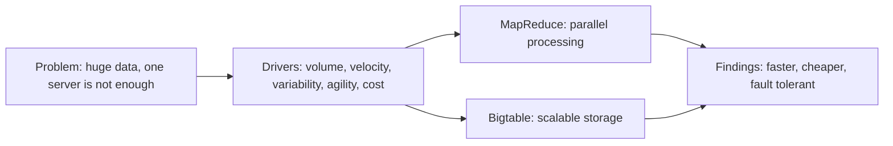
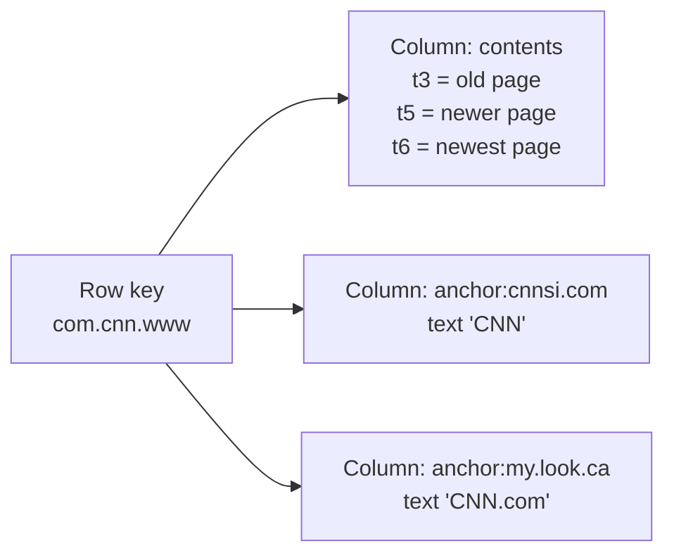

**In one line:** <mark>Google solved its business problems faster, cheaper and more effectively with MapReduce (simple parallel processing on commodity clusters) and Bigtable (a scalable sparse sorted-map store for structured data)</mark>. <Cite id="big-data-intro-mapreduce" /> <Cite id="nosql-intro-bigtable" />

<Box kind="key">

**Key points to write (Google MapReduce or Bigtable case study):**

- Write in four parts: <mark>business problem, business drivers, solution, findings</mark>.
- <mark>Drivers: volume, velocity, variability, agility (and low cost)</mark>.
- <mark>MapReduce: the programmer writes only map and reduce; the library handles splitting, scheduling and failures on commodity machines</mark>.
- <mark>Bigtable: a distributed, sparse, sorted map indexed by (row key, column key, timestamp), stored on GFS, scaling to thousands of machines</mark>.
- <mark>Findings: faster, cheaper, simpler code, fault tolerance, and capacity grows by adding machines</mark>.
- Bigtable inspired **HBase and Cassandra**; MapReduce inspired **Hadoop**.

</Box>

## Core answer (5 marks, fits every question here)

<Box kind="definition">

A **business driver** is a business need that pushes a company to change its technology. The NoSQL movement had four: **volume** (data grows to terabytes and petabytes), **velocity** (very fast reads and writes), **variability** (data of many shapes) and **agility** (quick changes). Google's MapReduce and Bigtable show how these drivers were met. <Cite id="big-data-intro-nosql" />

</Box>

| | Google MapReduce | Google Bigtable |
|---|---|---|
| **Problem** | Process 20 TB or more of crawled web data; every programmer had to handle distribution and failures by hand | Store structured data of very different sizes and uses (web index, Google Earth, Finance) at petabyte scale; an RDBMS could not scale |
| **Drivers** | Volume, velocity, low cost (cheap machines) | Volume, velocity, variability, agility |
| **Solution** | Write only a **map** and a **reduce** function; the library splits input, runs tasks on many machines, groups by key, handles failures | A distributed store on thousands of commodity servers, a sparse sorted map of (row, column, timestamp) to value, on GFS |
| **Findings** | Faster, simpler, cheaper, fault tolerant | Used by 60+ Google projects, scales by adding machines, high availability |

<Cite id="big-data-intro-mapreduce" /> <Cite id="nosql-intro-bigtable" />

**Conclusion:** <mark>both systems replaced special expensive hardware with simple software on many commodity machines</mark>, and they inspired Hadoop, HBase and Cassandra.

## Extended answer (10 marks): add these

### 1. Google's MapReduce in detail

- **Problem.** Raw documents for the web index were more than 20 TB. Old code did parallel work in ad-hoc ways and every programmer handled failures and data distribution. <Cite id="big-data-intro-mapreduce" />
- **Solution.** The programmer writes `map` (record to key-value pairs) and `reduce` (key and values to result). The library splits the input, runs map tasks near the data, groups by key, runs reduce tasks, and hides failures. It runs on large clusters of commodity PCs and uses GFS for storage. <Cite id="big-data-intro-gfs" />
- **Findings (from the paper).**
  - Faster: a search over about 1 TB took about 150 seconds and a sort of about 1 TB took 891 seconds on about 1800 machines.
  - Simpler: one phase of the indexing code shrank from about 3800 lines of C++ to about 700; changes that took months took days.
  - More effective: machine failures and slow machines are handled automatically, and speed grows by adding machines.
  - Widely used: hundreds of programs and over a thousand jobs a day at Google at the time. <Cite id="big-data-intro-mapreduce" loc="§5, §6.1" />

### 2. Google's Bigtable in detail

- **Problem.** Many products needed structured storage of very different sizes (small URLs to satellite images), and some needed fast serving while others needed bulk processing.
- **Data model.** A sparse, distributed, sorted map from **(row key, column key, timestamp)** to a value. The column key is `family:qualifier`, rows are sorted by row key, and the timestamp keeps several versions. <Cite id="nosql-intro-bigtable" /> <Cite id="nosql-intro-wiki-bigtable" />
- **Architecture.** It stores its files on GFS and uses a lock service (Chubby) to elect the master. Rows are split into ranges called tablets served by different machines.
- **Findings.** By August 2006 more than sixty Google projects used it; users liked its performance and high availability; capacity grows by adding machines; clients control the data layout. It inspired open-source **HBase** and **Cassandra**. <Cite id="nosql-intro-hbase" /> <Cite id="web-bda-1-hbase-book" />

<Cite id="nosql-intro-bigtable" loc="diagram" />

### 3. How each driver was answered

| Driver | Answer |
|---|---|
| Volume | Scale out over thousands of commodity machines (GFS, Bigtable tablets) |
| Velocity | Parallel map and reduce tasks, fast random reads from Bigtable |
| Variability | Sparse column families: each row can have different columns |
| Agility | Programmers write two small functions or choose their own column layout |
| Cost | Cheap machines, failures handled in software |

## Fit it to each question

- **"Demonstrate how business problems have been successfully solved faster, cheaper and more effectively considering NoSQL Google's MapReduce case study. Also illustrate the business drivers and the findings in it."** (5 marks) <PYQ id="2022-12-ce/q1b" />: the core answer's four parts for **MapReduce** only (the left column), the driver line and section 1 findings.
- **"... considering NoSQL Google's Bigtable case study. Also illustrate the business drivers and the findings in it."** (5 marks in 2025, 10 marks as "Summarize" in December 2025) <PYQ id="2025-05-ce/q1c" /> <PYQ id="2025-12-ce/q3b" />: the core answer's four parts for **Bigtable** (right column). For 10 marks add section 2 (data model diagram and architecture) and section 3.

## Exam tips

- **Use the four headings** (problem, drivers, solution, findings) literally; the question asks for exactly these.
- Quote the **numbers** (150 s and 891 s, 3800 to 700 lines, 60+ projects); they show you know the case.
- Check **which case study** the question names (MapReduce or Bigtable) and do not mix them.
