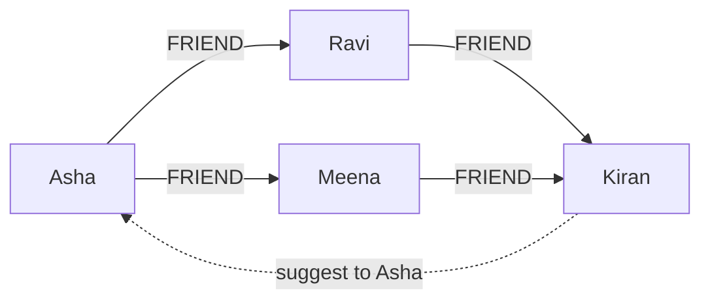
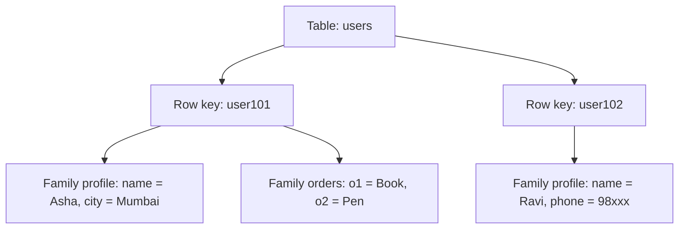

**Ek line mein:** <mark>Graph store data ko nodes aur unke beech ke relationships (edges) ki tarah rakhta hai</mark>, isliye connected questions links pe chalke solve ho jaate hain; <mark>column-family store mein row key se row milti hai aur columns column families mein group hote hain</mark>, isliye bahut bada sparse data store aur fast write hota hai. <Cite id="nosql-patterns-neo4j-model" /> <Cite id="nosql-patterns-gfg-col" />

<Box kind="key">

**Graph ya column-family question mein ye points likho:**

- Graph store ke parts: <mark>node (entity), edge (relationship) aur dono pe properties</mark>. Example: Neo4j, Amazon Neptune.
- <mark>Relationships directly stored hote hain, isliye ek hop ke liye join nahi chahiye</mark>; database bada hone pe speed nahi girti.
- Graph use cases: <mark>social networks, friend recommendation, fraud detection, routes</mark>.
- Column-family store: <mark>row key + column families; har row ke columns alag ho sakte hain</mark> (sparse), values ke timestamp versions ho sakte hain. Example: Cassandra, HBase, Google Bigtable.
- Column-family use cases: <mark>time series, logs, messaging, web indexing</mark>; bahut fast writes, kayi nodes pe scale.
- Weakness: column family joins aur ad-hoc queries mein weak; graph ko kayi servers pe failana mushkil.

</Box>

## Core answer (5 marks, yahan ke har question ke liye)

<Box kind="definition">

A **graph store** is a NoSQL database that stores data as **nodes** (things) and **edges** (relationships between things); both can carry properties. A **column-family store** keeps data in tables where each row has a **row key** and its columns are grouped into **column families** that are stored and read together. <Cite id="nosql-patterns-neo4j-model" /> <Cite id="nosql-patterns-gfg-col" />

</Box>

**Kyun chahiye:** SQL mein "friends of my friends" ke liye har hop pe join lagta hai aur query slow hoti jaati hai; aur lakhon mostly-empty columns wali table space waste karti hai. Graph store links ko real data ki tarah rakhta hai, aur column-family store sirf wahi cells rakhta hai jo exist karte hain. <Cite id="nosql-patterns-gfg-types" />

**Graph store, steps mein:**

1. **Node:** ek entity, jaise Person, properties ke saath (name, city).
2. **Edge:** ek named, directed link jaise FRIEND ya BOUGHT, jis pe bhi properties ho sakti hain (date).
3. **Query:** edges follow karke pattern match karte hain. Cost poore database pe nahi, sirf chhue gaye graph hisse pe depend karti hai. <Cite id="web-bda-2-neo4j-graphdb" />



<Cite id="nosql-patterns-neo4j-model" loc="diagram" />

**Column-family store, steps mein:** row key se row milti hai; uske columns families ke andar hote hain (jaise profile aur orders); ek row ke kuch columns doosri rows mein na bhi hon; rows key ke hisaab se nodes pe failti hain. <Cite id="nosql-intro-bigtable" />

| Point | Graph store | Column-family store |
|---|---|---|
| Stores | Nodes aur relationships | Grouped columns wali rows |
| Strong at | Deep connected queries | Bahut writes, sparse data |
| Examples | Neo4j, Neptune | Cassandra, HBase |

**Conclusion:** <mark>jab records ke beech ke links sabse important hon tab graph store, aur bahut bade, sparse, write-heavy data ke liye column-family store</mark>.

## Extended answer (10 marks): ye add karo

### 1. Column-family store detail mein



<Cite id="nosql-patterns-gfg-col" loc="diagram" />


- **Scale kaise hota hai:** rows key range (HBase) ya hash (Cassandra) se kayi nodes pe baanti jaati hain, aur writes bahut fast hote hain. <Cite id="nosql-patterns-cass-model" /> <Cite id="nosql-patterns-hbase-book" />
- **Kab achha:** time series, logs, messaging, web indexing. **Kab weak:** joins aur ad-hoc queries, kyunki tables known queries ke hisaab se design hoti hain.
- **Examples:** Google Bigtable (original), HBase, Cassandra.

### 2. Graph store detail mein


**Example business problem: friend recommendation.** Company chahti hai ki user ko aise log suggest ho jinhe wo jaanta ho sakta hai. Query friends of friends dhoondhti hai jo abhi friend nahi hain. Neo4j ki Cypher language mein: <Cite id="pyq-2024-05-ce-neo4j-cypher" />

```text
MATCH (me:Person {name: "Asha"})-[:FRIEND]->(:Person)-[:FRIEND]->(s:Person)
WHERE NOT (me)-[:FRIEND]->(s) AND s <> me
RETURN s.name, count(*) AS mutual_friends
ORDER BY mutual_friends DESC
```

Kiran ke Asha ke saath 2 mutual friends hain, isliye wo pehle rank hota hai. SQL mein ye bade friends table pe self-join hota hai, aur har extra hop pe repeat. Yehi idea **fraud rings** (same phone, address ya card share karne wale accounts), routes aur product recommendation mein bhi kaam aata hai. <Cite id="pyq-2024-05-ce-neo4j-fraud" /> <Cite id="nosql-patterns-ibm-graph" />

- **Limits:** key-value ya document stores ke mukable kayi servers pe failana mushkil, aur simple bulk data ke liye theek nahi.

### 3. Comparison

| Point | Relational database | Graph store |
|---|---|---|
| Relationships | Foreign keys, query time pe joins | Edges ki tarah stored |
| Deep link queries | Slow, bahut joins | Fast traversal |
| Best for | Tabular, transactional data | Highly connected data |

| Point | Column-family | Graph |
|---|---|---|
| Query by | Row key (aur columns) | Relationships pe chalke |
| Sparse data | Achha handle | Aim nahi |
| Typical use | Logs, time series | Social network, fraud |

## Har question mein kaise fit karein

- **"Explain Column family store and Graph Store NoSQL architectural pattern with example."** (10 marks) <PYQ id="2024-05/q2b" />: core answer, phir section 1 (diagram, rows ki table, Cassandra ya HBase) aur section 2 (property-graph diagram, friend-suggestion example) aur comparison table.
- **"What is graph store? Give an example where a graph store can be used to effectively solve a particular business problem."** (10 marks) <PYQ id="2024-05-ce/q2a" />: core answer ka graph part, phir section 2 poora (Cypher query, fraud aur recommendation use) aur relational-vs-graph table. Column-family store chhod do.

## Exam tips

- **Hamesha draw karo:** labelled edges wala chhota friend graph; column-family ke liye row key aur do families wali table.
- Graph ke liye **"relationships are stored, so no joins"** aur column-family ke liye **"sparse, row key, column family"** likho.
- Real products ke naam likho: graph ke liye Neo4j aur Neptune; column-family ke liye Cassandra, HBase aur Bigtable.

Exam mein English mein likho.
