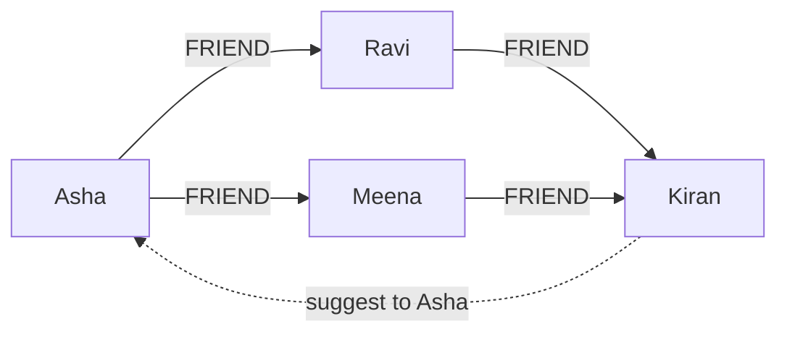
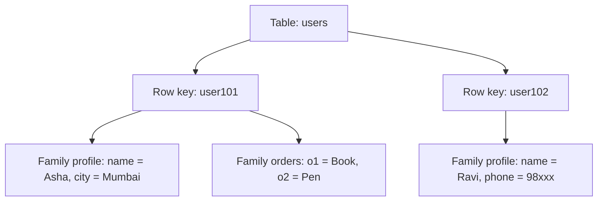

**In one line:** <mark>A graph store keeps data as nodes and the relationships (edges) between them</mark>, so connected questions are answered by walking links; a <mark>column-family store keeps rows found by a row key, with columns grouped into column families</mark>, so huge sparse data is stored and written fast. <Cite id="nosql-patterns-neo4j-model" /> <Cite id="nosql-patterns-gfg-col" />

<Box kind="key">

**Key points to write (graph or column-family question):**

- Graph store parts: <mark>node (entity), edge (relationship) and properties</mark> on both. Example: Neo4j, Amazon Neptune.
- <mark>Relationships are stored directly, so a hop needs no join</mark>; speed does not fall as the database grows.
- Graph use cases: <mark>social networks, friend recommendation, fraud detection, routes</mark>.
- Column-family store: <mark>row key + column families; each row can have different columns</mark> (sparse), values can have timestamp versions. Example: Cassandra, HBase, Google Bigtable.
- Column-family use cases: <mark>time series, logs, messaging, web indexing</mark>; very fast writes, scales over many nodes.
- Weakness: column family is poor at joins and ad-hoc queries; graph is harder to spread over many servers.

</Box>

## Core answer (5 marks, fits every question here)

<Box kind="definition">

A **graph store** is a NoSQL database that stores data as **nodes** (things) and **edges** (relationships between things); both can carry properties. A **column-family store** keeps data in tables where each row has a **row key** and its columns are grouped into **column families** that are stored and read together. <Cite id="nosql-patterns-neo4j-model" /> <Cite id="nosql-patterns-gfg-col" />

</Box>

**Why they are needed:** in SQL, "friends of my friends" needs a join for every hop and gets slower and slower; and a table with millions of mostly empty columns wastes space. A graph store keeps the links as real data, and a column-family store keeps only the cells that exist. <Cite id="nosql-patterns-gfg-types" />

**Graph store, in steps:**

1. **Node:** an entity such as a Person, with properties (name, city).
2. **Edge:** a named, directed link such as FRIEND or BOUGHT, which can also have properties (date).
3. **Query:** match a pattern by following edges. The cost depends on the part of the graph touched, not on the whole database. <Cite id="web-bda-2-neo4j-graphdb" />



<Cite id="nosql-patterns-neo4j-model" loc="diagram" />

**Column-family store, in steps:** a row key finds the row; its columns sit inside families (for example profile and orders); a row may have columns that other rows lack; rows are spread over nodes by key. <Cite id="nosql-intro-bigtable" />

| Point | Graph store | Column-family store |
|---|---|---|
| Stores | Nodes and relationships | Rows with grouped columns |
| Strong at | Deep connected queries | Huge write volume, sparse data |
| Examples | Neo4j, Neptune | Cassandra, HBase |

**Conclusion:** <mark>use a graph store when the links between records matter most, and a column-family store for huge, sparse, write-heavy data</mark>.

## Extended answer (10 marks): add these

### 1. Column-family store in detail



<Cite id="nosql-patterns-gfg-col" loc="diagram" />


- **How it scales:** rows are split by key range (HBase) or by hash (Cassandra) over many nodes, and writes are very fast. <Cite id="nosql-patterns-cass-model" /> <Cite id="nosql-patterns-hbase-book" />
- **Good for:** time series, logs, messaging, web indexing. **Weak at:** joins and ad-hoc queries, because tables are designed around known queries.
- **Examples:** Google Bigtable (the original), HBase, Cassandra.

### 2. Graph store in detail


**Example business problem: friend recommendation.** The company wants to suggest people a user may know. The query finds friends of friends who are not yet friends. In Neo4j's Cypher language: <Cite id="pyq-2024-05-ce-neo4j-cypher" />

```text
MATCH (me:Person {name: "Asha"})-[:FRIEND]->(:Person)-[:FRIEND]->(s:Person)
WHERE NOT (me)-[:FRIEND]->(s) AND s <> me
RETURN s.name, count(*) AS mutual_friends
ORDER BY mutual_friends DESC
```

Kiran has 2 mutual friends with Asha, so he is ranked first. In SQL this is a self-join on a huge friends table, repeated for every extra hop. The same idea finds **fraud rings** (accounts sharing a phone, address or card), routes and product recommendations. <Cite id="pyq-2024-05-ce-neo4j-fraud" /> <Cite id="nosql-patterns-ibm-graph" />

- **Limits:** harder to spread over many servers than key-value or document stores, and a poor fit for simple bulk data.

### 3. Comparison

| Point | Relational database | Graph store |
|---|---|---|
| Relationships | Foreign keys, joins at query time | Stored as edges |
| Deep link queries | Slow, many joins | Fast traversal |
| Best for | Tabular, transactional data | Highly connected data |

| Point | Column-family | Graph |
|---|---|---|
| Query by | Row key (and columns) | Walking relationships |
| Sparse data | Handled well | Not the aim |
| Typical use | Logs, time series | Social network, fraud |

## Fit it to each question

- **"Explain Column family store and Graph Store NoSQL architectural pattern with example."** (10 marks) <PYQ id="2024-05/q2b" />: core answer, then section 1 (diagram, table of rows, Cassandra or HBase) and section 2 (property-graph diagram, friend-suggestion example) and the comparison table.
- **"What is graph store? Give an example where a graph store can be used to effectively solve a particular business problem."** (10 marks) <PYQ id="2024-05-ce/q2a" />: graph part of the core answer, then section 2 in full (Cypher query, fraud and recommendation use) and the relational-versus-graph table. Leave out the column-family store.

## Exam tips

- **Always draw:** a small friend graph with labelled edges; for column-family, a table with a row key and two families.
- Write **"relationships are stored, so no joins"** for graph and **"sparse, row key, column family"** for column-family.
- Name real products: Neo4j and Neptune for graph; Cassandra, HBase and Bigtable for column-family.
