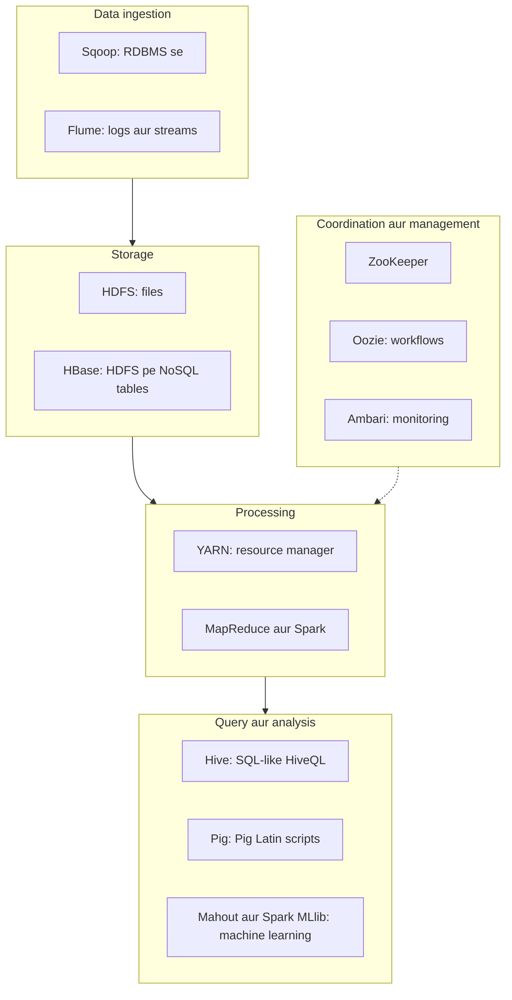
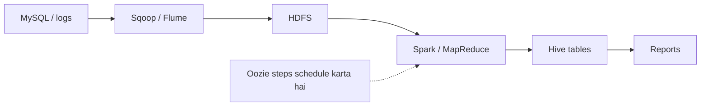

**Ek line mein:** <mark>Hadoop ecosystem un tools ka parivar hai jo Hadoop core (HDFS, YARN, MapReduce) ke around bane hain, big data ko load, store, process, query aur manage karne ke liye</mark>. <Cite id="hadoop-ecosystem-gfg-hadoop-ecosystem" /> <Cite id="hadoop-ecosystem-av-hadoop-ecosystem" />

<Box kind="key">

**Hadoop ecosystem ke har question mein ye points likho:**

- <mark>Core: HDFS (storage), YARN (resource management), MapReduce (processing)</mark>.
- <mark>Hive: HDFS data pe SQL-like queries (HiveQL); Pig: data-flow scripts (Pig Latin)</mark>.
- <mark>HBase: HDFS pe column-oriented NoSQL database, fast random read aur write ke liye</mark>.
- <mark>Spark: fast in-memory processing engine</mark>; Mahout: machine learning.
- <mark>Sqoop RDBMS aur HDFS ke beech data move karta hai; Flume streaming logs collect karta hai</mark>.
- <mark>ZooKeeper: coordination; Oozie: workflow scheduling; Ambari: cluster management</mark>.
- Ecosystem ko **layers ke hisaab se** draw karo: ingestion, storage, processing, query, coordination.

</Box>

## Core answer (5 marks, yahan ke har question ke liye)

<Box kind="definition">

The **Hadoop ecosystem** is the group of tools that work with the Hadoop core. The core stores and processes data, but raw MapReduce in Java is hard, and a real project also needs loading, querying, coordination and scheduling. Each ecosystem tool fills one such gap. <Cite id="hadoop-ecosystem-gfg-hadoop-ecosystem" /> <Cite id="hadoop-ecosystem-av-hadoop-ecosystem" />

</Box>

<Cite id="hadoop-ecosystem-gfg-hadoop-ecosystem" loc="diagram" />

| Component | Layer | Simple words mein kaam |
|---|---|---|
| **HDFS** | Storage | Bade files ko replicated blocks mein cluster pe store karta hai |
| **YARN** | Resource management | Applications ke beech CPU aur memory baantta hai |
| **MapReduce** | Processing | Map, shuffle, reduce steps mein batch processing |
| **Hive** | Query | HDFS data pe SQL-like queries (HiveQL), jobs mein convert hoti hain |
| **Pig** | Scripting | Lambe Java ki jagah Pig Latin data-flow scripts |
| **HBase** | NoSQL database | HDFS pe column database, ek row ka fast read aur write |
| **Spark** | Processing | Fast engine jo data memory mein rakhta hai |
| **Mahout** | Machine learning | Recommendation, clustering, classification |
| **ZooKeeper** | Coordination | Configuration, naming, locks, leader election |
| **Oozie** | Scheduling | Jobs ki chain ko sahi order mein chalata hai |
| **Sqoop** | Ingestion | RDBMS aur HDFS ke beech bulk copy |
| **Flume** | Ingestion | Streaming logs ko HDFS mein collect karta hai |
| **Ambari** | Management | Cluster set up aur monitor karne ka web tool |

<Cite id="hadoop-ecosystem-apache-hive" /> <Cite id="hadoop-ecosystem-apache-pig" /> <Cite id="hadoop-ecosystem-apache-hbase" /> <Cite id="hadoop-ecosystem-apache-spark" /> <Cite id="hadoop-ecosystem-apache-zookeeper" /> <Cite id="hadoop-ecosystem-apache-oozie" /> <Cite id="hadoop-ecosystem-apache-sqoop" /> <Cite id="hadoop-ecosystem-apache-flume" />

**Conclusion:** <mark>core storage aur processing deta hai, aur ecosystem tools ingestion, query, speed aur management add karte hain</mark>, isliye Hadoop ek complete big data platform ban jata hai.

## Extended answer (10 marks): ye add karo

### 1. Core thoda detail mein

- **HDFS:** master NameNode metadata rakhta hai, DataNodes blocks store karte hain (128 MB, 3 baar copy).
- **YARN:** ResourceManager (cluster master), NodeManager (har node pe, containers start karta hai), ApplicationMaster (har job ka). YARN alag hai, isliye Spark jaise engines bhi isi pe chalte hain. <Cite id="hadoop-ecosystem-apache-yarn" />
- **MapReduce:** map key-value pairs banata hai, shuffle key se group karta hai, reduce combine karta hai. <Cite id="hadoop-ecosystem-apache-hadoop" />

### 2. Tools detail mein ("explain any two" ke liye koi bhi do likho)

- **Hive:** analysts ko SQL aati hai, Java nahi. Aap `SELECT city, COUNT(*) FROM users GROUP BY city` likhte ho aur Hive use distributed jobs mein badal deta hai. Batch analysis ke liye achha, ek row ke quick lookup ke liye nahi. <Cite id="web-bda-1-hive-tutorial" />
- **HBase:** HDFS ek record jaldi padhne mein kamzor hai. HBase HDFS ke upar rows ko tables mein column families ke saath, row key se sorted rakhta hai, Google ke Bigtable pe based. Example: ek user ka profile milliseconds mein nikalna. <Cite id="web-bda-1-hbase-book" />
- **Pig:** chhoti Pig Latin script (load, filter, group, join) lambe Java code ki jagah leti hai.
- **Spark:** data memory mein rakhta hai, isliye repeated (iterative) jobs aur machine learning MapReduce se bahut tez hote hain.
- **Sqoop aur Flume:** Sqoop MySQL ya Oracle ke tables HDFS mein copy karta hai; Flume server logs ko bante hi collect karta hai.
- **ZooKeeper, Oozie:** ZooKeeper distributed tools ko agree rakhta hai (locks, leader election); Oozie jobs ke workflow ko sahi order mein chalata hai.

### 3. Real pipeline mein tools

### 4. Note

Kuch tools ab retire ya kam use hote hain (Sqoop ko Apache ne retire kar diya), lekin exam abhi bhi upar wali classic list hi poochta hai.

## Har question mein kaise fit karein

- **"Draw Hadoop Ecosystem and briefly explain its components."** (10 marks) <PYQ id="2023-12/q2a" /> <PYQ id="2025-05/q2a" />: **diagram**, component table (ek-ek line), conclusion. Detail ke liye section 1 aur 2 add karo.
- **"Describe the components of Hadoop ecosystem with the help of a diagram."** (10 marks) <PYQ id="2025-05-ce/q6a" />: wahi; har component pe 2 se 3 lines likho aur diagram ko saaf label karo.
- **"Explain Hadoop Ecosystem in detail."** (10 marks) <PYQ id="2025-12-ce/q2a" />: core answer plus section 1, 2 aur 3 (pipeline).
- **"Draw a diagram of the typical Hadoop Ecosystem and explain any two components of it."** (10 marks) <PYQ id="2024-12-ce/q4b" />: ecosystem diagram draw karo, phir **sirf do** explain karo (Hive aur HBase safe hain) need, working aur example ke saath, section 2 se.

## Exam tips

- **Draw** karo: **neeche HDFS, uske upar YARN, phir MapReduce/Spark, phir Hive/Pig/HBase** aur side mein management tools.
- Har tool ki **layer aur ek line ka kaam** likho; marks usi pe milte hain.
- "Any two" mein zyada explain mat karo, un do ke liye **definition, need, working aur example** do.
