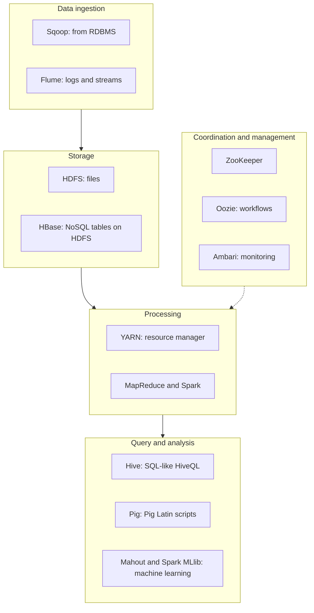
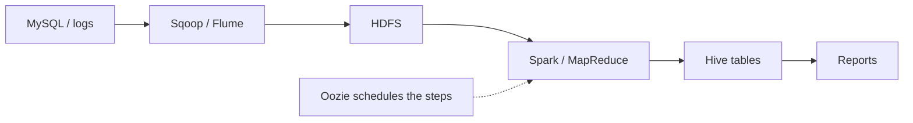

**In one line:** <mark>The Hadoop ecosystem is the family of tools built around the Hadoop core (HDFS, YARN, MapReduce) for loading, storing, processing, querying and managing big data</mark>. <Cite id="hadoop-ecosystem-gfg-hadoop-ecosystem" /> <Cite id="hadoop-ecosystem-av-hadoop-ecosystem" />

<Box kind="key">

**Key points to write (any Hadoop ecosystem question):**

- <mark>Core: HDFS (storage), YARN (resource management), MapReduce (processing)</mark>.
- <mark>Hive: SQL-like queries (HiveQL) on HDFS data; Pig: data-flow scripts (Pig Latin)</mark>.
- <mark>HBase: column-oriented NoSQL database on HDFS for fast random read and write</mark>.
- <mark>Spark: fast in-memory processing engine</mark>; Mahout: machine learning.
- <mark>Sqoop moves data between RDBMS and HDFS; Flume collects streaming logs</mark>.
- <mark>ZooKeeper: coordination; Oozie: workflow scheduling; Ambari: cluster management</mark>.
- Draw the ecosystem **by layers**: ingestion, storage, processing, query, coordination.

</Box>

## Core answer (5 marks, fits every question here)

<Box kind="definition">

The **Hadoop ecosystem** is the group of tools that work with the Hadoop core. The core stores and processes data, but raw MapReduce in Java is hard, and a real project also needs loading, querying, coordination and scheduling. Each ecosystem tool fills one such gap. <Cite id="hadoop-ecosystem-gfg-hadoop-ecosystem" /> <Cite id="hadoop-ecosystem-av-hadoop-ecosystem" />

</Box>

<Cite id="hadoop-ecosystem-gfg-hadoop-ecosystem" loc="diagram" />

| Component | Layer | Job in simple words |
|---|---|---|
| **HDFS** | Storage | Stores big files as replicated blocks across the cluster |
| **YARN** | Resource management | Shares CPU and memory between applications |
| **MapReduce** | Processing | Batch processing in map, shuffle, reduce steps |
| **Hive** | Query | SQL-like queries (HiveQL) on HDFS data, turned into jobs |
| **Pig** | Scripting | Data-flow scripts in Pig Latin instead of long Java |
| **HBase** | NoSQL database | Column database on HDFS for fast single-row read and write |
| **Spark** | Processing | Fast engine that keeps data in memory |
| **Mahout** | Machine learning | Recommendation, clustering, classification |
| **ZooKeeper** | Coordination | Configuration, naming, locks, leader election |
| **Oozie** | Scheduling | Runs a chain of jobs in order |
| **Sqoop** | Ingestion | Bulk copy between RDBMS and HDFS |
| **Flume** | Ingestion | Collects streaming logs into HDFS |
| **Ambari** | Management | Web tool to set up and monitor the cluster |

<Cite id="hadoop-ecosystem-apache-hive" /> <Cite id="hadoop-ecosystem-apache-pig" /> <Cite id="hadoop-ecosystem-apache-hbase" /> <Cite id="hadoop-ecosystem-apache-spark" /> <Cite id="hadoop-ecosystem-apache-zookeeper" /> <Cite id="hadoop-ecosystem-apache-oozie" /> <Cite id="hadoop-ecosystem-apache-sqoop" /> <Cite id="hadoop-ecosystem-apache-flume" />

**Conclusion:** <mark>the core gives storage and processing, and the ecosystem tools add ingestion, query, speed and management</mark>, so Hadoop becomes a complete big data platform.

## Extended answer (10 marks): add these

### 1. The core in a little more detail

- **HDFS:** master NameNode keeps metadata, DataNodes store blocks (128 MB, copied 3 times).
- **YARN:** ResourceManager (cluster master), NodeManager (per node, starts containers), ApplicationMaster (per job). Because YARN is separate, Spark and others also run on it. <Cite id="hadoop-ecosystem-apache-yarn" />
- **MapReduce:** map makes key-value pairs, shuffle groups by key, reduce combines. <Cite id="hadoop-ecosystem-apache-hadoop" />

### 2. Tools in more detail (write any two for "explain any two")

- **Hive:** analysts know SQL, not Java. You write `SELECT city, COUNT(*) FROM users GROUP BY city` and Hive turns it into distributed jobs. Good for batch analysis, not for quick single-row lookups. <Cite id="web-bda-1-hive-tutorial" />
- **HBase:** HDFS is poor at reading one record quickly. HBase stores rows in tables with column families, sorted by row key, on top of HDFS, modelled on Google's Bigtable. Example: fetch one user's profile in milliseconds. <Cite id="web-bda-1-hbase-book" />
- **Pig:** a short Pig Latin script (load, filter, group, join) replaces long Java code.
- **Spark:** keeps data in memory, so repeated (iterative) jobs and machine learning are much faster than MapReduce.
- **Sqoop and Flume:** Sqoop copies tables from MySQL or Oracle into HDFS; Flume collects server logs as they are produced.
- **ZooKeeper, Oozie:** ZooKeeper keeps the distributed tools in agreement (locks, leader election); Oozie runs a workflow of jobs in the right order.

### 3. Tools in a real pipeline

### 4. Note

Some tools are now retired or less used (Sqoop was retired by Apache), but exams still ask for the classic list above.

## Fit it to each question

- **"Draw Hadoop Ecosystem and briefly explain its components."** (10 marks) <PYQ id="2023-12/q2a" /> <PYQ id="2025-05/q2a" />: the **diagram**, the component table (one line each), conclusion. Add sections 1 and 2 for detail.
- **"Describe the components of Hadoop ecosystem with the help of a diagram."** (10 marks) <PYQ id="2025-05-ce/q6a" />: the same; write 2 to 3 lines per component and keep the diagram clearly labelled.
- **"Explain Hadoop Ecosystem in detail."** (10 marks) <PYQ id="2025-12-ce/q2a" />: core answer plus sections 1, 2 and 3 (pipeline).
- **"Draw a diagram of the typical Hadoop Ecosystem and explain any two components of it."** (10 marks) <PYQ id="2024-12-ce/q4b" />: draw the ecosystem diagram, then explain **only two** (Hive and HBase are safe) with need, how it works and an example from section 2.

## Exam tips

- **Draw** the ecosystem with **HDFS at the bottom, YARN above, then MapReduce/Spark, then Hive/Pig/HBase** and the management tools at the side.
- **Name the layer and one-line job** of each tool; that is what gets the marks.
- If asked for "any two", do not explain more, give **definition, need, working and example** for those two.
