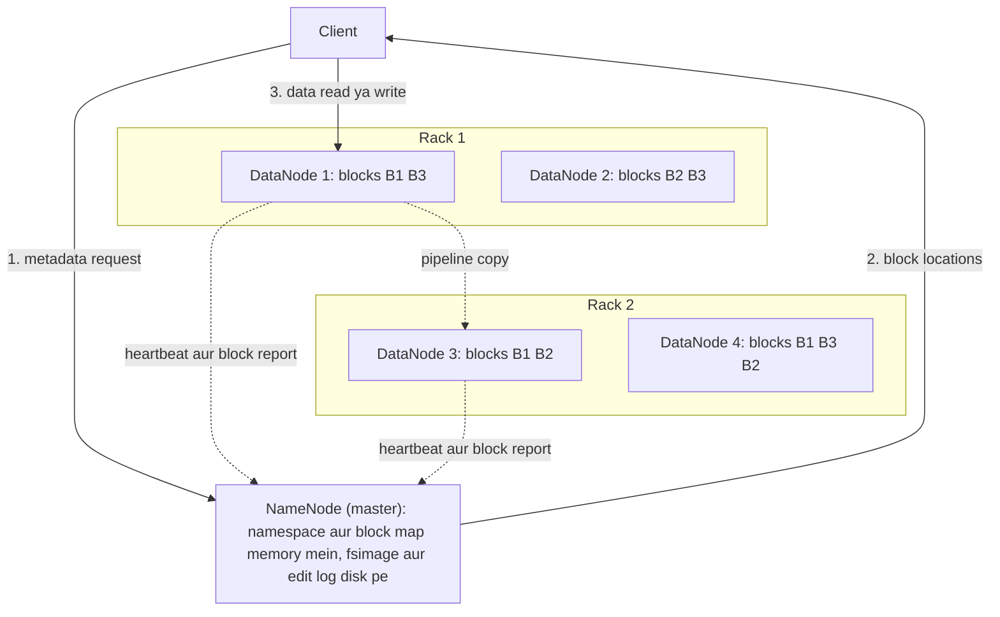
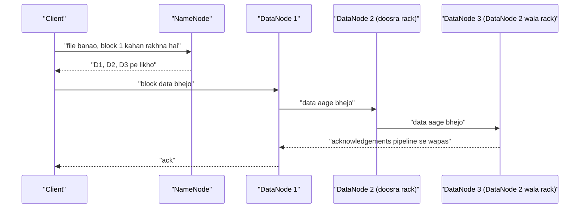

**Ek line mein:** <mark>HDFS master-slave distributed file system hai: ek NameNode metadata rakhta hai aur bahut saare DataNodes data blocks rakhte hain, har block ki 3 copies</mark>. <Cite id="hdfs-apache-design" /> <Cite id="hdfs-gfg" />

<Box kind="key">

**HDFS architecture, NameNode vs DataNode, Secondary NameNode ke question mein ye points likho:**

- <mark>HDFS = Hadoop Distributed File System: commodity hardware pe fault tolerant storage, bahut bade files ke liye, write once, read many</mark>.
- <mark>NameNode (master) metadata rakhta hai: namespace aur block locations; DataNodes (slaves) asli blocks rakhte hain</mark>.
- <mark>Block size 128 MB, replication factor 3, rack aware placement</mark>.
- <mark>DataNodes NameNode ko heartbeats (har 3 second) aur block reports bhejte hain</mark>.
- Client NameNode se locations leta hai aur phir DataNodes se **seedha data read ya write** karta hai.
- <mark>Secondary NameNode backup NAHI hai: woh sirf fsimage aur edit log merge karta hai (checkpointing)</mark>.

</Box>

## Core answer (5 marks, yahan ke har question ke liye)

<Box kind="definition">

**HDFS (Hadoop Distributed File System)** is the storage part of Hadoop. It is a distributed, fault-tolerant file system that runs on commodity hardware and is built for very large files that are written once and read many times. It follows a **master-slave** design. <Cite id="hdfs-apache-design" /> <Cite id="hdfs-tp" />

</Box>

<Cite id="hdfs-apache-design" loc="diagram" /> <Cite id="hdfs-gfg" loc="diagram" />

| Point | NameNode | DataNode |
|---|---|---|
| Role | Master | Slave (worker) |
| Number | Ek active (HA mein ek standby bhi) | Bahut saare, sainkdon ya hazaron |
| Kya store karta hai | Metadata: names, block lists, block locations | Asli data blocks |
| Memory need | Zyada RAM (saara metadata) | Bade disks |
| Kisse baat karta hai | Clients (metadata) aur DataNodes | Clients (data) aur NameNode (reports) |
| Fail ho to | Poora file system unavailable jab tak recover ya failover na ho | Cluster chalta rehta hai; blocks doosri replicas se dobara copy hote hain |

<Cite id="hdfs-apache-design" /> <Cite id="hdfs-tp" />

**Conclusion:** <mark>NameNode jaanta hai ki sab kuch kahan hai, aur DataNodes data rakhte hain</mark>.

## Extended answer (10 marks): ye add karo

### 1. Blocks aur replication

- File **blocks** mein katti hai, default 128 MB (purane Hadoop 1.x mein 64 MB). Aakhri block utna hi bada hota hai jitna data bacha ho. <Cite id="hdfs-apache-design" /> <Cite id="hdfs-ibm" />
- Blocks bade isliye hote hain ki NameNode ke paas metadata kam rahe aur seek time transfer time ke mukable chhota rahe.
- **Replication factor 3:** pehli copy writer ke node pe, doosri **doosre rack** ke node pe, teesri us doosre rack ke kisi aur node pe. Read sabse paas wali copy se hota hai. **Rack awareness** matlab NameNode ko pata hai ki har node kis rack mein hai. <Cite id="hdfs-apache-rack" />

### 2. Write aur read flow

**Read:** client NameNode se block locations leta hai, phir har block **sabse paas wale** DataNode se padhta hai aur **checksum** check karta hai; fail ho to doosri replica padhta hai. <Cite id="hdfs-apache-design" />

### 3. Secondary NameNode: kya ye backup hai? False

Secondary NameNode **backup ya standby nahi hai**. Edit log badhta rehta hai, jisse NameNode ka restart slow ho jata hai. Isliye woh time-time pe fsimage aur edit log download karta hai, unhe **merge** karke naya fsimage banata hai aur wapas bhej deta hai (**checkpointing**). NameNode mar jaye to woh uski jagah nahi le sakta, aur last checkpoint ke baad ke changes kho jate hain. Asli failover ke liye HDFS High Availability ka **Standby NameNode** chahiye. <Cite id="hdfs-apache-guide" /> <Cite id="hdfs-wiki-hadoop" /> <Cite id="hdfs-apache-ha" />

| Node | Kya karta hai | Kya take over kar sakta hai? |
|---|---|---|
| Secondary NameNode | fsimage aur edit log merge karta hai | Nahi |
| Standby NameNode (HA) | Hot standby, shared edit log padhta hai | Haan |

### 4. Failure handling aur design goals

- **DataNode mar jaye:** heartbeats ruk jate hain, NameNode use dead mark karta hai aur uske blocks ki nayi copies doosre nodes pe banwata hai.
- **Corrupt block:** checksum fail hota hai, client doosri replica use karta hai, aur nayi copy banti hai.
- **NameNode HA:** Active aur Standby NameNode JournalNodes ke through edits share karte hain. <Cite id="hdfs-apache-ha" />
- Design goals: hardware failure normal hai, streaming high-throughput access, bade files, write once read many, computation ko data ke paas le jao. <Cite id="hdfs-apache-design" />

## Har question mein kaise fit karein

- **"Distinguish between Name node and Data node."** (5 marks) <PYQ id="2023-05-ce/q1a" />: HDFS master-slave pe ek line, phir **NameNode versus DataNode table** aur architecture diagram.
- **"Explain HDFS architecture."** (10 marks) <PYQ id="2024-05/q2a" />: core answer (definition, diagram, table), phir section 1, 2 aur 3.
- **"Secondary Name node is a backup of Name node. Is this statement True or False? Justify your answer."** (5 marks) <PYQ id="2024-12-ce/q1b" />: pehle **False** likho, phir section 3 (checkpointing: fsimage aur edit log merge, take over nahi kar sakta, asli failover Standby NameNode), checkpoint flow ek line mein.

## Exam tips

- **Draw karo**: upar NameNode, neeche racks mein DataNodes, metadata, data aur heartbeats ke arrows ke saath.
- True/False mein **pehle verdict** likho, phir "checkpointing" se justify karo.
- **"128 MB, replication 3, heartbeat 3 seconds"** likho; numbers dikhate hain ki aapko aata hai.
