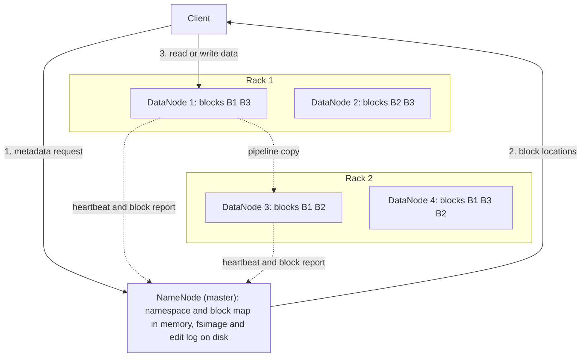
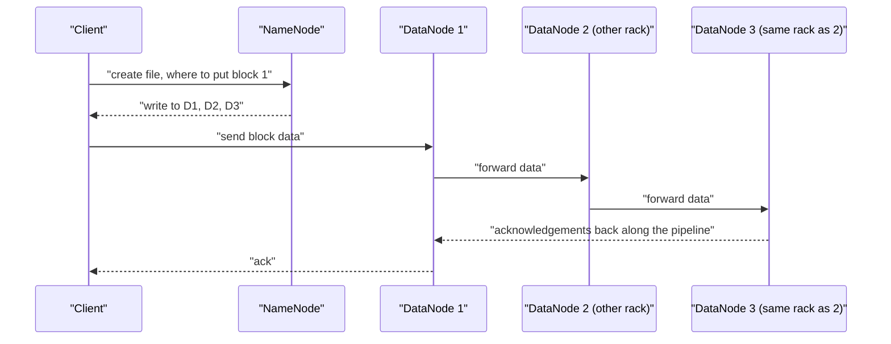

**In one line:** <mark>HDFS is a master-slave distributed file system: one NameNode stores the metadata and many DataNodes store the data blocks, each block copied 3 times</mark>. <Cite id="hdfs-apache-design" /> <Cite id="hdfs-gfg" />

<Box kind="key">

**Key points to write (HDFS architecture, NameNode vs DataNode, Secondary NameNode):**

- <mark>HDFS = Hadoop Distributed File System: fault tolerant storage on commodity hardware for very large files, write once, read many</mark>.
- <mark>NameNode (master) holds metadata: namespace and block locations; DataNodes (slaves) hold the actual blocks</mark>.
- <mark>Block size 128 MB, replication factor 3, rack aware placement</mark>.
- <mark>DataNodes send heartbeats (every 3 seconds) and block reports to the NameNode</mark>.
- The client gets locations from the NameNode and then **reads or writes data directly** with DataNodes.
- <mark>Secondary NameNode is NOT a backup: it only merges the fsimage and edit log (checkpointing)</mark>.

</Box>

## Core answer (5 marks, fits every question here)

<Box kind="definition">

**HDFS (Hadoop Distributed File System)** is the storage part of Hadoop. It is a distributed, fault-tolerant file system that runs on commodity hardware and is built for very large files that are written once and read many times. It follows a **master-slave** design. <Cite id="hdfs-apache-design" /> <Cite id="hdfs-tp" />

</Box>

<Cite id="hdfs-apache-design" loc="diagram" /> <Cite id="hdfs-gfg" loc="diagram" />

| Point | NameNode | DataNode |
|---|---|---|
| Role | Master | Slave (worker) |
| Number | One active (plus a standby in HA) | Many, hundreds or thousands |
| Stores | Metadata: names, block lists, block locations | Actual data blocks |
| Memory need | High RAM (holds all metadata) | Large disks |
| Talks to | Clients (metadata) and DataNodes | Clients (data) and NameNode (reports) |
| If it fails | Whole file system unavailable until recovered or failed over | Cluster continues; blocks re-copied from other replicas |

<Cite id="hdfs-apache-design" /> <Cite id="hdfs-tp" />

**Conclusion:** <mark>the NameNode knows where everything is, and the DataNodes hold the data</mark>.

## Extended answer (10 marks): add these

### 1. Blocks and replication

- A file is cut into **blocks**, 128 MB by default (64 MB in old Hadoop 1.x). The last block is only as big as the data left. <Cite id="hdfs-apache-design" /> <Cite id="hdfs-ibm" />
- Blocks are big so the NameNode has little metadata and seek time is small compared to transfer time.
- **Replication factor 3:** first copy on the writer's node, second on a node in a **different rack**, third on another node of that second rack. Reads go to the nearest copy. **Rack awareness** is the NameNode knowing each node's rack. <Cite id="hdfs-apache-rack" />

### 2. Write and read flow

**Read:** the client asks the NameNode for block locations, then reads each block from the **nearest** DataNode and checks the **checksum**; if it fails it reads another replica. <Cite id="hdfs-apache-design" />

### 3. Secondary NameNode: is it a backup? False

The Secondary NameNode is **not a backup or standby**. The edit log keeps growing, which makes a NameNode restart slow. So at intervals it downloads the fsimage and edit log, **merges them** into a new fsimage and sends it back (**checkpointing**). It cannot take over if the NameNode dies, and changes since the last checkpoint would be lost. Real failover needs the **Standby NameNode** of HDFS High Availability. <Cite id="hdfs-apache-guide" /> <Cite id="hdfs-wiki-hadoop" /> <Cite id="hdfs-apache-ha" />

| Node | What it does | Can it take over? |
|---|---|---|
| Secondary NameNode | Merges fsimage and edit log | No |
| Standby NameNode (HA) | Hot standby, reads the shared edit log | Yes |

### 4. Failure handling and design goals

- **DataNode dies:** heartbeats stop, the NameNode marks it dead and orders new copies of its blocks on other nodes.
- **Corrupt block:** checksum fails, client uses another replica, and a fresh copy is made.
- **NameNode HA:** an Active and a Standby NameNode share edits through JournalNodes. <Cite id="hdfs-apache-ha" />
- Design goals: hardware failure is normal, streaming high-throughput access, large files, write once read many, move computation to the data. <Cite id="hdfs-apache-design" />

## Fit it to each question

- **"Distinguish between Name node and Data node."** (5 marks) <PYQ id="2023-05-ce/q1a" />: one line on HDFS master-slave, then the **NameNode versus DataNode table** and the architecture diagram.
- **"Explain HDFS architecture."** (10 marks) <PYQ id="2024-05/q2a" />: core answer (definition, diagram, table), then sections 1, 2 and 3.
- **"Secondary Name node is a backup of Name node. Is this statement True or False? Justify your answer."** (5 marks) <PYQ id="2024-12-ce/q1b" />: write **False** first, then section 3 (checkpointing: merge fsimage and edit log, cannot take over, Standby NameNode is the real failover), with the checkpoint flow in one line.

## Exam tips

- **Draw** the NameNode at the top, DataNodes in racks below, with arrows for metadata, data and heartbeats.
- For True/False, **state the verdict first**, then justify with "checkpointing".
- Write **"128 MB, replication 3, heartbeat 3 seconds"**; numbers show you know it.
